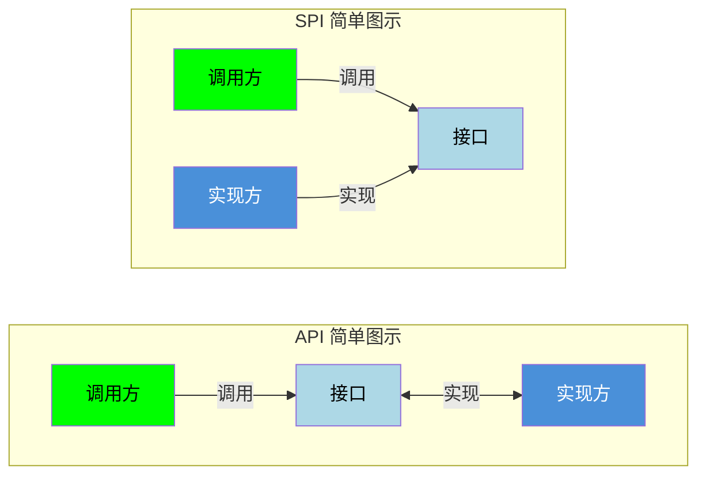

<!--module:
  parent: java
  slug: java/concepts/spi
  type: article
  category: 主模块子文章
  summary: Java SPI 机制：ServiceLoader 解耦接口与实现。
  depth: ⭐⭐⭐
  status: active
-->

# SPI（Service Provider Interface）

---

> **一句话定位**：SPI 用 `META-INF/services` + `ServiceLoader` 解耦接口与实现，是 JDBC、SLF4J 等可插拔架构的核心。

SPI 即 Service Provider Interface（服务提供者接口），是一种 Java 的扩展机制，允许应用程序在运行时动态发现和加载接口的实现类。

## 核心概念

- **接口定义方**（框架/库提供方）：定义接口规范
- **服务提供者**（第三方/扩展开发者）：实现接口
- **服务加载器**（`ServiceLoader`）：在运行时自动发现和加载实现类

## SPI 和 API 的区别



| 对比维度 | SPI | API |
|---------|-----|-----|
| **定义方式** | 框架定义接口，第三方实现 | 开发者主动编写并公开 |
| **调用方式** | 通过配置文件动态加载 | 直接调用接口方法 |
| **灵活性** | 运行时动态替换实现 | 编译时确定实现 |
| **依赖关系** | 调用方依赖接口+加载器 | 调用方依赖实现库 |
| **使用目的** | 插件化、可扩展 | 功能暴露、系统交互 |

## SPI 的使用步骤

### 0. 定义业务类

```java
// 订单类（后续示例中使用的业务对象）
public class Order {
    private final double amount;

    public Order(double amount) {
        this.amount = amount;
    }

    public double getAmount() {
        return amount;
    }
}
```

### 1. 定义接口

```java
// 框架方定义接口
public interface PaymentProvider {
    void pay(Order order);
    String getName();
}
```

### 2. 实现接口

```java
// 第三方实现 - 支付宝
public class AlipayProvider implements PaymentProvider {
    @Override
    public void pay(Order order) {
        System.out.println("使用支付宝支付: " + order.getAmount());
    }

    @Override
    public String getName() { return "alipay"; }
}

// 第三方实现 - 微信支付
public class WechatProvider implements PaymentProvider {
    @Override
    public void pay(Order order) {
        System.out.println("使用微信支付: " + order.getAmount());
    }

    @Override
    public String getName() { return "wechat"; }
}
```

### 3. 配置 SPI 文件

在实现类的 jar 包中创建配置文件：

```text
META-INF/services/com.example.PaymentProvider
```

文件内容为实现类的全限定名，每行一个：

```text
com.example.impl.AlipayProvider
com.example.impl.WechatProvider
```

### 4. 使用 ServiceLoader 加载

```java
import java.util.ServiceLoader;

// 加载所有实现
ServiceLoader<PaymentProvider> loader = ServiceLoader.load(PaymentProvider.class);

for (PaymentProvider provider : loader) {
    System.out.println("发现支付服务: " + provider.getName());
}

// 查找特定实现（注意：stream() 和 ServiceLoader.Provider 需要 Java 9+）
// 最佳实践：先过滤再实例化，避免全量加载所有 Provider
PaymentProvider alipay = loader.stream()
    .filter(p -> "alipay".equals(p.type().getSimpleName()))
    .findFirst()
    .map(ServiceLoader.Provider::get)
    .orElseThrow(() -> new RuntimeException("未找到支付宝支付"));

alipay.pay(new Order(100.0));
```

### 常见错误反例：配置写错 → ServiceConfigurationError

```text
❌ 反例 1：配置文件名写错（用了简单类名或写错包名）
META-INF/services/PaymentProvider            ← 必须是接口【全限定名】
META-INF/services/com.example.PaymentProvide ← 少一个字母 r

❌ 反例 2：文件没打进 jar —— 放在 src/ 根目录或 resources 上层
src/META-INF/services/...                    ← Maven 下必须是 src/main/resources/META-INF/services/
（编译产物 target/classes/META-INF/services/ 里没有 → jar 里自然也没有）

❌ 反例 3：文件内容写了接口名而非实现类名，或实现类没有公共无参构造器
com.example.PaymentProvider                  ← 应为 impl.AlipayProvider / impl.WechatProvider
```

后果分两种时机暴露：

```java
ServiceLoader<PaymentProvider> loader = ServiceLoader.load(PaymentProvider.class);
// 此时不报错——load() 只是构造 ServiceLoader，尚未读配置文件

for (PaymentProvider p : loader) { ... }
// ❌ 迭代时才炸：
// 文件名/路径错 → 静默无输出（找不到配置 = 0 个实现，不抛异常，最难排查！）
// 文件内容错（类不存在/不可实例化）→
// java.util.ServiceConfigurationError: com.example.PaymentProvider:
//     Provider com.example.impl.AlipayProvide not found
//     （或 ... could not be instantiated / IllegalAccessError 等）
```

> 排查口诀：**"没报错但一个都没加载" 查文件名与打包路径；"ServiceConfigurationError" 查文件内容与实现类构造器**。

```java
// ✅ 正例：用 AutoService 从根上规避（编译期生成 + 编译期校验，详见下文「最佳实践」）
@AutoService(PaymentProvider.class)   // 文件名、路径、全限定名全部自动生成，杜绝手写错
public class AlipayProvider implements PaymentProvider { ... }
```

## SPI 优缺点

### 优点

- **插件化扩展**：运行时动态加载实现类，无需修改代码即可扩展功能
- **松耦合**：接口与实现分离，提高可维护性和可测试性
- **可扩展性**：第三方开发者可以自行实现接口并注册

### 缺点

| 缺点 | 说明 |
|------|------|
| **配置繁琐** | 需要手动维护 `META-INF/services/` 下的配置文件 |
| **无法动态更新** | 应用启动后实现类的变更不会自动生效，需调用 reload() 方法手动刷新缓存 |
| **无法解决冲突** | 存在多个实现类时，加载顺序不确定，缺乏优先级选择机制 |
| **全量扫描** | 迭代时 `ServiceLoader` 会解析配置文件中**全部** Provider 条目（实例化本身是 lazy 的，但定位目标实现仍需逐个遍历），无法按名称直达（内部机制见下文「内部实现要点（源码级）」） |
| **获取方式不灵活** | 只能通过迭代器遍历，无法按名称直接获取 |
| **线程不安全** | `ServiceLoader` 实例在多线程环境下不安全 |

## 经典应用场景

### JDBC 驱动加载

**历史演进**：JDBC 4.0（Java 6）之前，需要手动加载驱动：

```java
// JDBC 3.0 及之前：必须手动注册驱动
Class.forName("com.mysql.jdbc.Driver");
Connection conn = DriverManager.getConnection(
    "jdbc:mysql://localhost:3306/db", "user", "password"
);
```

JDBC 4.0 之后，通过 SPI 自动发现驱动，消除了 `Class.forName()` 调用：

```java
// JDBC 4.0+（Java 6+）：SPI 自动加载，无需 Class.forName()
// SPI 配置文件: META-INF/services/java.sql.Driver
// 内容: com.mysql.cj.jdbc.Driver

// DriverManager 内部通过 ServiceLoader 自动发现并加载驱动
Connection conn = DriverManager.getConnection(
    "jdbc:mysql://localhost:3306/db", "user", "password"
);
```

这是 SPI 最经典的应用场景之一，体现了"约定优于配置"的设计思想。

### 日志框架

```java
// SLF4J 通过 SPI 加载日志实现
// META-INF/services/org.slf4j.spi.SLF4JServiceProvider
// 内容: ch.qos.logback.classic.spi.LogbackServiceProvider
```

### 其他常见场景

- **数据库驱动加载**：通过 SPI 自动发现和加载不同厂商的数据库驱动
- **RPC 框架**（Dubbo）：服务发现和序列化协议
- **微服务**：服务注册与发现
- **IDE 插件系统**：扩展 IDE 功能
- **序列化框架**：选择合适的序列化实现

## Java 9+ 的改进

Java 9 引入了模块系统（JPMS），SPI 也做了相应改进。推荐将 API、提供者、消费者分离到不同模块：

```java
// 1. API 模块（定义接口）
module payment.api {
    exports com.example.payment;  // 导出 PaymentProvider 接口
}

// 2. 提供者模块（实现接口）
module payment.alipay {
    requires payment.api;
    provides com.example.payment.PaymentProvider 
        with com.example.impl.AlipayProvider;  // 声明提供者
}

// 3. 消费者模块（使用接口）
module my.app {
    requires payment.api;
    uses com.example.payment.PaymentProvider;  // 声明使用者
}
```

这种分离方式符合 SPI 解耦的设计初衷：消费者只依赖 API 接口，无需知道具体实现。

Java 9+ 的 `ServiceLoader` 还支持 `stream()` 方法，可以延迟加载和过滤：

```java
ServiceLoader<PaymentProvider> loader = ServiceLoader.load(PaymentProvider.class);

// 只获取名称，不实例化
loader.stream()
    .map(ServiceLoader.Provider::type)
    .forEach(type -> System.out.println("Available: " + type.getName()));

// 按需实例化
PaymentProvider provider = loader.stream()
    .filter(p -> p.type().getSimpleName().contains("Alipay"))
    .findFirst()
    .map(ServiceLoader.Provider::get)
    .orElseThrow();
```

## 最佳实践：自动生成 SPI 配置文件

手动维护 `META-INF/services/` 配置文件容易出错且繁琐。实践中推荐使用 **Google AutoService** 在编译期自动生成：

### 1. 添加依赖

```xml
<dependency>
    <groupId>com.google.auto.service</groupId>
    <artifactId>auto-service</artifactId>
    <version>1.1.1</version>
    <scope>provided</scope>
</dependency>
```

### 2. 使用 @AutoService 注解

```java
import com.google.auto.service.AutoService;

@AutoService(PaymentProvider.class)
public class AlipayProvider implements PaymentProvider {
    @Override
    public void pay(Order order) {
        System.out.println("使用支付宝支付: " + order.getAmount());
    }

    @Override
    public String getName() { return "alipay"; }
}
```

### 3. 编译期自动生成

编译时 AutoService 会自动生成 `META-INF/services/com.example.PaymentProvider` 文件，内容为：

```text
com.example.impl.AlipayProvider
```

**优势**：
- 消除手动维护配置文件的负担
- 编译期检查，避免配置错误
- 多个 `@AutoService` 注解会自动合并到同一配置文件
- 与 Gradle、Maven 等构建工具无缝集成

这是目前 Java 生态中使用 SPI 的推荐实践，被 Google、Netflix 等公司广泛采用。

## 向上兄弟互链

本篇是 SPI 基础篇。SPI 的底层支撑是**类加载机制**——`ServiceLoader` 默认通过**线程上下文类加载器**（TCCL）加载实现类，这正是"打破双亲委派"的经典场景（接口在 `java.base` 中由启动类加载器加载，实现类却要靠 TCCL 从应用 classpath 加载）：

- [JVM — 类加载](../../02-jvm/README.md#五类加载) — 双亲委派模型与线程上下文类加载器，SPI / JDBC 驱动加载的底层机制
- [Spring SPI 对比（02-boot 专题）](../../../04.spring-backend/02-boot/spring-factories-migration.md) — Spring Framework 的 SpringFactoriesLoader 与 JDK ServiceLoader 异同
- [12.interview SPI 面试题](../../../12.interview/01.java/spi/README.md) — SPI 高频面试版（与本文互补）

## ServiceLoader 关键方法参数表

| 方法 | 签名 | 关键参数说明 |
|------|------|-------------|
| `ServiceLoader.load(Class<S> service)` | 线程上下文类加载器加载 | 默认使用 Thread.currentThread().getContextClassLoader() |
| `ServiceLoader.load(Class<S> service, ClassLoader loader)` | 指定类加载器 | 用于模块化系统（OSGi、Java Module System） |
| `ServiceLoader.load(ModuleLayer, Class<S>)` | 模块层加载（Java 9+） | JPMS 模块化场景 |
| `ServiceLoader.loadInstalled(Class<S>)` | 已安装扩展加载器 | Java 平台 SPI 用法 |
| `iterator()` | 返回迭代器 | lazy 加载，按需实例化 |
| `reload()` | 清空缓存重新加载 | 用于运行时新增实现 |
| `stream()` | 返回 Stream（Java 9+） | 函数式 API |
| `findFirst()` | 返回 Optional（Java 9+） | 便捷获取第一个实现 |
| `S provider()` | 获取当前元素实现（Java 9+） | Stream.forEach 中使用 |

**线程安全**：`ServiceLoader` 实例**不是线程安全**的；多线程下每个线程应使用独立实例，或使用 `ServiceLoader.loadStatic()`（Java 9+ 试验性）。

**内部实现要点**：`ServiceLoader` 并非"通过 Map 接口工作"——其内部由 `LazyIterator`（延迟迭代器，逐个解析 `META-INF/services` 配置并实例化）+ `providers` 缓存（`LinkedHashMap<String, S>`，按发现顺序缓存已实例化的 provider）构成；`reload()` 清空的正是这个缓存。

**内部实现要点（源码级，OpenJDK `java.util.ServiceLoader`）**：

```java
// 1. hasNextService()/hasNext()：解析配置文件是「按条目 lazy」的
//    LazyClassPathLookupIterator 用 ClassLoader.getResources("META-INF/services/" + 接口全限定名)
//    拿到所有 jar 中同名配置的 URL 枚举，configs 是惰性 Enumerations；
//    parseLine() 逐行读取并校验（非法行 → fail(service, "Illegal configuration-file syntax")）
public boolean hasNextService() {
    while (nextName == null && configs.hasMoreElements()) {
        // 关键：只把「下一行类名」解析到 nextName 为止，不做 Class.forName —— 真正的类加载被推迟
    }
    return nextName != null;
}

// 2. nextService()/next()：此刻才 Class.forName + 实例化
private S nextService() {
    Class<?> clazz = Class.forName(nextName, false, loader);  // initialize=false，不触发静态块
    // 校验 clazz 确实实现了 service 接口，否则 ServiceConfigurationError
    S provider = service.cast(clazz.getConstructor().newInstance());  // 要求公共无参构造器
    providers.put(nextName, provider);   // 写入 LinkedHashMap 缓存，第二次迭代直接命中
    return provider;
}
```

三个源码级结论（对应上文缺点表的定性描述）：

1. **"全量扫描"的准确含义**：`getResources()` 会枚举 classpath 上**所有 jar** 中该接口的配置文件（jar 越多，IO 越重）；`hasNextService()` 逐行解析全部条目，但 `Class.forName`/实例化推迟到 `nextService()` —— 即"**解析 eager、实例化 lazy**"
2. **无按名索引**：缓存 key 虽是类名字符串，但没有公开的 `get(name)` 入口，只能迭代或 Java 9+ `stream().filter(...)` 线性查找
3. **`initialize=false` 的细节**：Provider 类被加载但不初始化，静态块直到首次真正使用才执行——排查"SPI 实现类静态块没跑"时先想到这一点

---

← [返回 Java 核心概念](../README.md)
