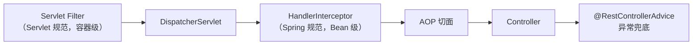

<!--module:
  parent: 04.spring-backend
  slug: 04.spring-backend/01-core/extension-points
  type: article
  category: 主模块子文章
  summary: Spring 扩展点全景（按容器启动时间线排序的插槽清单）
  depth: ⭐⭐⭐⭐
  status: active
-->

# Spring 扩展点全景

> ⬅️ [返回 01 核心容器](README.md) | [Bean 生命周期](ioc/bean-lifecycle.md) | [启动流程](../02-boot/startup-flow.md) | [Event 机制](event.md)

Spring 的扩展点不是一堆并列的接口，而是**沿容器启动时间线分布的一串插槽**——每个插槽卡在生命周期的某个精确位置上，插手时机不同，适用场景就完全不同。

---

## 🎯 一句话定位

**Spring 扩展点 = 容器在"定义期 → 实例期 → 初始化期 → 启动后 → 关闭期"各阶段预留的介入入口**——看懂它落在哪个阶段，就知道该用它做什么。

---

## 一、为什么按时间线理解扩展点

初学 Spring 时最常见的困惑是：接口那么多，`BeanPostProcessor`、`BeanFactoryPostProcessor`、`ApplicationRunner`、`ApplicationContextInitializer`……到底该用哪个？

答案不在接口名里，而在**它介入的时机**：

```mermaid
graph LR
    subgraph 定义期["定义期（Bean 还没诞生）"]
        BFPP[BeanFactoryPostProcessor]
        BDRPP[BeanDefinitionRegistryPostProcessor]
        Import[ImportSelector / ImportBeanDefinitionRegistrar]
    end
    subgraph 实例期["实例期（Bean 已创建，未初始化）"]
        BPP[BeanPostProcessor]
        Aware[Aware 家族]
    end
    subgraph 初始化期["初始化期"]
        Init[InitializingBean / @PostConstruct]
        SIS[SmartInitializingSingleton]
    end
    subgraph 启动后["启动后（容器就绪）"]
        Runner[ApplicationRunner / CommandLineRunner]
        Listener[ApplicationListener / @EventListener]
    end
    subgraph 关闭期["关闭期"]
        Dest[DisposableBean / @PreDestroy]
    end
    定义期 --> 实例期 --> 初始化期 --> 启动后 --> 关闭期
```



**核心判据**：
- 想改 **Bean 定义**（还没创建）→ `BeanFactoryPostProcessor`
- 想改 **Bean 实例**（已创建）→ `BeanPostProcessor`
- 想在 **容器就绪后** 跑任务 → `ApplicationRunner` / `ApplicationReadyEvent`

---

## 二、主线扩展点：框架核心容器

> 这一组是 Spring Framework（不含 Boot）的扩展点，介入 `AbstractApplicationContext.refresh()` 全流程。

### 2.1 定义期：改 Bean 定义

| 扩展点 | 接口 | 介入时机 | 典型用途 |
|---|---|---|---|
| `BeanFactoryPostProcessor` | `ConfigurableListableBeanFactory` | refresh 第 5 步，**实例化之前** | 改 BeanDefinition 属性；`PropertySourcesPlaceholderConfigurer`（`@Value` 占位符解析）就在此生效 |
| `BeanDefinitionRegistryPostProcessor` | 继承上者，额外拿到 `BeanDefinitionRegistry` | 同上，但**能注册新定义** | MyBatis `MapperScannerConfigurer` 扫描 Mapper 接口并注册为 Bean |
| `ImportSelector` | `selectImports()` | 配置类解析期 | 动态返回要导入的类名数组；`AutoConfigurationImportSelector` 就是它 |
| `DeferredImportSelector` | 继承 `ImportSelector` | **延迟到所有配置类解析完后** | 让自动配置对用户配置做条件匹配（顺序问题的解法） |
| `ImportBeanDefinitionRegistrar` | `registerBeanDefinitions()` | 配置类解析期 | 手动注册 BeanDefinition，最灵活；`MapperScannerRegistrar`（`@MapperScan`） |
| `Condition` | `matches()` | 条件装配求值期 | `@ConditionalOn*` 11 个内置注解之外的自定义判定 |

**关键区别**（最高频考点）：

```java
// BeanFactoryPostProcessor —— 处理 Bean 定义（实例化前）
public interface BeanFactoryPostProcessor {
    void postProcessBeanFactory(ConfigurableListableBeanFactory beanFactory) throws BeansException;
}

// BeanPostProcessor —— 处理 Bean 实例（实例化后）
public interface BeanPostProcessor {
    default Object postProcessBeforeInitialization(Object bean, String beanName) {}
    default Object postProcessAfterInitialization(Object bean, String beanName) {}
}
```

> 📌 记忆法：**定义用 Factory，实例用 Post**。

### 2.2 实例期：改 Bean 实例

| 扩展点 | 时机 | 说明 |
|---|---|---|
| `BeanPostProcessor.postProcessBeforeInitialization` | 属性注入后、`afterPropertiesSet()` 前 | Aware 回调之后 |
| `BeanPostProcessor.postProcessAfterInitialization` | `afterPropertiesSet()` 后 | ⭐ **AOP 代理在此生成**；`EventListenerMethodProcessor` 也靠它扫 `@EventListener` |

> 📌 **关键考点**：`postProcessAfterInitialization` 是 AOP 代理生成的地方——所以 `@PostConstruct` 里 `this` 调用 `@Transactional` 方法时，代理还不存在，**事务不生效**。

**Aware 家族**（拿容器资源）：

| 接口 | 回调方法 | 注入的资源 |
|---|---|---|
| `BeanNameAware` | `setBeanName(String)` | 当前 Bean 名称 |
| `BeanClassLoaderAware` | `setBeanClassLoader(ClassLoader)` | 加载当前 Bean 的 ClassLoader |
| `BeanFactoryAware` | `setBeanFactory(BeanFactory)` | BeanFactory 引用 |
| `ApplicationContextAware` | `setApplicationContext(ApplicationContext)` | ApplicationContext 引用 |

调用顺序：`BeanNameAware` → `BeanClassLoaderAware` → `BeanFactoryAware` → 其他 Aware。

### 2.3 初始化期与关闭期

| 扩展点 | 时机 | 说明 |
|---|---|---|
| `InitializingBean.afterPropertiesSet()` | 依赖注入完成后 | Spring 提供的初始化回调 |
| `@PostConstruct`（JSR-250） | 同上 | **推荐**（注解驱动、不耦合 Spring 接口） |
| `init-method` | 同上 | XML / `@Bean(initMethod=...)` |
| `SmartInitializingSingleton.afterSingletonsInstantiated()` | **所有单例 Bean 初始化完成后** | 跨 Bean 的复杂初始化 |
| `DisposableBean.destroy()` | 容器关闭 | Spring 提供的销毁回调 |
| `@PreDestroy`（JSR-250） | 同上 | **推荐** |
| `destroy-method` | 同上 | XML / `@Bean(destroyMethod=...)` |

**销毁顺序固定**：`@PreDestroy` → `DisposableBean.destroy()` → `destroy-method`（与初始化侧完全对称）。三处都写清理逻辑会**按序全部执行**，重复释放资源可能抛异常。

**Bean 供给层**：

| 扩展点 | 说明 |
|---|---|
| `FactoryBean.getObject()` | 自定义 Bean 的创建逻辑；容器对外暴露的是 `getObject()` 的返回值（`&beanName` 才拿到工厂本身） |

---

## 三、叠加线：Spring Boot 启动扩展点

> 框架扩展点之外，Boot 在**启动两端**又插了两段。以下时序以 **Boot 3.5.3 源码**为准（`SpringApplication.run()`）：

```java
refreshContext(context);                 // 阶段 4：refresh
afterRefresh(context, applicationArguments);
Duration timeTakenToStarted = startup.started();
listeners.started(context, timeTakenToStarted);   // ① ApplicationStartedEvent
callRunners(context, applicationArguments);        // ② Runner 执行
// ...
listeners.ready(context, startup.ready());         // ③ ApplicationReadyEvent
```

> ⚠️ **常见误解**：`ApplicationStartedEvent` 在 **Runner 之前**触发。Runner 跑完才广播 `ApplicationReadyEvent`。

| 扩展点 | 介入时机 | 典型用途 |
|---|---|---|
| `EnvironmentPostProcessor` | 阶段 2（Environment 准备） | K8s ConfigMap / Vault 注入配置源 |
| `ApplicationContextInitializer` | 阶段 3（Context 创建后、refresh 前） | 注册自定义 Scope；Spring Cloud 起"父 Context"读远程配置 |
| `SpringApplicationRunListener` | 全启动生命周期 | 把生命周期回调翻译成事件；`EventPublishingRunListener` 是默认实现 |
| `ApplicationRunner` | 阶段 5 | 启动后任务、缓存预热；按 `@Order` 排序 |
| `CommandLineRunner` | 阶段 5 | 同上，参数是 `String...` 原始形式 |
| `ApplicationListener` / `@EventListener` | 全生命周期事件 | 事件驱动解耦；`ApplicationReadyEvent` = 应用完全可用 |

**Runner vs ReadyEvent 选型**：

| 需求 | 选择 | 理由 |
|---|---|---|
| 访问命令行参数（`--server.port` 等） | `ApplicationRunner` | `ApplicationArguments` 解析友好 |
| 确保内嵌服务器已监听端口、可对外服务 | `ApplicationListener<ApplicationReadyEvent>` | ReadyEvent 在 Runner **之后** |
| 跨 Bean / 跨模块的解耦通知 | `@EventListener` | 发布者不关心订阅者 |

> 📌 **Boot 3.x 小坑**：`ApplicationRunner` 与 `CommandLineRunner` 共享父接口 `Runner`，而 `callRunner()` 用的是**两个独立 `if`**（不是 `else if`）——一个 Bean 同时实现两个接口时，**两个方法都会被调用**。

---

## 四、旁路：Web 层扩展点

> Web 层是"从外到内"的洋葱结构，扩展点也按这个顺序嵌套。



| 扩展点 | 介入位置 | 注册方式 |
|---|---|---|
| `Filter` | 最外层，所有请求（含静态资源） | `@Component` + `@ServletComponentScan` / `FilterRegistrationBean` |
| `WebMvcConfigurer` | MVC 配置总入口 | 实现接口的 `@Configuration` Bean |
| `HandlerInterceptor` | Filter 之后、Controller 之前 | `WebMvcConfigurer.addInterceptors()` |
| `HandlerMethodArgumentResolver` | 参数解析 | `addArgumentResolvers()` |
| `HttpMessageConverter` | 请求/响应体序列化 | `configureMessageConverters()` |
| `ViewResolver` | 逻辑视图名 → 物理视图 | `configureViewResolvers()` |
| `@RestControllerAdvice` + `@ExceptionHandler` | 异常兜底 | 注解 |

> 📌 **Filter vs Interceptor**：需要注入 Spring Bean → 用 Interceptor；需要处理所有请求（含静态资源）→ 用 Filter。

---

## 五、Boot 4.x 的变化（2025-11 GA）

> ⚠️ 以下为 **Boot 4.0+ 专有**。KB 其余内容仍以 Boot 3.x 为基线，升级前请勿混用。

### 5.1 关键结论：SPI 机制**没有**被移除

这是最容易误解的一点。Boot 3.0 只是把**自动配置注册**从 `spring.factories` 迁到 `AutoConfiguration.imports`，但 `spring.factories` 本身**在 Boot 4.1.1 中依然存在**，且仍承载全部 SPI 扩展点：

```properties
# Boot 4.1.1 的 spring.factories（实测自官方 jar）
org.springframework.context.ApplicationContextInitializer=\
org.springframework.boot.context.ConfigurationWarningsApplicationContextInitializer,\
org.springframework.boot.context.ContextIdApplicationContextInitializer,\
org.springframework.boot.io.ProtocolResolverApplicationContextInitializer

org.springframework.boot.SpringApplicationRunListener=\
org.springframework.boot.context.event.EventPublishingRunListener
```

> 📌 **结论**：自研 Starter 注册 `ApplicationContextInitializer` / `ApplicationListener` / `EnvironmentPostProcessor` 时，**继续用 `spring.factories`**，不要跟着"Boot 3 弃用 spring.factories"的说法一起改。

### 5.2 新增扩展点：`BackgroundPreinitializer`

Boot 4 新增，**Boot 3.5.3 中不存在**（已用 jar 逐一比对确认）：

| 类 | 作用 |
|---|---|
| `BackgroundPreinitializer` | Boot 4 新增的 SPI，在主线程启动的**后台**预初始化资源 |
| `CharsetsBackgroundPreinitializer` | 预热字符集 |
| `ConversionServiceBackgroundPreinitializer` | 预热 `ConversionService` |
| `ZoneIdBackgroundPreinitializer` | 预热时区 |
| `BackgroundPreinitializingApplicationListener` | 触发上述预初始化的监听器 |

### 5.3 包路径迁移：`EnvironmentPostProcessor`

Boot 4 把接口**提升到根包**，旧包路径保留为兼容桥接（未标 `@Deprecated`）：

| 版本 | 接口全限定名 |
|---|---|
| Boot 3.x | `org.springframework.boot.env.EnvironmentPostProcessor` |
| Boot 4.x | `org.springframework.boot.EnvironmentPostProcessor`（新）<br>`org.springframework.boot.env.EnvironmentPostProcessor`（兼容桥接） |

> 自研实现**优先用新路径**；但注意本库 `startup-flow.md` 等文中未给出该接口的 import 示例，不会因此产生错误。

### 5.4 自动配置模块化拆分

Boot 4 把 `spring-boot-autoconfigure` 拆成多个独立模块，每个模块自带 imports 文件：

```text
META-INF/spring/org.springframework.boot.autoconfigure.AutoConfiguration.imports
```

拆分后的包名也随之变化（实测 Boot 4.1.1）：

| Boot 3.x | Boot 4.x |
|---|---|
| `org.springframework.boot.autoconfigure.web.servlet.WebMvcAutoConfiguration` | `org.springframework.boot.webmvc.autoconfigure.WebMvcAutoConfiguration` |
| `org.springframework.boot.autoconfigure.web.servlet.DispatcherServletAutoConfiguration` | `org.springframework.boot.webmvc.autoconfigure.DispatcherServletAutoConfiguration` |

> ⚠️ **影响面**：按类名 `exclude` 自动配置时，Boot 4 需要用新包名。

### 5.5 保持不变的扩展点

以下接口在 Spring Framework 7.0.9（Boot 4.1.1 配套）中**位置与语义均未变**：

`BeanFactoryPostProcessor` · `BeanPostProcessor` · `BeanDefinitionRegistryPostProcessor` · `ImportBeanDefinitionRegistrar` · `ImportSelector` · `ApplicationContextInitializer` · `ApplicationListener` · `SmartInitializingSingleton` · `DisposableBean` · `ApplicationContextAware` · `FactoryBean`

---

## 六、实战选型速查

| 我想做的事 | 用哪个 | 注意 |
|---|---|---|
| 改 Bean 的定义属性（实例化前） | `BeanFactoryPostProcessor` | 别和 BPP 混用 |
| 动态注册一批 BeanDefinition | `BeanDefinitionRegistryPostProcessor` | MyBatis 扫 Mapper 就走这条 |
| 给所有 Bean 加代理 / 埋点 | `BeanPostProcessor` | AOP 代理本身就在这里生成 |
| 拿容器资源（BeanFactory 等） | `ApplicationContextAware` | 比注入更"轻"，但耦合容器 |
| Bean 自己的初始化逻辑 | `@PostConstruct` | 优先于 `InitializingBean` |
| 所有单例就绪后的跨 Bean 编排 | `SmartInitializingSingleton` | 晚于 `@PostConstruct` |
| 启动后跑任务、预热缓存 | `ApplicationRunner` | 按 `@Order` 排序 |
| 确认服务已可对外提供 | `ApplicationReadyEvent` | 比 Runner 更晚 |
| 跨模块解耦通知 | `@EventListener` | 默认同步，异步要 `@Async` |
| 请求级鉴权、日志 | `HandlerInterceptor` | 需注入 Spring Bean 时用它 |
| 全局异常兜底 | `@RestControllerAdvice` | Web 层专用 |
| 启动时读远程配置 | `ApplicationContextInitializer` | Spring Cloud 走的就是它 |

---

## 七、5 大高频陷阱

### 陷阱 1：`@PostConstruct` 里 `this` 调用 `@Transactional` 方法，事务不生效

- **真相**：初始化期执行 `@PostConstruct`（第 7 步）时操作的是**原始对象**，AOP 代理要到 `postProcessAfterInitialization`（第 10 步）才创建。`this.xxx()` 走的是原始对象，**事务完全不生效**。需要事务的初始化逻辑应拆到另一个 Bean，或用 `ApplicationRunner` 在容器就绪后执行。

### 陷阱 2：以为 `ApplicationStartedEvent` 在 Runner 之后

- **真相**：`run()` 里是 `listeners.started(...)` → `callRunners(...)` → `listeners.ready(...)`。`ApplicationStartedEvent` **早于** Runner；`ApplicationReadyEvent` 才在 Runner 之后。要"服务已可对外"必须用 `ApplicationReadyEvent`。

### 陷阱 3：prototype Bean 期待 `@PreDestroy` 触发

- **真相**：销毁回调**只对单例生效**。prototype Bean 创建后交给调用方，容器不再跟踪其生命周期。持有资源（连接、线程）的 prototype Bean 必须调用方自己清理。

### 陷阱 4：实现 `ApplicationRunner` + `CommandLineRunner` 期望只跑一个

- **真相**：`callRunner()` 用的是两个独立 `if` 而非 `else if`——同时实现两个接口的 Bean，**两个方法都会被调用**。

### 陷阱 5：在 `BeanFactoryPostProcessor` 里注入普通 Bean

- **真相**：BFPP 阶段容器尚未实例化普通 Bean，注入会触发"Bean 提前初始化"，可能导致循环依赖或半初始化状态。BFPP 中应只操作 `BeanDefinition`，需要 Bean 时改用 `BeanPostProcessor` 或 `ApplicationRunner`。

---

## 🤔 思考

1. **为什么 `BeanPostProcessor` 自身要特殊注册？** 它不能按普通 Bean 实例化，否则会导致所有 Bean 提前创建、破坏三级缓存的懒加载机制。Spring 通过 `registerBeanPostProcessors()` 提前实例化它们，并让 `BeanPostProcessorChecker` 记录"存在 BPP"的标记。
2. **为什么 `ApplicationContextInitializer` 早于 refresh？** 它需要容器已创建但 Bean 未实例化的窗口期，才能注册 Scope、设置 BeanFactory 定制逻辑。
3. **Boot 4 为什么把 `EnvironmentPostProcessor` 提到根包？** 配合自动配置模块化拆分（原 `env` 子包被拆散到 `context.config` / `support` 等），接口留在 `env` 下语义已不准确。
4. **扩展点和设计模式的关系？** `BeanPostProcessor` 是**模板方法**（`postProcess*` 骨架固定，填充点可变），`ApplicationEventPublisher` 是**观察者模式**，`ImportSelector` 是**策略模式**（条件决定装配哪批 Bean）。

---

## 相关章节

- ⬅️ [返回 01 核心容器](README.md)
- [Bean 生命周期](ioc/bean-lifecycle.md) — 扩展点在生命周期 4 阶段中的精确落点
- [IoC 总览](ioc/README.md) — `refresh()` 12 步源码链路
- [Spring 启动流程](../02-boot/startup-flow.md) — Boot 6 阶段与 8 个启动事件
- [启动后钩子](../02-boot/application-bootstrap.md) — `@PostConstruct` / Runner / ReadyEvent 详解
- [Spring Event 机制](event.md) — `ApplicationListener` / `@EventListener` 全链路与 6 大陷阱
- [@Configuration vs @Component](configuration-lite-vs-full.md) — `@Import` 三机制（Selector / Deferred / Registrar）
- [自动配置原理](../02-boot/auto-configuration.md) — `@ConditionalOn*` 11 注解 + 自定义 `Condition`
- [spring.factories 迁移](../02-boot/spring-factories-migration.md) — Boot 3 的 imports 机制（Boot 4 SPI 未变）
- [MVC 组件执行顺序](../02-web/mvc/components-order.md) — Web 层 Filter → Interceptor → AOP 顺序
- [异常处理](exception-handling.md) — `@RestControllerAdvice` 全局兜底

---

> 📅 2026-10-21 · 咬文嚼字 · Spring 扩展点 · ⭐⭐⭐⭐（高频面试 + 实战必会）
>
> 版本基线：Spring Framework 6.1.x / Spring Boot 3.5.x（主线），Boot 4.1.1 / Framework 7.0.9 差异见第五章（实测自官方 Maven Central jar）
