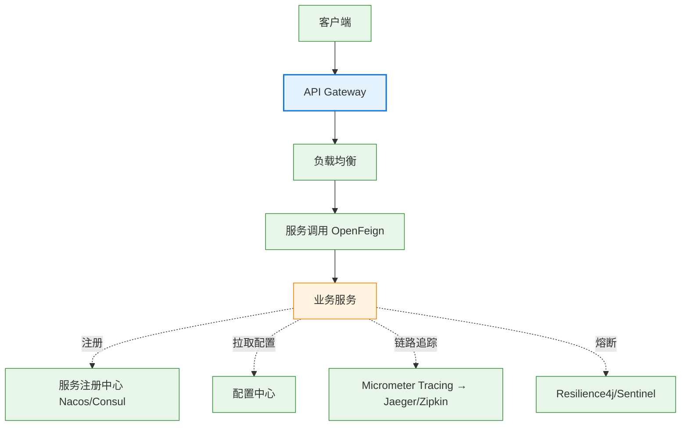
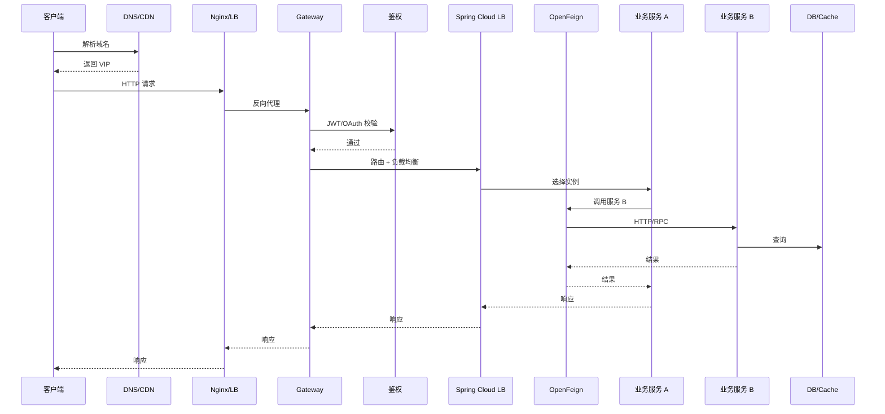
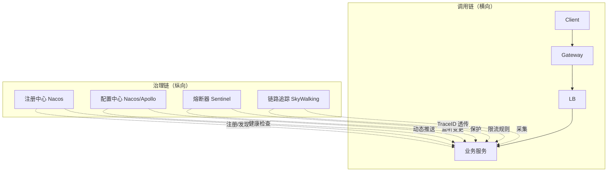

<!--module:
  parent: spring
  slug: spring/cloud
  type: index
  category: 后端框架 / Spring 全家桶
  topic: Spring Cloud
  audience: Java 后端工程师
  summary: Spring Cloud = 微服务治理工具集（12 篇：服务注册/配置中心/负载均衡/OpenFeign/熔断/网关/链路追踪/Stream/Bus/Seata 集成/版本对应/Config 加密）
  depth: ⭐⭐⭐
  status: active
-->

# 05 Spring Cloud

> ⬅️ [返回 Spring 顶层](../README.md)

---

## 🎯 一句话定位

**Spring Cloud = 微服务治理工具集**——基于 Spring Boot，把 Netflix/Alibaba 等公司的微服务最佳实践封装为开箱即用的组件。本章讲清"7 大组件各管什么、为什么、怎么选"。

---

## 📚 章节导航

| 章节 | 文件 | 核心问题 | 建议时长 |
|:----:|:----|:---------|:--------:|
| **Spring Cloud 总览** | [README.md](README.md) | 7 大组件全景图 + 组件淘汰与替代 | 20 min |
| **服务注册与发现** | [service-registry/](service-registry/) | 服务实例怎么注册和发现？ | 20 min |
| **配置中心** | [config-center.md](config-center.md) | 微服务配置如何集中管理？ | 20 min |
| **负载均衡** | [load-balancer.md](load-balancer.md) | 客户端负载均衡 vs 服务端？ | 15 min |
| **服务调用** | [rpc-and-feign.md](rpc-and-feign.md) | OpenFeign 怎么用？ | 15 min |
| **熔断与容错** | [circuit-breaker.md](circuit-breaker.md) | Resilience4j / Sentinel 怎么用？ | 20 min |
| **API 网关** | [gateway.md](gateway.md) | Spring Cloud Gateway vs Zuul？ | 20 min |
| **链路追踪** | [distributed-tracing.md](distributed-tracing.md) | Micrometer Tracing 怎么用？ | 15 min |

---

## 🧭 7 大组件全景



---

## ⚡ 核心概念速查

| 组件 | 替代的淘汰组件 | 推荐 | 章节 |
|------|--------------|------|:----:|
| **服务注册/发现** | Eureka | Nacos / Consul | [注册中心](service-registry/eureka-vs-consul-vs-nacos-vs-zookeeper.md) |
| **配置中心** | Archaius | Nacos / Spring Cloud Config | [配置中心](config-center.md) |
| **负载均衡** | Ribbon | Spring Cloud LoadBalancer | [负载均衡](load-balancer.md) |
| **服务调用** | Feign (Netflix) | OpenFeign | [RPC 与 Feign](rpc-and-feign.md) |
| **熔断/容错** | Hystrix | Resilience4j / Sentinel | [熔断与容错](circuit-breaker.md) |
| **API 网关** | Zuul | Spring Cloud Gateway | [API 网关](gateway.md) |
| **链路追踪** | Sleuth+Zipkin (旧) | Micrometer Tracing | [链路追踪](distributed-tracing.md) |

---

## 🤔 思考

1. **为什么 Eureka 被淘汰？** 停止维护，仅 AP 模式、缺配置中心功能。
2. **Nacos vs Consul 怎么选？** Nacos 阿里系、易用、中文文档；Consul 多数据中心、支持服务网格。
3. **Spring Cloud Gateway vs Zuul？** Gateway 基于 WebFlux（非阻塞），Zuul 基于 Servlet（阻塞）。
4. **微服务什么时候该上？** 团队 ≥ 50 人 + 业务边界稳定 + 有 DevOps 能力。

---

## 🧭 整条调用链路 + 治理矩阵（深度剖析）

> **反直觉点**：很多人以为 Spring Cloud 是「7 个组件的简单堆叠」——其实它有 **横向调用链**（请求怎么穿）和 **纵向治理链**（组件之间谁管控谁）两条线。理解这两条线才能搞懂微服务，面试追问任何「链路问题」都能答上来。

### 一、横向：整条调用链路（一次请求的 7 跳）



#### 7 跳职责拆解

| 跳 | 组件 | 职责 | 不做啥 |
|---|------|------|--------|
| 1 | DNS / CDN | 域名解析 + 边缘缓存 | 不解析业务 |
| 2 | Nginx / LVS | 四层负载均衡 + HTTPS 终止 | 不解析 HTTP 7 层 |
| 3 | API Gateway | 路由 / 限流 / 鉴权 / 灰度 | 不执行业务 |
| 4 | 鉴权中心 | JWT / OAuth 校验 | 不查业务数据 |
| 5 | Spring Cloud LB | 客户端负载均衡（选实例） | 不解析 HTTP 头 |
| 6 | OpenFeign | 声明式 HTTP 调用 | 不做服务发现 |
| 7 | 业务服务 | 真正执行业务逻辑 | 不感知上游 |

#### 关键追问：每跳都可能出什么问题？

| 跳 | 常见故障 | 排查方法 |
|---|---------|---------|
| 1 | DNS 缓存污染 | `dig` / `nslookup` |
| 2 | Nginx 502（upstream 挂） | upstream 健康检查 + access log |
| 3 | Gateway 路由失败 | 路由表匹配日志 |
| 4 | 鉴权 401 | JWT 签名校验 + 时钟同步 |
| 5 | LB 选到不健康实例 | actuator/health + Nacos 实例状态 |
| 6 | Feign 调用超时 | Feign 超时配置 + Retryer |
| 7 | 业务服务 OOM | JVM 监控 + GC 日志 |

### 二、纵向：4 类治理关系（谁管控谁）



#### 治理矩阵（4 类 × 4 阶段）

| 治理类型 | 服务启动时 | 运行时 | 出问题时 | 配置变更时 |
|---------|----------|--------|---------|----------|
| **注册中心**（Nacos） | 注册实例 + 健康检查 | 心跳续约（5s）+ 摘除不健康实例 | 摘除异常实例 | 注册信息变更通知 |
| **配置中心**（Nacos/Apollo） | 拉取启动配置 | 长轮询监听变更（30s） | 推送降级配置 | 推送 + 监听 + 热更新 |
| **熔断器**（Sentinel） | 加载熔断规则 | 实时统计 QPS / 错误率 | 触发熔断 / 降级返回 | 动态规则推送 |
| **链路追踪**（SkyWalking） | Agent 注入 + 注册 | TraceID 透传 + Span 采集 | 异常 span 高亮 | OAP 配置热更新 |

#### 治理关系一句话总结

- **谁注册谁**：服务启动 → 向 Nacos 注册 → Nacos 健康检查摘除不健康实例
- **谁发现谁**：服务调用 → LB 从 Nacos 拉取实例列表 → 选实例
- **谁保护谁**：Sentinel 监控调用 → QPS 超阈值 / 错误率超阈值 → 熔断降级
- **谁观察谁**：SkyWalking Agent 采集 span → OAP 聚合 → UI 展示调用链

### 三、一次请求的完整生命周期（10 个关键事件）

```text
服务冷启动阶段：
  1. ServiceA 启动 → 从 Nacos Config 拉取 application.yml 配置
  2. ServiceA 向 Nacos Discovery 注册实例（IP:port + metadata）
  3. Nacos 每 5s 心跳检查 → ServiceA 续约
  4. ServiceB 也启动 → 同上注册

请求阶段：
  5. Client 请求 → Nginx → Gateway → LB 选 ServiceA 实例
  6. ServiceA 通过 OpenFeign 调用 ServiceB
     → OpenFeign 从 Nacos 拉取 ServiceB 实例列表
     → LB 选择 ServiceB 实例
     → Feign 注入 TraceID（从 SkyWalking 上下文取）
  7. ServiceA → ServiceB → ServiceB 查 DB 返回结果

异常处理：
  8. ServiceB 抛异常 → Sentinel 记录错误率上升
  9. 错误率超阈值（如 50%）→ Sentinel 触发熔断
  10. SkyWalking 把这个 TraceID 下的所有 Span 聚合展示
```

### 四、5 大反模式

#### ❌ 反模式 1：以为「加了组件就完事」

- 错：以为装了 Nacos / Sentinel / SkyWalking 就微服务了
- 对：必须**理清组件之间的协作关系**（谁注册谁、谁保护谁、谁观察谁）

#### ❌ 反模式 2：横向链路层数过深（> 7 层）

- 错：A → B → C → D → E（深度 5 层）
- 对：BFF 聚合 / CQRS / 服务分组降层（控制深度 ≤ 5 层）

#### ❌ 反模式 3：治理组件串行阻塞调用链

- 错：每次调用都要查 Nacos + 推 Sentinel 规则 → 性能暴跌
- 对：Nacos 实例列表**本地缓存** + Sentinel 规则**懒加载**

#### ❌ 反模式 4：链路追踪 TraceID 不透传

- 错：自己用 Log4j 打印日志，没有 TraceID
- 对：SkyWalking / Micrometer Tracing 自动注入 + Feign 拦截器透传

#### ❌ 反模式 5：治理组件单点（无 HA）

- 错：Nacos 单节点部署
- 对：Nacos 集群（3 节点）+ Sentinel 集群限流 + SkyWalking OAP 集群

### 五、面试话术（90 秒版 · 链路拓扑追问）

> 「**Spring Cloud 7 个组件是怎么串起来的？** 答案分**横向调用链**和**纵向治理链**两条线——
>
> **横向（一次请求 7 跳）**：
> 1. Client → Nginx（L4 负载均衡）
> 2. Nginx → Gateway（路由 + 限流 + 鉴权）
> 3. Gateway → LB（客户端负载均衡选实例）
> 4. LB → ServiceA（业务服务）
> 5. ServiceA → OpenFeign（声明式调用）
> 6. OpenFeign → ServiceB（LB 选下游实例）
> 7. ServiceB → DB / Cache（真正查数据）
>
> **纵向（4 类治理）**：
> - **注册中心**（Nacos）：服务启动时注册，运行时心跳续约，调用时 LB 拉取实例列表
> - **配置中心**（Nacos/Apollo）：启动时拉配置，运行时长轮询监听变更
> - **熔断器**（Sentinel）：调用时统计 QPS/错误率，超阈值熔断降级
> - **链路追踪**（SkyWalking）：调用时注入 TraceID，异常时聚合展示
>
> **关键反模式**：
> - 不要把治理组件串行塞进调用链（性能暴跌）
> - 不要链路层数过深（> 7 层 → 用 BFF 聚合）
> - 不要治理组件单点（Nacos / Sentinel 必须集群）
>
> 本质：**Spring Cloud 是「调用链 + 治理链」的两层架构**——理清这两条线，面试官追问任何「链路问题」都有答案。」

### 六、深度阅读

- [§Gateway](gateway.md) —— 第 3 跳 Spring Cloud Gateway 路由原理
- [§LoadBalancer](load-balancer.md) —— 第 5 跳客户端负载均衡
- [§RPC & Feign](rpc-and-feign.md) —— 第 6 跳 OpenFeign 调用
- [§Circuit Breaker](circuit-breaker.md) —— 治理链 Sentinel 熔断
- [§Distributed Tracing](distributed-tracing.md) —— 治理链 SkyWalking 链路追踪
- [§Service Registry](service-registry/) —— 治理链 Nacos 注册中心
- [12.interview/04.system-design/microservices-vs-monolith](../../12.interview/04.system-design/microservices-vs-monolith/README.md) —— 微服务 vs 单体面试题（90s 话术 + 6 大反模式）

---

## 相关章节

- ⬅️ [返回 Spring 顶层](../README.md)
- ⬅️ [04 Spring Boot](../02-boot/README.md) — Spring Cloud 基于 Spring Boot
- ➡️ [03 数据层/分布式事务/理论](../04-data/transaction/distributed/theory-and-patterns.md) — 分布式事务是云端关键问题
- [12.interview/04.system-design/01-foundation/microservices](../../06.distributed-systems/01-foundation/system-design-basics/microservices/README.md) — 微服务架构理论基础

---

## Spring Cloud 与 Spring Cloud Alibaba 关系

Spring Cloud 本身是**一组规范**（接口 + 默认实现），Spring Cloud Alibaba 是**阿里系实现**（Nacos / Sentinel / Seata 等），二者通过 **BOM** 协同使用。

### 一、版本对应矩阵

| Spring Cloud | spring-cloud-alibaba | Spring Boot | 维护状态 |
|:------------:|:-------------------:|:-----------:|:--------:|
| 2023.0.x (Leyton) | 2023.0.1.x | 3.3.x | 活跃 |
| 2022.0.x (Kilburn) | 2022.0.0.x | 3.2.x | 活跃 |
| 2021.0.x (Jubilee) | 2021.0.5.x | 2.7.x / 3.x | 维护 |
| 2020.0.x (Ilford) | 2020.0.1.x | 2.4.x – 2.6.x | 维护 |
| Hoxton.SR12 | 2.2.9.RELEASE | 2.3.x | EOL |
| Greenwich.SR6 | 2.1.4.RELEASE | 2.1.x | EOL |
| Finchley.SR4 | 2.0.4.RELEASE | 2.0.x | EOL |

> Spring Cloud 与 Spring Boot **强绑定**，错配会导致 `@EnableDiscoveryClient` 等注解失效。

### 二、BOM 导入机制

```xml
<dependencyManagement>
    <dependencies>
        <!-- Spring Cloud 父 BOM（Netflix 体系默认实现） -->
        <dependency>
            <groupId>org.springframework.cloud</groupId>
            <artifactId>spring-cloud-dependencies</artifactId>
            <version>2023.0.1</version>
            <type>pom</type>
            <scope>import</scope>
        </dependency>
        <!-- Spring Cloud Alibaba BOM（阿里系组件版本统一） -->
        <dependency>
            <groupId>com.alibaba.cloud</groupId>
            <artifactId>spring-cloud-alibaba-dependencies</artifactId>
            <version>2023.0.1.0</version>
            <type>pom</type>
            <scope>import</scope>
        </dependency>
    </dependencies>
</dependencyManagement>
```

子模块引入 `spring-cloud-starter-alibaba-nacos-discovery` 等 starter 时**无需指定版本**，由 BOM 仲裁。

### 三、阿里系核心组件

| 组件 | 对应 Spring Cloud Netflix | 定位 |
|------|--------------------------|------|
| **Nacos Discovery** | Eureka | 注册中心 + 配置中心二合一 |
| **Nacos Config** | Spring Cloud Config | 长轮询实时推送 |
| **Sentinel** | Hystrix / Resilience4j | 熔断 + 限流 + 热点 + 系统自适应 |
| **Seata** | （无） | 分布式事务（AT/TCC/Saga/XA） |
| **RocketMQ Binder** | Spring Cloud Stream | 阿里消息中间件绑定 |
| **Dubbo** | OpenFeign | 高性能 RPC（阿里生态首选） |

### 四、何时用 Netflix 体系 vs Alibaba 体系

**选 Netflix 体系（LoadBalancer / OpenFeign / Config）**：
- 跨云中立（避免被某家云绑定）
- 已有 Spring Cloud Config + Git 工具链
- 团队熟悉 Spring 原生生态

**选 Alibaba 体系（Nacos / Sentinel / Seata）**：
- 国内项目，中文文档完善
- 需要**一站式**（注册 + 配置 + 限流 + 事务）
- 高并发场景，Sentinel 规则更细（热点参数 / 系统自适应）
- 已在用 RocketMQ / Dubbo

**混合使用**：常见做法——Nacos Discovery + Spring Cloud LoadBalancer + OpenFeign + Sentinel + Seata。

### 五、补充章节

- [Spring Cloud 版本演进](version-train.md) — Angel 到 2025.0.x 完整代号史
- [Seata 集成](seata-integration.md) — Spring Cloud Alibaba 分布式事务
- [Config 加密](config-encryption.md) — Nacos / Spring Cloud Config / Jasypt
- [Spring Cloud Stream](stream.md) — 消息驱动微服务
- [Spring Cloud Bus](bus.md) — 配置实时推送与集群广播

---

> 🚀 从 [Spring Cloud 总览](README.md) 开始

---

## 📊 本节统计（leaf MD 数）

| 子目录 | 篇数 |
|:------|:----:|
| `03-cloud/`（本目录直接） | 11 |
| └─ `service-registry/` | 1 |
| **合计** | **12** |

> 数字基线：以 leaf MD 数（含子目录与子子目录的 .md，不含任何 README 索引页）为统计口径。统计时间 2026-07-01。

← [返回 Spring 顶层](../README.md)
