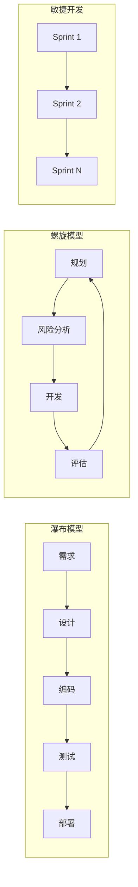

<!--module:
  parent: system-design
  slug: system-design/software-engineering
  type: index
  category: 主模块子文章
  summary: 软件工程方法论——瀑布/敏捷/DevOps 演进 + 质量保障体系 + 工具链选型
  depth: ⭐⭐
  status: active
-->

# 软件工程

> 软件工程是系统化、规范化开发维护软件的工程学科，覆盖需求→设计→编码→测试→运维全生命周期。

## 一、学科定位与目标

软件工程以计算机科学为基础，结合经济学、数学及管理学等理论，建立标准化的开发流程。其核心目标包括：

* **提升软件质量**：减少缺陷、增强稳定性。
* **优化开发效率**：缩短周期、合理分配资源。
* **降低维护成本**：通过模块化设计、文档化管理。
* **保障软件的可扩展性与可复用性**：适应需求变化，减少重复开发。

## 二、开发流程与方法

软件工程覆盖需求分析、设计、编码、测试、部署及维护六大阶段，强调阶段性评审与迭代优化。例如，敏捷开发通过短周期迭代快速响应用户反馈。其开发方法包括：

* **瀑布模型**：线性顺序开发，适合需求稳定明确的项目。
* **螺旋模型**：风险驱动的开发过程，适用于大型复杂系统。
* **敏捷开发**：强调快速响应变化、顾客协作和交付可用的软件产品。

## 三、工具与模型

软件工程采用标准化工具与模型规范开发行为，包括：

* **UML建模**：用于软件系统的可视化建模。
* **DevOps自动化工具**：实现持续集成与持续部署。
* **版本控制系统**：如Git，用于代码管理与协作。

## 四、质量保障体系

软件工程引入单元测试、集成测试、持续集成（CI/CD）等技术，结合代码审查与性能监控，确保软件可靠性。

## 五、应用领域与影响

软件工程广泛应用于金融（交易系统风控）、医疗（电子病历管理）、教育（在线学习平台）、交通（自动驾驶算法）等领域。其技术支撑了云计算、人工智能等前沿科技的发展，推动社会数字化转型。

## 六、发展趋势与挑战

随着AI与大数据的融合，软件工程趋向智能化（AI辅助代码生成）与数据驱动化（基于用户行为优化功能）。同时，云原生架构、低代码开发降低了技术门槛，但安全漏洞防范（如隐私保护）、跨平台兼容性（适应多终端）等问题仍需持续突破。

## 七、分布式下的软件工程差异（F1 衔接）

软件工程方法论诞生于单体时代；进入分布式系统后，同样的实践会因"部分失败、网络不可靠、多团队并行部署"这三个前提而改变含义。理解这些差异，是本目录（软件工程）与 `02-distributed/`（分布式深钻）之间的桥：

- **康威定律 → 服务边界**："系统设计复制组织的沟通结构"在单体时代只是观察，在分布式时代成了**设计约束**——微服务边界若与团队边界错位（一个服务两个团队改、一个团队维护五个服务），每次发布都要跨团队协调，变更成本随服务数平方级上升。落地上即"逆康威策略"（Inverse Conway Maneuver）：先按目标架构调整团队，再拆服务。详见 [微服务](../system-design-basics/microservices/README.md)。
- **契约测试 → 跨服务集成**：单体里"集成测试"跑在一个进程内即可；分布式下 N 个服务两两集成是 O(N²) 的组合爆炸，且测试环境难以让所有依赖同时在线。**消费者驱动契约测试**（Consumer-Driven Contract，如 Pact）把"服务间接口不被破坏"的验证前移到各自的 CI 中，无需拉起全链路环境。
- **Monorepo vs Polyrepo → 部署耦合**：单仓（Monorepo）让原子化重构容易，但需要精细的构建缓存/受影响分析（Bazel、Nx）才能避免"改一行全量构建"；多仓（Polyrepo）天然隔离部署，但跨服务的接口变更要发 N 个 PR 并保持版本兼容。选择本质是在"变更原子性"与"部署独立性"之间取舍——服务间耦合越紧越倾向 Monorepo。
- **发布工程 → 部分失败常态**：单体的发布失败可以整体回滚；分布式下一个特性横跨多个服务、各自独立发布，"回滚"意味着处理**新旧版本共存**（数据已按新 schema 写入怎么办）。因此前向兼容的 API 演进、特性开关（Feature Flag）、渐进式发布（金丝雀）成为软件工程流程的必备件，而非可选优化。
- **代码审查 → 故障域审查**：单体审查关注逻辑正确性；分布式还要审"这段代码失败时会怎样"——超时是否有界、重试是否幂等、依赖挂了是否级联。评审 checklist 需要显式加入容错维度（见 [06 模块 SPEC](../../SPEC.md) 写作要求）。

## 八、学科体系与教育

软件工程是中国普通高等学校本科专业（计算机类，四年制，授工学学士），培养从事大型软件项目分析、设计、编程、测试与项目管理的高层次工程人才。

---

## 导航

- [开发流程与方法](development-process/README.md) — 瀑布/敏捷/原型/螺旋模型
- [工具与模型](tools-and-models/README.md) — UML/DevOps/版本控制
- [质量保障体系](quality-assurance/README.md) — 测试/CI-CD/代码审查

---

← [返回 基础篇](../README.md)