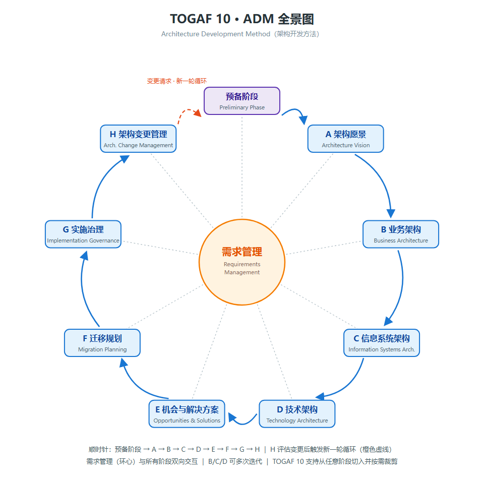
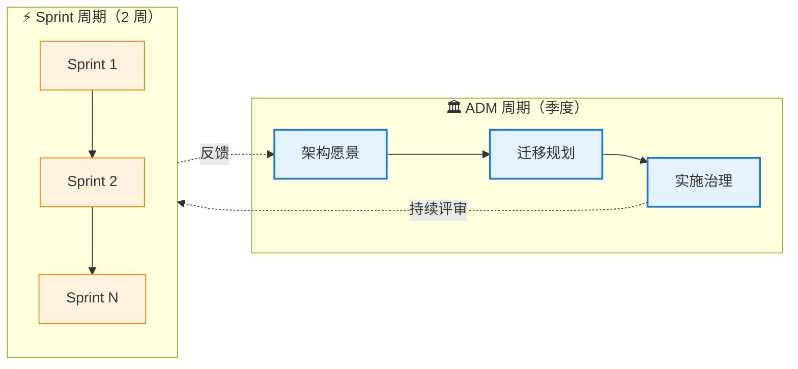

<!--module:
  parent: 06.distributed-systems
  slug: system-design/togaf/adm
  type: article
  category: 主模块子文章
  summary: TOGAF ADM 架构开发方法详解：预备阶段 + A-H 九阶段循环迭代 + 需求管理贯穿始终，传统瀑布误区 vs 现代敏捷融合实践，TOGAF 10 "应用 TOGAF 方法"的裁剪思路。
  depth: ⭐⭐⭐
  status: active
-->

# 第一章：核心思想 + ADM 详解

> ⬅️ [返回目录](README.md) | 下一篇：[BCAT + 业务能力 + 价值流](business-capability.md)

---

## 🎯 一句话定位

**ADM（Architecture Development Method，架构开发方法）是 TOGAF 的核心引擎**——一个 9 阶段的循环迭代流程，把"业务战略"系统化地拆解为"可执行的 IT 蓝图"。TOGAF 10 在保留 9.x ADM 主体结构的基础上，强化了**敏捷适配**与**模块化裁剪**。

---

## 一、核心思想：从业务战略到技术实现的全链路对齐

当系统规模从"一个应用"扩展到"一个企业的数百个系统"时，单纯的技术设计已不够。企业架构回答的不是"这个类怎么设计"，而是：

```text
业务战略 → 需要什么业务能力？ → 需要哪些数据支撑？
    ↓           ↓                    ↓
  价值链      业务能力地图         数据资产规划
    ↓           ↓                    ↓
  需要哪些应用？ → 用什么技术实现？ → 团队怎么组织？
    ↓              ↓                    ↓
  应用架构         技术架构            治理体系
```

**TOGAF 10 的核心贡献**：
1. **标准化的流程**（ADM）—— 9 阶段循环迭代
2. **统一的语言**（BCAT 四层 + 架构内容，内容元模型在 v10 由 Series Guide 承载）—— 跨团队沟通的基础
3. **治理体系**（6 维治理）—— 设计不被执行打折
4. **可配置的方法**（Series Guides）—— 适配不同行业与规模

---

## 二、ADM：架构开发方法详解

### 2.1 ADM 全景图

**标准环形布局**（复刻 TOGAF 官方 ADM 全景图：需求管理居中，8 个字母阶段环绕成环，顺时针 A → … → H → A 闭环；预备阶段挂在环外顶部、与 A 以双向箭头相连；9 个节点按官方四大迭代循环着色）：



> 📐 矢量版：[img/adm-ring.svg](img/adm-ring.svg)（缩放不失真，可直接编辑）

> **读图五要点**（对应图中两块图例）：
> 1. **同色 = 同一迭代循环（官方四分组）**：棕 = 架构能力迭代（预备 ⇄ A）、黄 = 架构定义迭代（B ⇄ C ⇄ D）、绿 = 过渡规划迭代（E ⇄ F）、蓝 = 架构治理迭代（G ⇄ H）——同色阶段是一个可内部来回迭代的整体（C 发现数据约束要回 B 修业务架构、迁移计划排不动要回 E 重拆工作包），**ADM 不是瀑布**；
> 2. **灰蓝实线 = 跨组主链顺时针**：A → B → C → D → E → F → G → H → A 闭环，一轮 ADM 周期的默认走向；
> 3. **棕色双向箭头 = 能力迭代**：预备阶段与 A 互迭代——先建立架构能力（原则 / 治理 / 裁剪）再出愿景，愿景反过来修正原则；
> 4. **橙色虚线 = 跨周期迭代**：H 不是终点，变更请求触发**新一轮 ADM 循环**（H → 预备阶段 → A）；配合阶段内"基线 ⇄ 目标两遍扫"，构成 TOGAF 的**三层迭代**（阶段内 / 阶段间 / 跨周期）；
> 5. **灰色双向虚线 = 需求管理环心**：与全部 8 个字母阶段双向交互——它不是"第 10 个阶段"，而是整个环的枢纽（见 §2.3）。
>
> 补充：TOGAF 10 明确支持**从任意阶段切入 + 按需裁剪**，上图的环是"完整版"，不是强制路线（见 §3.1）。

### 2.2 九阶段详解

#### ⚙️ 预备阶段（Preliminary）

| 项目 | 内容 |
|------|------|
| **目标** | 建立组织的架构能力、定义架构原则、选择工具 |
| **关键活动** | 1. 识别利益相关方 2. 定义架构原则 3. 选择 ADM 裁剪方案 4. 建立架构治理结构 5. 选型工具 |
| **输入** | 业务战略、IT 现状、约束条件 |
| **输出** | 架构原则清单（4 字段模板详见[第六章](architecture-principles.md)）、治理框架、ADM 裁剪计划 |
| **常见错误** | 跳过此阶段直接进入 A；不定义原则导致后续争议 |

#### A. 架构愿景（Architecture Vision）

| 项目 | 内容 |
|------|------|
| **目标** | 获得高管对架构项目的支持，定义范围与约束 |
| **关键活动** | 1. 业务场景（Business Scenarios）分析 2. 识别利益相关方关切 3. 草拟架构愿景声明 4. 评估业务能力差距 5. 风险与约束识别 |
| **输入** | Request for Architecture Work（发起人触发）、架构原则、业务战略、IT 战略 |
| **输出** | 架构愿景文档、**Statement of Architecture Work**（架构工作说明书）、Stakeholder Map、范围声明（4 大交付物辨析见 §2.4）|
| **工具提示** | Business Scenarios 是 TOGAF 10 推荐的开场方法 |

#### B. 业务架构（Business Architecture）

| 项目 | 内容 |
|------|------|
| **目标** | 描绘组织的业务能力、价值流、组织结构、信息流 |
| **关键活动** | 1. 业务能力地图 2. 价值流建模 3. 组织映射 4. 业务数据建模 5. 业务流程 |
| **输入** | 架构愿景、业务现状 |
| **输出** | 业务能力地图、价值流图、组织图、业务数据模型 |
| **关键产出物** | **业务能力地图**（详见[第二章](business-capability.md)） |

#### C. 信息系统架构（Information Systems Architecture）

| 项目 | 内容 |
|------|------|
| **目标** | 设计支持业务的数据架构 + 应用架构 |
| **关键活动** | 1. 数据架构（实体、关系、生命周期） 2. 应用架构（应用组合、服务目录） 3. 应用间接口与依赖 |
| **输入** | 业务架构、数据现状 |
| **输出** | 概念数据模型、逻辑数据模型、应用目录、服务依赖图 |
| **与 DDD 关系** | **数据架构 ≈ DDD 限界上下文划分**；**应用架构 ≈ 微服务边界** |

#### D. 技术架构（Technology Architecture）

| 项目 | 内容 |
|------|------|
| **目标** | 设计技术基础设施（硬件、软件、中间件、网络） |
| **关键活动** | 1. 技术选型（云/IaaS/PaaS） 2. 中间件与平台选型 3. 网络与部署拓扑 4. 安全架构 5. 可观测性方案 |
| **输入** | 应用架构、非功能需求 |
| **输出** | 技术栈清单、部署拓扑图、技术决策记录 |
| **与 OOD 关系** | OOD 设计模式在此层**编码实现**——技术架构决定了哪些模式可行 |

#### E. 机会与解决方案（Opportunities & Solutions）

| 项目 | 内容 |
|------|------|
| **目标** | 评估实现方案、识别项目组合、形成候选工作包 |
| **关键活动** | 1. 解决方案构建块（ABB/SBB）识别 2. 工作包（Work Package）定义 3. 项目依赖分析 4. 成本/收益初评 |
| **输入** | BCAT 四层架构、约束条件 |
| **输出** | 工作包清单、项目组合、依赖图、**Architecture Requirements Specification**（架构需求规格，汇总 B~D 需求定稿，见 §2.4）|
| **关键概念** | **ABB（Architecture Building Block）** vs **SBB（Solution Building Block）**——前者是架构层抽象，后者是具体产品/技术 |

#### F. 迁移规划（Migration Planning）

| 项目 | 内容 |
|------|------|
| **目标** | 制定从现状到目标架构的迁移路线图 |
| **关键活动** | 1. 实施项目排序 2. 风险与价值评估 3. 阶段性里程碑 4. 资源与预算规划 |
| **输入** | 工作包清单、约束条件 |
| **输出** | 实施与迁移计划（含**实施治理模型**——实施阶段角色/责任/流程/标准框架，详见[第四章 §1.3](architecture-governance.md)）、阶段性目标、ROI 评估 |

> **易错点**：实施治理模型是**阶段 F** 的输出（治理框架随迁移计划一起"立法"），阶段 G 按它"执法"——详见[第四章 §1.3](architecture-governance.md)。

#### G. 实施治理（Implementation Governance）

| 项目 | 内容 |
|------|------|
| **目标** | 确保实施项目符合架构定义 |
| **关键活动** | 1. 架构合规性评审 2. 偏差影响评估 3. 变更请求管理 4. 项目复盘 |
| **输入** | 架构契约（Architecture Contract）、实施治理模型（阶段 F 输出）|
| **输出** | 合规报告、变更授权、偏差纠正 |
| **关键机制** | **架构评审委员会（ARB）**——详见[第四章](architecture-governance.md)；**合规性评估**（3 部分内容 + 8 类架构检查单 + 五级合规评级）详见[第四章 §1.4](architecture-governance.md) |

#### H. 架构变更管理（Architecture Change Management）

| 项目 | 内容 |
|------|------|
| **目标** | 持续监控架构变更、滚动更新架构基线 |
| **关键活动** | 1. 变更影响评估 2. 架构基线更新 3. 与业务需求管理对接 4. 定期架构健康检查 |
| **输入** | 变更请求、实际运行数据 |
| **输出** | 更新后的架构基线、变更趋势报告 |

### 2.3 需求管理（贯穿始终）

> **需求管理不是单独阶段，而是与所有阶段并行的横向活动**。它确保业务需求在 ADM 每个阶段都被持续追溯与验证。

### 2.4 ADM 核心交付物辨析（4 个高频混淆项）

TOGAF 的交付物（Deliverables）是**受控的、经评审批准的正式文档**，存入架构存储库（Architecture Repository）。以下 4 个是 OGEA 匹配题的最高频考点——名字都带 "Architecture Work"，但**方向、创建者、稳定性完全不同**：

| 交付物 | 谁创建 | 干什么用 | 所属阶段 | 一句话特征 |
|--------|:------:|---------|:--------:|-----------|
| **Request for Architecture Work**<br/>架构工作请求 | **发起人**（sponsor）→ 发给架构组织 | 触发架构开发周期的开始；定义具体架构项目的**范围、预算、时间表和交付物** | **A**（H 阶段可触发新一轮）| **从发起组织发到架构组织**的触发文件 |
| **Statement of Architecture Work**<br/>架构工作说明书（也译"架构工作声明"）| **架构师** | 定义完成架构项目所需的**方法和资源**；是**发起人与架构组织之间的契约基础** | **A** 的输出 | 架构开发周期的**范围和方法** |
| **Architecture Principles**<br/>架构原则 | **架构师**（预备阶段）| 定义架构工作的**通用规则和指南**，反映业务原则、目标和驱动因素 | **预备阶段**（A~G 全程裁决）| **持久且很少修改**的规则（详见[第六章](architecture-principles.md)）|
| **Architecture Requirements Specification**<br/>架构需求规格 | **架构师** | 定义支配架构工作的**功能性和非功能性需求**，以及约束和假设 | **E**（汇总 B~D 需求）| 一组**定量陈述**：实施项目必须做什么才符合架构 |

**两大易混陷阱**：

1. **Request vs Statement：方向相反**
   ```text
   Request   for Architecture Work：发起人 → 架构组织（"我要你启动这件事"）
   Statement of Architecture Work：架构组织 → 发起人（"好，我这样做，签字吧"）
   ```
   考题给"从发起组织发送到架构组织的文件" → 选 **Request**；给"契约基础 / 范围和方法" → 选 **Statement**。

2. **Principles vs Requirements Specification：粒度与稳定性相反**
   ```text
   Principles：通用规则、持久、很少改（以年计）——"数据即资产"
   Requirements Spec：具体定量陈述、随项目变（以项目计）——"P99 延迟 < 200ms"
   ```
   考题给"持久且很少修改" → 选 **Principles**；给"一组定量陈述" → 选 **Requirements Specification**。

**匹配题速记口诀**：**请求触发（A）· 说明立约（A）· 原则长效（预备）· 规格定量（E）**

> **交付物 vs 其他制品**：TOGAF 内容框架里，Deliverable（交付物）= 需经正式评审与批准的受控文档；Artifact（制品，如目录/矩阵/图）= 交付物的组成部分；Building Block（ABB/SBB，见 §2.2 阶段 E）= 可复用的架构/解决方案单元。考题问"发布到存储库的受控制品"时，三者都是候选——按颗粒度选（详见[第五章](scenario-exam-method.md) Step 3 全面性比较）。

---

## 三、ADM 迭代循环：现代实践

### 3.1 传统误区 vs 现代实践

| 误区 | 真相 |
|------|------|
| "ADM 必须从 A 到 H 顺序走完" | TOGAF 10 明确：**ADM 是迭代的**，可从任意阶段切入 |
| "必须完成所有阶段才能产生价值" | **MVP 思路**：先 A+B 出最小可用架构，再迭代 |
| "ADM 是一次性大型项目" | **持续节奏**：每个迭代周期 1-3 个月 |
| "只有大型企业才用 ADM" | **裁剪后**也适用于 10 人小团队（详见[第四章](architecture-governance.md)） |

### 3.2 与 Agile 融合



**关键原则**：

| 原则 | 含义 |
|------|------|
| **ADM 节奏** | 季度/半年——做架构决策、定原则 |
| **Sprint 节奏** | 双周/周——做实现、收集反馈 |
| **架构在 Sprint 中的角色** | Architecture Owner（参考 Team Topologies）参与关键 Sprint Review |
| **轻量文档** | 用 ADR 替代厚重的架构文档（详见[第四章](architecture-governance.md)） |

### 3.3 TOGAF 10 强调的"应用 TOGAF 方法"

TOGAF 10 引入了 **"Applying the TOGAF Approach"**（应用 TOGAF 方法）这一**实用指导篇章**，核心变化是：

- 减少对"严格按 ADM 顺序走"的强制
- 增加**对小型组织、敏捷团队的指导**
- 把 9.x 时代的"合规导向"调整为**"价值导向"**——架构不为了合规而存在，而是为了支撑业务敏捷

---

## 四、章节思考

1. **你的项目应该走完整 ADM 吗**：评估组织规模、变更幅度、时间窗口。大多数项目可以裁剪。
2. **MVP 架构愿景**：如果只做 ADM 的 A+B 两阶段，能产出什么价值？哪些"看起来重要但其实可后置"的环节被你忽略了？
3. **需求管理的难点**：需求从哪来？如何避免"需求池"变成无人维护的垃圾场？
4. **架构师与 Sprint 的关系**：你的架构师在 Sprint Review 中的角色是什么？是被动响应还是主动塑造？
5. **交付物辨析自测**（§2.4）：不看表回答——"从发起组织发送到架构组织、用于触发架构开发周期的文件"是哪个？"一组定量陈述，概述实现项目必须做什么才符合架构"是哪个？两个都答对才算过。

---

## 相关章节

- ⬅️ [返回目录](README.md)
- ➡️ [第二章：BCAT + 业务能力 + 价值流](business-capability.md)
- [第五章：TOGAF 10 情景题答题方法（OGEA-102）](scenario-exam-method.md) — 9 阶段职责与产出物是答题法 Step 1「定阶段排除」的知识底座
- [第六章：架构原则模板](architecture-principles.md) — 预备阶段关键活动「定义架构原则」的 4 字段模板（Name/Statement/Rationale/Implications）写作细则
- 🏛️ [ADM 与需求管理（TOGAF 10 官方）](https://pubs.opengroup.org/togaf-standard/)

← [返回: 企业架构（TOGAF 10）](README.md)
