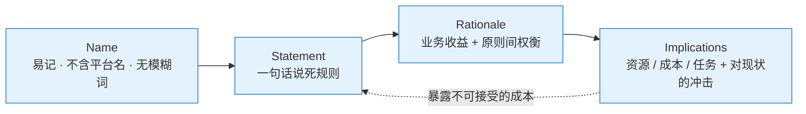

<!--module:
  parent: system-design
  slug: system-design/togaf/architecture-principles
  type: article
  category: 主模块子文章
  summary: TOGAF 架构原则：EA 原则的 4 大目的（促进决策/企业一致性/确保治理/理解价值观与文化）+ 4 字段模板（Name / Statement / Rationale / Implications）官方要求（中英对照）、坏词清单（support / open / consider / avoid / manage + 多余形容词副词）、完整示例（好例 + 坏例改写）、与预备阶段 / 架构治理 / ADR 的衔接。
  depth: ⭐⭐⭐⭐
  status: active
-->

# 第六章：架构原则模板（Name / Statement / Rationale / Implications）

> ⬅️ [返回 TOGAF 10 总览](README.md)

---

## 🎯 一句话定位

**架构原则不是口号，而是"能裁决争议的规则"**——TOGAF 标准用 4 字段模板定义一条原则：Name 让它易记、Statement 让它无歧义、Rationale 回答"为什么值得遵守"、Implications 回答"这对我有什么影响"。4 个字段齐备，原则才能在后续 ADM 各阶段的技术选型与利益冲突中真正被拿来裁决，而不是贴在墙上落灰——这也正是 EA 原则 4 大目的（§1.1：促进决策 / 企业一致性 / 确保治理 / 理解价值观与文化）得以达成的机制。

---

## 一、原则为什么存在、从哪来

### 1.1 EA 原则要解决的 4 个目的

**先摆正位置**：TOGAF《ADM Guidelines and Techniques》开篇提醒——**架构原则可能只是一套结构化理念中的一个元素，这些结构化理念从价值观到行动和结果共同界定和指导着组织**：

```text
价值观（Values）→ 原则（Principles）→ 行动（Actions）→ 结果（Outcomes）
     组织信什么        决策的裁决标尺        日常选型/设计       业务与 IT 的实际改变
```

原则单独存在没有力量——它上承企业价值观（价值观是原则的立法依据），下启行动与结果（原则要靠阶段 B~F 的设计决策和阶段 G 的治理才转化为现实）。理解这条理念链，才能理解下面 4 个目的为什么是"组织级"的，而不只是文档级的：

| 目的 | 解决的问题 | 落到组织的动作 |
|------|-----------|---------------|
| **促进决策**（Enable Decision-Making）| 权衡讨论没有先例可引，每次都从零吵起 | 在权衡讨论中**确定优先顺序 / 设定先例**；必要时明确**"打破平局"的权利**归属（谁有最终裁决权）|
| **企业一致性**（Align the Enterprise）| 各部门按主观偏好选型，方向发散 | 原则**消除主观性和偏见**，推动客观且与企业价值观一致的关键对话 |
| **确保治理**（Governance）| 决策没人管：谁在什么时候决定什么？过程可追溯吗？ | 确保**正确的决策在正确的时间由正确的决策者做出**；并**监控决策和做出决策所采取的方法**（对接[第四章治理体系](architecture-governance.md)）|
| **理解价值观和文化**（Values and Culture）| 组织对自己"信什么、怕什么"没有显式表达 | 提供对企业**文化和价值观**更好的理解；提供一种方法并深入了解**企业对变革的反应程度** |

> **译名变体提示**：同一段 TOGAF 原文在不同课程/译本中亦作「**帮助决策** / **企业对齐** / 治理 / 价值观和文化」——语义与上表完全一致，**以英文规范名为准**（Enable Decision-Making / Align the Enterprise / Governance / Values and Culture），考试遇到任一译法直接映射本表。

> **4 目的与 4 字段的对应**：Statement 承载"促进决策"（可裁决才成先例）；Rationale 承载"企业一致性"（业务收益论证消除主观偏见）与"理解价值观和文化"（原则本身就是价值观的显式声明）；Implications 承载"确保治理"（暴露现状冲突 = 生成监控与合规需求）。**写不好字段 = 达不成目的**——这是 §三逐字段要求的底层逻辑。
>
> **"打破平局"的权利值得单独强调**：原则体系必须预先指定仲裁者（通常是架构委员会，见[第四章 §1.3 六维治理](architecture-governance.md)的"决策"维度）。没有仲裁权威，原则冲突时（如 Business Continuity vs Maximize Benefit）就退化成职位高低之争——这正是 §3.3 要求 Rationale 写明优先级情形、§六要求治理闭环的原因。

### 1.2 预备阶段的核心交付物

架构原则是 [第一章](adm.md) 预备阶段（Preliminary Phase）的关键活动 2「定义架构原则」的产出（它也是 ADM 4 大核心交付物之一，与 Request/Statement of Architecture Work、Requirements Specification 的辨析见[第一章 §2.4](adm.md)）：

| 维度 | 说明 |
|------|------|
| **产出时机** | 预备阶段（建立架构能力时），并在阶段 A 愿景确认后回头修正 |
| **使用位置** | 阶段 A 的输入；阶段 B~F 每个设计决策的裁决标尺；阶段 G 合规评估的依据 |
| **常见错误** | 跳过定义原则 → 后续每次技术选型都变成立场之争（见第一章预备阶段「常见错误」）|
| **与 ADR 的区别** | 原则 = 长期标尺（以年计，很少变）；[ADR](architecture-governance.md) = 一次性决策记录（一个项目一个决策一条）。ADR 的「决策」必须能引用某条原则作为依据 |

> **为什么原则先行**：TOGAF 把原则放在 ADM 循环的起点之前（预备阶段），因为原则定义了"什么算好架构"——没有这个共识，阶段 G 的治理就退化成架构师个人审美裁决。

---

## 二、4 字段模板总览

TOGAF 标准规定每条架构原则用 4 个字段描述：

| 字段 | 中文 | 一句话职责 | 达标判据 |
|------|------|-----------|---------|
| **Name** | 名称 | 代表规则本质 + 易于记忆 | 不提具体技术平台；不含模糊词 |
| **Statement** | 声明 | 简洁明确传达基本规则 | 毫不含糊（unambiguous）|
| **Rationale** | 基本原理/依据 | 用业务术语讲清遵守它的业务收益 | 说清与其他原则的关系及优先级权衡 |
| **Implications** | 含义/相关影响 | 讲清执行业务与 IT 各自的代价 | 读者能直接回答"这对我有什么影响？" |



> 4 字段不是单向填空：写 Implications 时若发现代价离谱，往往要回头收窄 Statement——这是模板自带的自检回路。

---

## 三、4 字段详解（官方要求 · 中英对照）

### 3.1 Name（名称）

> Should both represent the essence of the rule as well as be easy to remember. Specific technology platforms should not be mentioned in the name or statement of a principle. Avoid ambiguous words in the name and in the statement such as: "support", "open", "consider", and for lack of good measure the word "avoid", itself, be careful with "manage(ment)", and look for unnecessary adjectives and adverbs.
>
> 应该既代表规则的本质，又易于记忆。原则名称或陈述中不应提及特定的技术平台。避免在名称和陈述中使用含糊不清的词语，例如："支持""开放""考虑"，并且由于缺乏好的度量，"避免"一词本身应谨慎对待"管理"，以及避免使用不必要的形容词和副词。

**写作要点**：
1. **代表本质 + 易记**：好的 Name 本身就是口号级短语（如 "Data is an Asset"），开会时能直接引用；
2. **不提技术平台**：出现 "Kubernetes""Oracle""AWS" 等具体平台名 = 把原则降格成选型结论，平台更替时原则即作废；
3. **避开模糊词**（详见 §四坏词清单）——名称和声明都要检查。

### 3.2 Statement（声明）

> Should succinctly and unambiguously communicate the fundamental rule. For the most part, the principles statements for managing information are similar among organizations. It is vital that the principles statement be unambiguous.
>
> 应该简洁明确地传达基本规则。在大多数情况下，组织之间用于管理信息的原则声明相似。原则声明必须毫不含糊。

**写作要点**：
1. **一两句话说死规则**：Statement 是裁决时真正引用的那句话，必须能直接判定"某方案符合 / 违反"；
2. **无歧义是生命线**：出现"尽量""酌情""在可能的情况下"这类弹性措辞，原则就失去了裁决力——争议双方都能声称自己符合；
3. **组织间趋同是正常的**：信息管理类原则的 Statement 各家相似并不丢人，差异体现在 Rationale（本组织的业务收益）与 Implications（本组织的现状冲击）里。

### 3.3 Rationale（基本原理/依据）

> Should highlight the business benefits of adhering to the principle, using business terminology. Point to the similarity of information and technology principles to the principles governing business operations. Also describe the relationship to other principles, and the intentions regarding a balanced interpretation. Describe situations where one principle would be given precedence or carry more weight than another for making a decision.
>
> 应使用业务术语强调遵守该原则的业务利益。指出信息和技术原理与管理业务运营的原理的相似性。还描述与其他原则的关系，以及有关平衡解释的意图。描述一种情况，在该情况下一个原则将被赋予优先权或在决策时比另一个原则具有更大的重要性。

**写作要点**（Rationale 要回答 4 个问题）：
1. **业务收益是什么**——必须用**业务术语**（收入 / 风险 / 合规 / 客户体验），不是技术术语（解耦 / 可维护性）；
2. **与业务运营原则的相似性**——如"数据像财务资产一样管理"，借业务侧已有共识降低推行阻力；
3. **与其他原则的关系**——它支撑谁、依赖谁、可能与谁冲突；
4. **优先级情形**——当本原则与另一原则冲突时，什么情况下本原则让位 / 压过对方。**这一条最常被漏写**，而它恰恰是阶段 G 裁决争议的直接依据。

### 3.4 Implications（含义/相关影响）

> Should highlight the requirements, both for the business and IT, for carrying out the principle – in terms of resources, costs, and activities/tasks. It will often be apparent that current systems, standards, or practices would be incongruent with the principle upon adoption. The impact on the business and consequences of adopting a principle should be clearly stated. The reader should readily discern the answer to: "How does this affect me?" It is important not to oversimplify, trivialize, or judge the merit of the impact.
> Some of the implications will be identified as potential impacts only, and may be speculative rather than fully analyzed.
>
> 应该在资源、成本和活动/任务方面强调对业务和 IT 实施原则的要求。很明显，当前的系统、标准或实践在采用时与该原则不一致。应明确说明采用原则对业务的影响和后果。读者应该很容易看出答案："这对我有何影响？"重要的是不要过分简化、琐碎化或判断影响的优劣。
> 其中的某些影响仅会被识别为潜在影响，并且可能是推测性的，而不是进行全面分析的。

**写作要点**：
1. **业务侧 + IT 侧分别写**：资源（要加人吗）、成本（要花多少钱）、活动/任务（要改哪些流程）；
2. **点名现状冲突**：哪些现有系统、标准、实践在采用该原则后不再合规——这是后续架构项目（阶段 E/F 迁移规划）的需求来源；
3. **回答"How does this affect me?"**：每个读者（业务负责人 / 项目经理 / 开发者）读完应能判断自己受影响的方式；
4. **不粉饰、不评判**：影响再难看也要如实写（不 oversimplify / trivialize / judge the merit）；
5. **允许推测性影响**：部分影响标注为"潜在影响"即可，不必等全面分析——但要在字段里显式标注推测性质。

---

## 四、坏词清单（Name 与 Statement 都要过一遍）

TOGAF 标准点名的模糊词——它们让原则"看起来有立场，实际无法裁决"：

| 坏词 | 为什么坏 | 修复方向 |
|------|---------|---------|
| **support（支持）** | 支持到什么程度算达标？无法判定违反 | 改成明确动作：use / adopt / require |
| **open（开放）** | "开放"没有度量，人人都自称开放 | 改成可验证条件：published specification / no vendor lock-in |
| **consider（考虑）** | 考虑了然后呢？考虑后否决也算遵守 | 改成结论性规则，或把"考虑"升级为"默认选择 X，除非 Y" |
| **avoid（避免）** | 标准原话：for lack of good measure——"避免"本身缺乏度量 | 改成正向陈述：X 只在 Y 条件下使用 |
| **manage(ment)（管理）** | 谨慎使用——"管理数据"不说明管理到什么标准 | 改成具体机制：data has an accountable trustee |
| **多余形容词/副词** | "适当的""充分的""高效的"全是弹性垫 | 删掉，或换成可测判据 |

**自检法**：把 Statement 交给两个不了解背景的架构师独立判断同一方案是否符合——结论不一致 = 有模糊词残留。

---

## 五、完整示例

### 5.1 好例：数据即资产（TOGAF 标准示例原则）

| 字段 | 内容 |
|------|------|
| **Name** | Data is an Asset（数据即资产）|
| **Statement** | 全部数据是企业级资产，必须像财务资产一样被统一登记、问责和治理。 |
| **Rationale** | 业务收益：决策质量取决于数据的完整性与一致性——如同资金管理需要账本与审计，数据也需要 Owner 与质量标准。本原则是「Data is Shared」「Data Trustee」两条原则的前提；当数据质量投入与短期项目排期冲突时，资产视角优先（一次脏数据的业务代价远高于治理成本）。 |
| **Implications** | 业务侧：每类核心数据需任命 Data Owner，业务部门承担数据质量责任（不只是 IT 的事）。IT 侧：建立数据字典、血缘与质量度量；现存"部门私有数据"需盘点迁移（潜在影响：迁移工作量可能显著，属推测性估计）。对个人的影响：申请数据访问将走审计流程，"随手导一份"不再合规。 |

### 5.2 坏例改写：从模糊到可裁决

| 版本 | Name | Statement | 诊断 |
|------|------|-----------|------|
| ❌ 坏例 | 支持开放标准 | 系统设计应支持使用开放的、业界标准的接口技术 | "支持""开放"双模糊词；"标准"未限定；无法判定违反 |
| ✅ 改写 | Technology Independence（技术独立性）| 企业业务处理不依赖任何特定技术平台供应商；跨系统接口只采用有公开规范、多供应商实现的协议 | 名称无平台名；声明给出可验证判据（公开规范 + 多供应商实现）|

### 5.3 TOGAF 标准示例原则速查（节选）

TOGAF 标准按 BCAT 四层给出示例原则集，可作为组织自定义原则的起点：

| 类别 | 示例原则（节选）|
|------|----------------|
| **业务** | Primacy of Principles（原则至上）、Maximize Benefit to the Enterprise（企业利益最大化）、Information Management is Everybody's Business（信息管理人人有责）、Business Continuity（业务连续性）、Compliance with Law（依法合规）|
| **数据** | Data is an Asset、Data is Shared、Data is Accessible、Data Trustee（数据受托人）、Common Vocabulary and Data Definitions（统一词汇与数据定义）、Data Security |
| **应用** | Ease of Use（易用性）、Application Independence（应用独立性）、Requirements-Based Procurement（按需求采购）|
| **技术** | Technology Independence、Responsive Change Management（响应式变更管理）、Control Technical Diversity（控制技术多样性）、Interoperability（互操作性）|

> **裁剪提示**：示例原则是起点不是终点——Rationale 与 Implications 必须重写为本组织的业务收益与现状冲击，否则原则没有裁决力（各组织 Statement 趋同是正常的，见 §3.2）。

---

## 六、落地纪律：原则要少而硬

1. **数量克制**：全套原则（业务/数据/应用/技术四类）通常十几到二十几条——超过 30 条没人记得住，等于没有；
2. **每条都过坏词清单**（§四）：Name 和 Statement 各扫一遍，模糊词清零后才允许发布；
3. **Rationale 必写优先级**：原则间冲突是常态（如 Business Continuity vs Maximize Benefit），没有预先声明的权衡规则，冲突就会升级成高层站队；
4. **Implications 喂给阶段 E/F**：点名"与原则不一致的现存系统"就是在生成迁移需求清单——写完原则不做差距评估，等于白写；
5. **治理闭环**：阶段 G 的合规评估、豁免（dispensation）申请、[ADR](architecture-governance.md) 的决策依据，全部回指原则条目——原则是治理体系的"宪法"，ADR 是"判例"。

---

## 章节思考

1. §1.1 的 4 个目的里，「治理」要求"监控决策过程和采取的方法"——回看 §五 Data is an Asset 的 Implications，哪些内容会成为监控的检查点？
2. 你所在组织现有的"架构原则"里，有几条能通过 §四坏词清单？挑一条含"支持/考虑"的原则，现场改写成可裁决版本。
3. "Data is an Asset" 的 Implications 里写着"部门私有数据需盘点迁移"——如果你是该部门业务负责人，你会用什么理由反对？这条反对意见应该记录在哪个字段里？
4. 两条原则冲突（如 Compliance with Law vs Maximize Benefit to the Enterprise）时，TOGAF 期望在哪里找到裁决依据？如果没有，暴露的是哪个字段的缺失？
5. 为什么说 ADR 的「决策」字段应该引用原则条目？不引用会失去什么？

---

## 相关章节

- ⬅️ [返回 TOGAF 10 总览](README.md)
- ⬅️ [第一章：核心思想 + ADM 详解](adm.md) — 预备阶段「定义架构原则」的上下文；原则如何流入阶段 A~G
- ⬅️ [第二章：BCAT + 业务能力 + 价值流](business-capability.md) — 业务类原则（企业利益最大化）是能力优先级排序的价值标尺
- ⬅️ [第三章：康威定律 + 团队拓扑](conway-and-team-topology.md) — 「Information Management is Everybody's Business」的组织落地视角
- ⬅️ [第四章：架构治理 + 落地实践](architecture-governance.md) — 原则 vs ADR（宪法 vs 判例）；阶段 G 合规评估以原则为依据
- ⬅️ [第五章：TOGAF 10 情景题答题方法（OGEA-102）](scenario-exam-method.md) — 预备阶段类考题的原则层知识；开卷 REFERENCE 中原则模板原文出处

## 📚 参考来源

- [TOGAF Standard v10 在线文档](https://pubs.opengroup.org/togaf-standard/) — Architecture Principles 章节（4 字段模板与示例原则集的官方出处；本章中英对照引文基于 TOGAF 标准原文）

← [返回: 企业架构（TOGAF 10）](README.md)
