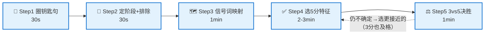

<!--module:
  parent: system-design
  slug: system-design/togaf/exam-method
  type: article
  category: 主模块子文章
  summary: OGEA-102（TOGAF EA Practitioner Part 2）情景题速答法：梯度评分数学 + 五步应考流水线（圈钥匙句→定阶段→信号映射→选5分→3vs5决胜）+ 0分死法黑名单 + 题族绑定表；基于 42 题题库逆向工程与官方考纲。
  depth: ⭐⭐⭐⭐
  status: active
-->

# 第六章：OGEA-102 情景题速答法（应考流水线 + 题族绑定）

> ⬅️ [返回 TOGAF 10 总览](README.md)

---

## 🎯 一句话定位

**第五章的判据表教你"实践中该做什么"，本章教你"考场上该选哪个"**——这是两套不同的判断。考试不是问"哪个选项是错的"，而是把四个**都听起来合理**的选项按 5/3/1/0 排序，让你选出排第一的那个。本章给出一套可在每题 11 分钟内机械执行的流水线，并用 42 题真题逆向验证每个规则。

> **为什么只读判据表学不会做题**：判据表是"知识地图"（场景信号 → 阶段 → 动作），做题需要的是"搜索算法"（钥匙句 → 阶段 → 排除 → 决胜）。地图告诉你每个地方在哪，算法告诉你先走哪步。本章就是那个算法。
>
> **证据基础**：本章规则来自对 57 题中培伟业 OGEA-102 题库（42 题独立场景）的逐题逆向工程 + The Open Group 官方考纲 + 《TOGAF Practitioner Study Guide》联合作者 Dave Hornford 的官方解题法。每条规则都标注了真题题号，可回题库复核。

---

## 一、先懂考试：梯度评分的数学

OGEA-102（TOGAF Enterprise Architecture Part 2）官方考试机制：

| 维度 | 事实 |
|------|------|
| 题量 / 时间 | **8 道情景题 / 90 分钟**（ESL 可加 30 分钟）→ 每题约 **11 分钟** |
| 评分 | 每题 4 个选项按质量梯度给分：**最佳 5 / 次佳 3 / 第三 1 / 干扰 0** |
| 及格线 | **24/40（60%）** |
| 开卷 | 考试界面内置 TOGAF 标准（REFERENCE 按钮），仅电子版，不能带自己的笔记 |
| 考纲 | EA 语境 / 利益相关者管理 / 阶段 A / 阶段 B-D / 阶段 E-G / 阶段 H / 需求管理 / ADM 支撑，单题可跨多个领域 |

**这场考试最重要的一条数学**：

```text
8 题全部选"次佳（3分）" = 24 分 = 恰好及格
8 题全部选"最佳（5分）" = 40 分
踩 1 次 0 分干扰项     = 直接损失 5 分容错空间
```

→ **考试策略不是"每题都选对"，而是"每题都接近 + 绝不踩 0 分"**。这意味着：

1. 在两个合理选项之间纠结 5 分钟是亏的——选到 3 分照样及格；
2. 快速识别并排除 0 分干扰项，比精确区分 5 分与 3 分**更值钱**；
3. 开卷救不了你：11 分钟里读完几段场景 + 四个长选项已用掉大半，REFERENCE 只用于确认"某步骤属于哪个阶段"，不是用来现学的。

---

## 二、考试判断 vs 实践判断：三个关键差异

| 差异 | 实践（第五章判据表） | 考试（本章） |
|------|-------------------|------------|
| **回答的对象** | 场景里的问题 | **问题句**，不是场景 |
| **选项性质** | 对 / 错 | 四个都"可辩护"，只有排序 |
| **知识来源** | 经验 + 判据 | ADM 阶段归属 + 官方动作链措辞 |

**差异一是最大的坑**（Study Guide 作者原话级洞察）：场景可能停在阶段 G（项目在飞、合同在履行），但问题句问的是阶段 A 的动作（"高层想了解他们的选项"）。**场景的阶段 ≠ 问题的阶段**，出题人恰恰在这个错位处考你。做题时永远以**问题句**为锚定，场景只提供约束与钥匙句。

**差异二决定了排除法的形态**：不能找"错的选项"（几乎没有绝对错误），要找"**不属于当前阶段**的选项"——一旦确定问题句落在哪个 ADM 阶段，所有不以该阶段动作为主体的选项立即出局，不管它看起来多有道理。例：问题是阶段 D，则一切不是技术架构导向的选项直接排除。

**差异三决定了决胜方式**：5 分选项的措辞几乎总是**官方动作链的完整复述**（步骤最全、顺序不颠倒、含官方产出物名）。这不是文采，是出题人从 TOGAF 标准/系列指南原文改写选项的痕迹——42 题逆向中约九成成立。

---

## 三、五步速答流水线（每题 11 分钟预算）



### Step 1：圈钥匙句（30 秒，先读问题句再扫场景）

42 题逆向统计：**约八成题目的 5 分答案可由"钥匙句"直接锁定**。钥匙句只有三种形态，按优先级扫：

| 形态 | 长什么样 | 真题示例 | 推出什么 |
|------|---------|---------|---------|
| **① 赞助人/高管原话** | "CIO 明确表示…" / "CEO 强调…" / "她表示必须…" | Q27"CIO 明确要求在批准实施迁移计划**之前评估风险**" | 直接推出考点技术（BTRA） |
| **② "然而/但是"转折句** | 转折点 = 题目的真正矛盾 | Q21"**然而**发现关键利益相关者偏好存在重大不兼容" | 推出"评估标准 + 替代方案审查" |
| **③ 进度定位句 / 硬约束** | "架构愿景已批准" / "大纲已批准" / "尚无共享愿景" / "不得超预算" | Q38"领域架构及差距**已得到批准**，已确认需要开展哪些工作" | 直接决定当前处于 ADM 哪一步，排除跳步/回退项 |

> **形态 ③ 是排除法引擎**：进度定位句说"愿景已批准"，则一切"重做愿景/回到阶段 A"的选项出局（Q32-C）；说"尚无共享愿景"，则一切"基线技术架构先行"的选项出局（Q19-B、Q24-A）。

### Step 2：定阶段 + 第一轮排除（30 秒）

用问题句（不是场景！）确定 ADM 阶段，然后**排除所有不属于该阶段的选项**：

- 问题问"如何启动项目" → 阶段 A → 出现"试点项目""发架构合同"的选项出局（Q20-B、Q36-C：官方明确不建议阶段 A 做试点）；
- 问题问"迁移计划下一步" → 阶段 F → 出现"合规评估监控实施"（阶段 G 动作）的选项降级（Q34-A）；
- 问题问"提高韧性" → 阶段 H 变更管理 → 出现"发检查表做合规审查"的选项出局（Q28-D，工具错配）。

**自检技巧**（Study Guide 作者的"ADM 质量反测"）：如果排除后剩下的选项质量参差（一个很强、一个很弱），说明你的阶段定位大概率是对的；如果剩下两个同样强，回头怀疑阶段定位。

### Step 3：信号词映射（1 分钟，查下面的映射表）

题干触发词 → 正确考点的速查表（完整 25 行版见[第五章判据表](scenario-judgment.md)，这里是**考试高频压缩版**，每行都有真题支撑）：

| 题干触发词 | 考点 | 5 分选项核心词 | 真题 |
|-----------|------|--------------|------|
| "尚无共享愿景或需求" + 高管已定方向 | 架构定义起点 | **变更参数** → 需求/驱动因素/问题/约束 | Q19/Q24/Q31 |
| 合伙人/利益相关者"担忧""质疑" | 阶段 A 利益相关者管理 | **利益相关者地图** + 关注点记入架构愿景文档 + 渐进演化 | Q26/Q33 |
| 并购后"关键人士未充分参与" | 阶段 A | 双方关键人识别 + 职务/影响力分类 + 尽早频繁沟通 | Q36 |
| "批准实施计划**之前**评估风险" | **BTRA 业务转换准备度评估** | 评估变革准备情况 + 每个转型的价值/工作量/风险 | Q27 |
| "架构合同已起草" + 第三方承包商 + 质量担忧 | 阶段 G | 合同含验收标准 + 第三方**法律强制** + 关键节点**合规性审查** | Q22 |
| "最小化干扰 + 逐步推广" | 阶段 E | **实施因素目录** + 差距/方案/依赖矩阵 + **能力增量** + 过渡架构 | Q29 |
| 工作包已定义，问"迁移计划下一步" | 阶段 F | **业务价值评估技术** + ROI + **架构定义增量表** | Q34 |
| 差距已批准，问"下一步" | 阶段 E | 变更**依赖关系** → 工作包 → 过渡架构 → 增量交付 → 路线图 | Q38 |
| "增量式实施 + 看到每个增量的价值" | 阶段 F | 业务规划/项目组合/运营管理**共同参与**迁移规划 | Q39 |
| 利益相关者偏好"重大不兼容" | 阶段 E 方案比较 | 用愿景/原则/需求定**评估标准** + 替代方案 + 正式审查 | Q21 |
| 两个备选方案"乍看彼此排斥" | 跨域治理 | **权衡法** + 架构师促进、**利益相关者做知情决策** | Q37 |
| 客户反馈"价值不高、未达目标受众" | 阶段 B | **客户细分/价值主张建模 + 价值流映射** + 替代目标业务架构 | Q23/Q25 |
| 勒索软件/业务连续性 | 阶段 H | 业务连续性要求 → 差距分析 → 变更请求 → 委员会批准 → **新架构工作请求** | Q28 |
| 实验产品"转正"为持续运行 | 阶段 F/治理 | **需求影响评估** → 提交架构委员会 | Q17 |
| 多实施小组并行落地已批架构 | 阶段 G | 存储库**发布受控制品** + 定期跟进 + 符合 ARS 实施规格 | Q13 |
| "成本上升/削减持续成本需要什么信息" | 阶段 C | 信息流根因 + **一次性成本 vs 持续成本** + 利益相关者确认值得 | Q10/Q42 |
| EA 团队被实施治理占满 | 角色转型 | 制品**记录在案** + 从执行者转治理者 + 专注目标架构 | Q15/Q16 |

### Step 4：在剩余 2-3 项中选 5 分（2-3 分钟）

按以下特征依次比对（按判别力排序）：

1. **动作链最完整且有序**：5 分选项几乎总是 4 步以上、顺序符合 ADM 逻辑的链条；
2. **精确呼应钥匙句**：赞助人原话里的诉求，5 分选项会逐词回应（Q22"一致性和质量" → 唯一含"验收标准 + 合规性审查"的 C）;
3. **含利益相关者结构化动作**：场景出现"担忧/冲突/抵触"字样时，5 分答案**必含**利益相关者分析/地图/共同决策/正式审查——42 题中 11 道冲突类题无一例外；且永远是"架构师**促进/帮助**决策"，绝不是"架构师选定后说服"；
4. **含增量关键词**：出现"过渡架构 / 能力增量 / 渐进 / 候选架构"且不与硬约束冲突 → 强 5 分信号（Q3/Q12/Q14/Q29/Q34/Q38/Q39）；反之"一次性彻底改造"是 0 分信号；
5. **含制品动词**："记录在案 / 发布到存储库 / 录入标准资料库 / 文档化"——TOGAF 治理强调受控制品，这类动词是稳定的 5 分标记（Q13/Q16/Q38/Q40）。

### Step 5：3 vs 5 决胜（1 分钟）

3 分选项的画像是**方向对但缺一环**。与 5 分候选逐项对比，找缺的是哪一环——缺环只有五种类型：

| 缺失类型 | 说明 | 真题对照 |
|---------|------|---------|
| **缺关键步骤/制品** | 链条中段少一个官方产出物 | Q29-B 缺"实施因素目录 + 依赖识别"；Q21-A 缺"用愿景/原则/需求定评估标准"；Q14-B 缺"过渡架构"概念 |
| **缺利益相关者确认 / 范围收窄** | 少了正式审查，或只面向"关键"利益相关者 | Q26-C 只面向最有权力者；Q41-A/C 只建模不带利益相关者参与；Q39-D EA 团队闭门做计划 |
| **范围/层面偏了** | 停在应用层没到数据层；落点跳到别的阶段产出 | Q11-A 缺数据架构层面；Q4-B 落点偏到"给高层做路线图" |
| **少产出物落点** | 动作都对但没落到官方交付物 | Q16-D 缺"差距/工作包/ARS/控制"完整制品清单；Q34-D 缺业务价值评估 + 增量表 |
| **被动 vs 主动** | 事后响应替代事前主动 | Q15-D 等新能力可用**后**才对话；Q13-B 让实施团队反向更新 ARS；Q28-B 缺委员会批准闭环 |

> **一句话判别法**：3 分 = 5 分链条**砍掉最后一环**（通常是利益相关者确认/正式治理闭环）或**砍掉第一环**（通常是评估标准/实施因素/利益相关者分析）。

---

## 四、0 分死法黑名单（反向排除引擎）

命中以下任一死法的选项，几乎必为 0 分（或至多 1 分）——考场上**先扫黑名单再看正确特征**，速度更快：

| # | 死法 | 典型措辞 | 真题 |
|:-:|------|---------|------|
| 1 | **过早锁定方案**（最高频，≈13 题） | "直接扩展现有 X""先给方案后补文档""用短期变通方法" | Q7-A、Q8-A、Q18-A、Q38-B、Q2-A |
| 2 | **架构师单方裁定** | "根据**自己**对上级架构的理解选择""选定后向利益相关者解释/推销" | Q6-B、Q37-C、Q41-D |
| 3 | **跳步 / 阶段顺序颠倒** | "B/C/D 三阶段同时开展""无愿景先做基线技术架构""跳过信息流分析直接建模" | Q31-B、Q19-B、Q9-A、Q10-B |
| 4 | **颠倒治理权责** | "让实施团队重新起草 ARS""随时调整一致性测试以适应实施""每次偏差都改合同" | Q13-D、Q22-D |
| 5 | **按地理/简单维度推广** | "按地理区域顺序推广""用 CRUD 矩阵创建工作包""按成本效益排名" | Q29-D |
| 6 | **被动等指示 / 工具错配** | "另起隔离项目""向委员会确认是否影响范围""用安全培训解决架构问题""用数据质量管理替代数据安全" | Q17-C、Q28-D、Q35-A、Q30-C |
| 7 | **违背已拍板的决策** | 高管/CIO 已明确决策后，选项推翻该决策 | Q40-C（CIO 已批准部署 COTS，选项却要删除非标组件） |

**两个精细提醒**：

- **"MoU 替代法律合同"不是 0 分判据**：Q22 中主张内部团队用 MoU 的 A/B 分别得 3 分/1 分。规则是——"第三方合同须法律强制"出现在 5 分选项里（可用来**确认** 5 分），但 MoU 措辞本身不足以**定位** 0 分；
- **同一干扰项在不同场景分值不同**：扁豆族里"先定义基线技术架构"在 Q19/Q24 是 0 分、在 Q31 是 3 分——因为 Q31 已有获批的架构变更请求，基线评估的破坏性变小。**黑名单必须对照本场景的进度定位句使用，不能跨题死记**。

---

## 五、题族绑定表：见过一次，得分一族

42 题独立场景实际只有约 30 个——**同族题目场景近乎逐字复用，考点绑定固定**。考试遇到眼熟场景，先回忆族绑定考点再看选项：

| 题族 | 场景特征 | 绑定考点 | 题号 |
|------|---------|---------|------|
| **扁豆农业**（3 题） | 扫帚根虫、CEO 弃扁豆、"再利用非替换"、无共享愿景 | **变更参数** → 需求/驱动因素/问题/约束 | Q19/Q24/Q31 |
| **律所 AI**（2 题） | 人身伤害律所、多国合规、CIO 批 AI 诉讼流程、合伙人担忧 | **利益相关者地图** + 关注点记入架构愿景文档 + 定期评估 | Q26/Q33 |
| **消费品 MVA**（2 题） | 第三方平台直销数字产品、客户反馈价值不高 | **目标业务架构 + 客户细分/价值主张 + 价值流映射** | Q23/Q25 |
| **CRM 数字化主线**（18 题连续剧） | EA 团队从 IT 组合转向数字产品客户体验 | 剧情推进顺序 = ADM 阶段顺序：角色转变→利益相关者→建模→信息流成本→路线图→实施协作 | Q1-Q18 |
| **汽车行业**（3 题） | 电池包/电动车平台/自动驾驶数据 | 行业皮肤相同但**考点各异**（G/E/安全）——证明"行业不决定考点，进度定位句决定考点" | Q22/Q32/Q30 |
| **ERP 多工厂**（2 题） | 制造业多工厂系统整合 | 同素材考 ADM 两端：怎么开始（A）/ 迁移下一步（F） | Q20/Q34 |
| **并购整合**（2 题） | 收购后组织/系统整合 + 人员抵触 | 必含**利益相关者结构化参与** | Q36/Q39 |

> 扁豆族与律所族的四个选项在两题间**完全平行、只换位**——背熟一族的"5/3/1/0 选项画像"，族内其余题即送分。这是题库刷题 ROI 最高的动作。

---

## 六、实战演算：两道真题走完整流水线

### 例 1：Q19（扁豆农业，答案 A）

**Step 1 圈钥匙句**：① CEO 原话"希望**重构现有资源而不是完全替换**，以管理风险并控制成本"；③ 进度定位句"**尚无明确的共同愿景或需求**"。

**Step 2 定阶段**：问题问"实现 CEO 新战略的最佳架构开发方法"。无愿景 + 战略已定 → 起点在**架构定义/变更参数**，不在技术基线。→ B（先定义基线技术架构）与 D（基线优先走完 B-D）都与"无愿景"矛盾，排除；剩 A、C。

**Step 3 信号映射**：命中映射表第 1 行（"尚无共享愿景" → 变更参数）。

**Step 4/5 决胜**：A 与 C 都提结构化方法，但 C 是"基线优先 + 事后制定共同愿景"——把愿景放在变更参数**之后**，顺序缺陷（缺环类型一）；A 是"定义变更参数 → 识别需求/驱动因素/问题/约束 + 覆盖非功能性需求"，链条完整且呼应"重构而非替换"（非功能性需求保障健壮性）。**选 A**。

**复盘**：本题即扁豆族模板。族内 Q24 同答案逻辑；Q31 因多了"变更请求已获批"，0 分变成"优先重新制定架构工作请求"（D）——进度定位句改变干扰项分值。

### 例 2：Q29（生物技术疫苗推广，答案 C）

**Step 1 圈钥匙句**：① 赞助人原话"**必须最小化对临床试验的干扰，且推广必须逐步进行**"；③ 定位句"EA 团队正在进行架构项目…使用 TOGAF ADM"（阶段 E 语境：识别增量推广工作包）。

**Step 2 定阶段**：问题问"识别满足要求的**增量推广工作包**" → 阶段 E 工作包技术。

**Step 3 信号映射**：命中"最小化干扰 + 逐步推广"行 → 实施因素目录 + 矩阵 + 能力增量 + 过渡架构。

**Step 4 黑名单预扫**：D 命中死法 5（"按地理区域顺序推广" + CRUD 矩阵）→ 0 分，出局。

**Step 5 决胜 A/B/C**：C 链条最全（实施因素目录 → 矩阵 → 方案分类 → 工作包 → **依赖识别 + 临床试验时间表** → 能力增量 → 过渡架构序列），逐环呼应"最小干扰、逐步推广"；B 缺"实施因素目录 + 显式依赖识别"（缺环类型一）；A 缺"方案分类（新开发/采购/现有产品）"整段。→ **选 C**。

---

## 七、备考策略（怎么刷这个题库）

1. **按 11 分钟/题计时刷**：难度不在知识在时钟。不限时的正确率没有参考价值；
2. **答对了也要读解析**：梯度评分下"对"有程度——看清自己选的是 5 分还是 3 分，3 分说明决胜环节还没形成肌肉记忆；
3. **按题族刷，不按题号刷**：先刷扁豆族/律所族/CRM 主线这类重复族，一族吃透 = 3-18 题的分数；
4. **错题归因到流水线步骤**：错了不要只记"答案是 C"，要归因——是 Step 1 没圈到钥匙句？Step 2 阶段定错？还是 Step 5 缺环没找到？连续 5 题同一步骤出错，才需要回[第五章](scenario-judgment.md)补对应场景族的判据；
5. **开卷模拟**：练习时允许自己查 TOGAF 标准，但记录"查了几次、每次花多久"——超过 2 次/题说明阶段归属知识不牢，考试时会超时；
6. **考前一天只看三张表**：本章的信号词映射表（§三 Step 3）+ 0 分死法黑名单（§四）+ 题族绑定表（§五）。

---

## 八、章节思考

1. 拿题库里任意一题，只做 Step 1（圈钥匙句）就遮住选项，你能预测 5 分答案的核心词吗？
2. 你最近一次做错/做慢的题，卡点在流水线哪一步？
3. Q22 的 A（MoU，3 分）和 B（MoU + 始终授予偏差许可，1 分）差在哪一环？这个差值符合 §三 Step 5 的哪种缺失类型？
4. 如果场景说"架构愿景已批准"，而某个选项说"重新识别利益相关者并制定愿景"——它一定错吗？（提示：想想问题句问的是哪个阶段。）

---

## 相关章节

- ⬅️ [返回 TOGAF 10 总览](README.md)
- ⬅️ [第一章：核心思想 + ADM 详解](adm.md) — Step 2 定阶段的知识底座：9 阶段职责与输入输出
- ⬅️ [第二章：BCAT + 业务能力 + 价值流](business-capability.md) — 信号映射中"价值流映射/客户细分"考点的原理层
- ⬅️ [第三章：康威定律 + 团队拓扑](conway-and-team-topology.md) — 利益相关者类考题的组织视角背景
- ⬅️ [第四章：架构治理 + 落地实践](architecture-governance.md) — 阶段 G 合同/合规/委员会类考点的原理层
- ⬅️ [第五章：情景判据表（ADM 阶段选择 + 常见误判）](scenario-judgment.md) — 实践版判据（31 条完整版）；本章是其"应试压缩 + 流水线化"

## 📚 参考来源

- [The Open Group 官方：OGEA-102 Exam Plan](https://help.opengroup.org/hc/en-us/articles/32158246401042-What-Is-the-Exam-Plan-for-the-OGEA-102-TOGAF-Enterprise-Architecture-Part-2-Exam) — 考试结构、梯度评分、开卷机制、考纲范围（一手来源）
- [Conexiam：How to Pass the TOGAF EA Certification Exams](https://conexiam.com/how-to-pass-the-togaf-certification-test/) — 《TOGAF Practitioner Study Guide》联合作者 Dave Hornford 的官方解题法："答问题不答场景" + ADM 阶段排除法 + ADM 质量反测（一手来源，作者即 TOGAF 系列指南《实践者方法》编写团队）
- [GoToCertify：OGEA-102 exam format and gradient scoring explained](https://www.gotocertify.com/guides/ogea-102-exam-format) — 梯度评分数学（8×次佳=24=恰好及格）与备考推论（二手来源，数据对照官方核实过）
- 中培伟业 OGEA-102 题库 57 题（本地整理版 `temp/togaf/二`）— 42 题独立场景的逆向工程证据基础（题号 Q1-Q42 均指此题库）

← [返回 TOGAF 10 总览](README.md)
