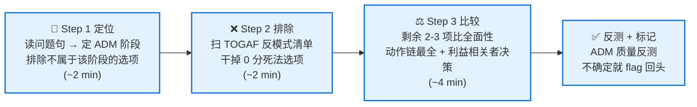

<!--module:
  parent: system-design
  slug: system-design/togaf/scenario-exam-method
  type: article
  category: 主模块子文章
  summary: OGEA-102（TOGAF 10 Practitioner）情景题答题方法：梯度评分数学 + 第一铁律「答问题不答场景」+ 三步答题法（定阶段→排反模式→比全面性）+ 阶段定位速查表 + 开卷与时间策略；基于官方 Exam Plan、Study Guide 联合作者 Dave Hornford 解题法与 2026 年通过者实战复盘。
  depth: ⭐⭐⭐⭐
  status: active
-->

# 第五章：TOGAF 10 情景题答题方法（OGEA-102）

> ⬅️ [返回 TOGAF 10 总览](README.md)

---

## 🎯 一句话定位

**情景题不是考"你知道什么"，而是考"按 TOGAF 的规定你该做什么"**——四个选项往往都"听起来合理"，你要选出的不是"现实中你会做的"，而是**最 TOGAF、动作链最全、把决策权留给利益相关者**的那一个。本章给出一套三步答题法，每一步都来自官方 Study Guide 编写者的解题法与近期通过者的实战复盘。

> **为什么"背知识点"做不对情景题**：Part 1（Foundation）考记忆，四个选项一错三对；Part 2（Practitioner）考判断，四个选项按质量给 5/3/1/0 分——**没有"错得离谱"的选项，只有"TOGAF 程度"不同的选项**。所以答题方法的核心不是回忆，而是**定位 + 排除 + 比较**。

---

## 一、先懂这场考试：机制与数学

OGEA-102（TOGAF Enterprise Architecture Practitioner，即 Part 2）官方机制：

| 维度 | 事实 |
|------|------|
| 题量 / 时间 | **8 道情景题 / 90 分钟**（ESL 英语非母语可加 30 分钟 → 120 分钟）|
| 题目形态 | 每题 = 一段长场景 + 一个问题句 + 4 个长选项 |
| 评分 | 梯度给分：**最佳 5 / 次佳 3 / 第三 1 / 干扰 0**（不是对错二值）|
| 及格线 | **24/40（60%）** |
| 开卷 | 考试界面内置 TOGAF 标准（REFERENCE 按钮），仅电子版，不能带自己的笔记 |
| 与 Part 1 连考 | OGEA-103 合并卷共 150 分钟，Part 1 交卷后**不能回头** |

**这场考试最重要的一条数学**：

```text
8 题全部选到"次佳（3 分）" = 24 分 = 恰好及格
8 题全部选到"最佳（5 分）" = 40 分
踩 1 次 0 分干扰项        = 直接吃掉一题的全部容错
```

由此推出三条策略（贯穿全章）：

1. **目标不是"每题选对"，而是"每题 ≥ 3 分 + 绝不踩 0 分"**——排除法的价值大于精确命中；
2. 在两个合理选项之间纠结 5 分钟是亏的：选到 3 分照样及格，**踩 0 分才致命**；
3. 开卷救不了现学：11 分钟里读完场景 + 四个长选项已用掉大半，REFERENCE 只用于**确认**（某产出物属于哪个阶段），不是用来学习新知识。

---

## 二、第一铁律：答问题，不答场景

这是官方《TOGAF Practitioner Study Guide》联合作者 Dave Hornford 反复强调的第一原则：

> **You need to answer the question, not the scenario.**
> 场景所处的 ADM 阶段 ≠ 问题句所问的阶段——出题人恰恰在这个错位处考你。

**官方示例**（Conexiam 公布的教学题）：

- **场景**：组织正在进行一场重大转型，复杂的项目组合已规划完毕，市场变化动摇了转型计划，**首批项目已在实施中**、关键项目处于临界点。（场景明显停在**阶段 G**：有实施计划、项目在飞）
- **问题句**：高层领导希望**了解他们的选项**（understand their options）。按 TOGAF 标准，你该怎么做？

四个选项与推理：

| 选项 | 内容 | 判定 |
|:---:|------|------|
| 1 | 确保每个项目履行架构合同承诺，让转型价值按计划交付 | 纯阶段 G 动作——**回答的是场景，不是问题** |
| 2 | **发起一个架构项目，重新审视项目组合路线图** | 经典阶段 A 启动动作——**5 分** |
| 3 | 与组合负责人、项目经理协作，加速在飞工作 | "加速"不是 ADM 动作（想快应是阶段 E 的路线图备选方案）——0 分 |
| 4 | 评估初始路线图中关键利益相关者的期望 | 阶段 A 内部动作但偏窄——次佳 |

**推理主线**：问题句问的是"了解选项" = 需要**新的架构工作**（阶段 A：发起架构项目），而场景停在 G。一旦确认问题句落在 A，选项 1、3 无论多"合理"都立即出局——**它们不属于问题所问的阶段**。

> ⚠️ 这就是为什么"读场景找答案"会失败：场景里全是 G 阶段的细节，按场景选，你会选 1（0 分或 1 分）。**先读问题句、用它定阶段，场景只提供约束。**

---

## 三、三步答题法（每题 ≈ 11 分钟预算）



**做题顺序**（与直觉相反，但是通过者的共识）：

```text
① 先读问题句（不看场景）→ ② 通读 4 个选项 → ③ 执行三步法
→ ④ 带着"需要确认什么"回头扫场景 → ⑤ 必要时开卷核实 → ⑥ 作答/flag
```

**为什么先读题再读场景**：场景又长又充满干扰细节（公司历史、行业背景多为填充物）。先知道问题问什么，读场景时才能只抓关键信息，过滤噪音。

### Step 1：定位——用问题句锁定 ADM 阶段（~2 分钟）

1. 只看问题句，判断它问的动作属于哪个 ADM 阶段（用 §四速查表）；
2. **排除一切"主体动作不属于该阶段"的选项**——不管它看起来多合理；
3. 若两个选项指向不同阶段，先怀疑自己：回到问题句找阶段动词（"发起/审视选项" = A，"排定迁移" = F，"监控实施" = G）。

> **开考前把 ADM 图默画在草稿纸上**（考场提供纸笔）：定位阶段时对着图走一遍，比在脑中回忆快得多。

### Step 2：排除——TOGAF 反模式清单（~2 分钟）

剩下的选项里，命中以下任一**反模式**的，几乎必为 0 分或 1 分。这份清单是 TOGAF 的"价值观"，出题人用它制造干扰项：

| # | 反模式 | 典型措辞 | TOGAF 的立场 |
|:-:|--------|---------|-------------|
| 1 | **架构师替利益相关者做决定** | "根据你的理解选择方案""选定后向利益相关者解释/推销" | ✅ 架构师**摆选项、促进决策**；决定权在利益相关者 |
| 2 | **直接跳进技术设计** | "立即开始技术架构设计""直接扩展现有 X" | ✅ 先识别利益相关者与关注点，再进设计 |
| 3 | **选项里含具体技术决策** | "你决定在基础设施层解决""你决定采用软件 X" | ✅ Part 2 考**流程**（ADM），技术选型交给利益相关者与后续阶段 |
| 4 | **架构师直接管控实施团队** | "管理/指挥实施团队确保合规" | ✅ 由利益相关者（项目治理）指挥实施；架构师做**合规性评估**与偏差处置 |
| 5 | **过早 PoC / 试点** | "先做个概念验证""阶段 A 就启动试点项目" | ✅ PoC 在 TOGAF 里极少是正确答案，尤其早期阶段 |
| 6 | **跳步 / 阶段顺序颠倒** | "B、C、D 三阶段同时开展""无愿景先做基线技术架构" | ✅ ADM 对活动顺序非常讲究；顺序错 = 大概率错 |
| 7 | **供应商优先于利益相关者** | "先咨询供应商方案""从现有供应商产品中选" | ✅ 先与利益相关者工作；供应商是阶段 E 方案分类时的事 |
| 8 | **关键关注点后置** | "风险管理放到最后一步""先上线再补安全评估" | ✅ 风险与关注点**贯穿全程**，用 BTRA / 风险管理技术处理 |
| 9 | **推翻已拍板的决策** | 高管/委员会已明确决定后，选项要重议、重做、绕开 | ✅ 已批准的决策**跟随执行**；要变更走阶段 H 变更管理流程 |

**两个精细提醒**：

- 反模式清单必须**对照本场景的进度信息**使用：同一措辞（如"先定义基线技术架构"）在"尚无愿景"的场景里是 0 分，在"变更请求已获批"的场景里可能得 3 分——**不存在跨题通用的死记黑名单**；
- "用 MoU 替代第三方合同"这类措辞**不是**独立的 0 分判据（官方样题中它拿过 3 分）——判 0 分靠的是反模式 + 阶段错位，不是关键词。

### Step 3：比较——在剩余 2-3 项中选"最 TOGAF"的（~4 分钟）

排除后通常剩 2-3 个选项。按以下**判别力从高到低**的规则比较：

| 规则 | 说明 | 示例 |
|------|------|------|
| **① 全面性优先** | "考虑 P、Q、R 再做 X" > "做 X"——覆盖利益相关者关注点越全越好 | ✅ "开发架构愿景，涵盖成本、合规与上市时间三类关注点" ❌ "开发架构愿景" |
| **② 动作链完整且有序** | 5 分选项几乎总是 4 步以上、顺序符合 ADM 逻辑、含官方产出物名的链条 | "识别变更参数 → 定义需求/驱动因素/约束 → 评估准备度 → 提交委员会" |
| **③ 利益相关者结构化参与** | 场景出现"担忧/冲突/抵触"时，正确答案**必含**利益相关者分析/地图/共同决策/正式审查 | 且永远是"架构师**促进**决策"，不是"架构师决定后说服" |
| **④ 业务价值 > 技术卓越** | 强调业务价值、长期价值的选项 > 强调技术先进性、短期见效的选项 | "过渡架构 + 能力增量逐步交付" > "一次性彻底改造" |
| **⑤ 增量关键词** | 出现"过渡架构 / 能力增量 / 渐进 / 候选架构"且不与场景硬约束冲突 → 强 5 分信号 | "大爆炸式切换"是经典 0 分信号 |
| **⑥ 产出物动词** | "记录在案 / 发布到存储库 / 文档化 / 更新架构需求规格"——TOGAF 治理强调受控制品 | 无产出物落点的"口头协调"类选项偏弱 |

**3 分 vs 5 分的本质差异**：3 分选项 = **方向对但缺一环**——常见缺的是"最后一环"（利益相关者确认 / 正式治理闭环）或"第一环"（评估标准 / 利益相关者分析 / 实施因素识别）。逐项对比两条动作链，**找缺的那一环**，就找到了 5 分。

### 反测：ADM 质量反测（Hornford 的自检法）

排除结束后，检查剩余选项的"质量分布"：

- 剩下的选项**一个明显强、一个明显弱** → 你的阶段定位大概率**正确**，选强的；
- 剩下**两个同样强** → 回头怀疑阶段定位：这两个选项分别属于哪个阶段？哪个阶段能讲出"最佳 → 次佳 → 第三"的完整故事？（Hornford 原话：能为你的阶段定位构建 5/3/1 叙事的，才是对的阶段。）

---

## 四、阶段定位速查表（Step 1 的弹药）

问题句的动词/诉求 → ADM 阶段 → 该阶段标志性动作与产出物。**这张表是开卷前唯一需要背熟的东西**：

| 问题句信号 | 阶段 | 标志性动作 / 产出物 |
|-----------|:---:|-------------------|
| "启动/发起架构工作""了解选项""高层想要方向" | **A** | Request for Architecture Work、定义**变更参数**、识别利益相关者与关注点、**利益相关者地图**、架构愿景、架构工作说明书 |
| "业务要变成什么样""客户体验差""价值主张不清" | **B** | 业务能力 / **价值流映射** / 客户细分 / 组织地图、目标业务架构、差距分析 |
| "系统怎么切""数据放哪""信息流成本高" | **C** | 逻辑应用组件 + 逻辑数据组件、**信息流**分析、数据驻留/监管要求、一次性成本 vs 持续成本 |
| "跑在什么上""容量够不够""韧性/安全性保障" | **D** | 技术架构、平台容量评估、**非功能性需求**（性能/可用/安全） |
| "怎么拆成项目""方案怎么选""改动太激进被质疑" | **E** | 差距-方案-依赖矩阵、方案分类（新开发/采购/复用）、**工作包 → 能力增量 → 过渡架构**、架构路线图草案、**BTRA**、权衡法 |
| "迁移计划下一步""增量交付价值""排序投资组合" | **F** | **业务价值评估技术**（ROI）、实施与迁移计划定稿、**架构定义增量表**、过渡架构状态演变表、三方（业务规划/组合管理/运营管理）共同参与 |
| "实施是否合规""第三方合同""偏差怎么处理" | **G** | **架构合同**（第三方须法律强制）、**合规性评估**、ARS 发布到存储库、架构委员会处置偏差、变更请求 |
| "架构要不要改""业务连续性/安全事件""试验转生产" | **H** | 差距分析 → 变更请求 → 委员会批准 → **新的 Request for Architecture Work**（ADM 闭环再启动）、需求影响评估 |
| "需求变了怎么办"（贯穿） | **RM** | 需求管理居 ADM 圆心，任何阶段都可触发；需求变更走影响评估 + 委员会 |

> 阶段职责详解见[第一章 ADM](adm.md)；产出物归属拿不准时，开卷查"该阶段的 Inputs/Outputs"是最快的确认方式（见 §六）。

---

## 五、场景怎么读：只抓四类信息

带着 Step 1-2 的结果回头扫场景时，**跳过填充物**（"你是一名企业架构师…""组织使用 TOGAF…""你的 EA 发起人是 CIO…"及公司行业历史——这些几乎从不影响答案），只抓四类：

| 信息类型 | 找什么 | 用途 |
|---------|-------|------|
| **① 进度定位句** | "架构愿景已批准""大纲已批准""项目已在实施中""尚无共享愿景" | 排除"重做已完成工作"或"跳过未完成前提"的选项 |
| **② 已拍板的决策** | "董事会决定整合应用到中心""CIO 批准部署 COTS" | **不推翻**——推翻已批决策的选项直接出局 |
| **③ 利益相关者关注点** | "担忧成本""质疑太激进""合伙人不满""抵触变革" | 正确答案必须**覆盖全部关注点**（全面性规则①的输入） |
| **④ 新发生的事件** | 并购、网络攻击、市场剧变、监管新规 | 这类事件通常就是考题的触发器，对应阶段 H 变更管理或新一轮阶段 A |

**用 scratchpad（草稿板）记笔记**：每读到一个关键信息就记一行（"进度：愿景已批 / 关注点：成本+合规 / 决策：CIO 批 COTS"），比较选项时对照覆盖率，避免回头重读场景。

---

## 六、开卷 REFERENCE 的正确用法

开卷是**确认工具**，不是学习工具。每题查卷超过 2 次 = 阶段归属知识不牢，考试时必然超时。

**该查的四种情况**：

1. 选项里出现**不认识的产出物/术语** → Ctrl+F 搜术语名，确认它属于哪个阶段；
2. 两个选项**指向不同阶段** → 查该活动的阶段归属（看阶段的 Inputs/Outputs 与步骤描述）；
3. 不确定某产出物是否是某阶段的**正式输出** → 查 Practitioner 指南的"Essential ADM Outputs"表；
4. 确认产出物、阶段、利益相关者之间的**关系**。

**不该查的**：完整读某章"现学"、逐字核对四个选项措辞、查你已经确定的事实。

**搜索技巧**：用 Ctrl+F 搜精确术语（"Architecture Vision""Architecture Requirements Specification""Phase F"），不要靠目录层层点进——考前应先把开卷 PDF 的结构过一遍，知道"ADM 各阶段步骤"和"产出物清单"在哪。

---

## 七、时间与考场操作

| 时点 | 动作 |
|------|------|
| 开考前 | 草稿纸**默画 ADM 图**（阶段 A-H + 中心需求管理） |
| 每题第 1-4 分钟 | 先只读问题句 + 4 选项，执行三步法，**先锁一个"至少 3 分"的答案**（保底：即使后面没时间深读场景，也有分） |
| 每题第 5-9 分钟 | 带问题回扫场景四类信息，必要时开卷确认，修正答案 |
| 不确定时 | **flag（标记）后继续**，不要卡死——后面的题会触发记忆联想（TOGAF 知识互锁，别的题会给你提示） |
| 最后 15-20 分钟 | 回看 flag 题：对照 scratchpad 笔记重走三步法；**不要反复改答案**——TOGAF 答案都很"字面"，按流程排除的结论比临时直觉可靠，过度用现实经验脑补反而会改错 |

---

## 八、备考路径（怎么练这套方法）

1. **背熟 §四阶段定位速查表**——Step 1 定位是整个方法的地基，定位错则全题错；
2. **按 11 分钟/题计时练**：难度不在知识在时钟，不限时的正确率没有参考价值；
3. **答对了也要看解析**：梯度评分下"对"有程度——确认自己拿的是 5 分还是 3 分；拿 3 分说明 Step 3 的"缺环比较"还没形成肌肉记忆；
4. **错题归因到步骤**：是 Step 1 阶段定错？Step 2 反模式没扫出来？还是 Step 3 全面性比错了？连续多题同一步骤出错，回对应章节补原理（阶段职责 → [第一章](adm.md)；治理与合同 → [第四章](architecture-governance.md)）；
5. **练习开卷模拟**：允许自己查 TOGAF 标准但记录"查了几次、每次多久"——超过 2 次/题说明该背的没背；
6. **心态校准**：你在答"TOGAF 会怎么做"，不是"你们公司会怎么做"——实际经验会误导你（现实中架构师常常直接拍板，TOGAF 世界里这是 0 分反模式 #1）；
7. **考前一天只看三样**：§三反模式清单 + §四阶段定位速查表 + §五场景四类信息。

---

## 九、章节思考

1. 官方示例题（§二）里，如果你只看场景不看问题句，你会选哪个选项？它值几分？
2. 反模式 #1（架构师替利益相关者做决定）和 #3（选项含技术决策）有什么共同根源？（提示：TOGAF 里架构师的职责边界。）
3. "全面性优先"规则会不会导致"最长选项必对"的误解？两者的区别是什么？（提示：全面 = 覆盖场景中的**关注点**，不是字数多。）
4. 场景说"架构愿景已批准"，某选项说"重新识别利益相关者并制定愿景"——它一定是 0 分吗？（提示：先看**问题句**问的是哪个阶段。）

---

## 相关章节

- ⬅️ [返回 TOGAF 10 总览](README.md)
- ⬅️ [第一章：核心思想 + ADM 详解](adm.md) — Step 1 定阶段的知识底座：9 阶段职责与输入输出
- ⬅️ [第二章：BCAT + 业务能力 + 价值流](business-capability.md) — 阶段 B 类考题（价值流映射/客户细分）的原理层
- ⬅️ [第三章：康威定律 + 团队拓扑](conway-and-team-topology.md) — 利益相关者类考题的组织视角背景
- ⬅️ [第四章：架构治理 + 落地实践](architecture-governance.md) — 阶段 G 合同/合规/委员会类考点的原理层

## 📚 参考来源

- [The Open Group 官方：OGEA-102 Exam Plan](https://help.opengroup.org/hc/en-us/articles/32158246401042-What-Is-the-Exam-Plan-for-the-OGEA-102-TOGAF-Enterprise-Architecture-Part-2-Exam) — 考试结构、梯度评分、开卷机制、考纲范围（一手来源）
- [Conexiam：How to Pass the TOGAF EA Certification Exams](https://conexiam.com/how-to-pass-the-togaf-certification-test/) — 《TOGAF Practitioner Study Guide》联合作者 Dave Hornford 的官方解题法："答问题不答场景" + ADM 阶段排除法 + ADM 质量反测 + §二官方示例题（一手来源）
- [Shing Lyu：TOGAF Practitioner exam tips（2026-01）](https://shinglyu.com/enterprise-architecture/2026/01/21/togaf-practitioner-exam-tips.html) — 近期通过者实战复盘：先读问题、反模式清单、全面性优先、场景四类信息、scratchpad 与开卷策略（一手通过经验）
- [Good e-Learning：Top Ten Tips for TOGAF Certification](https://goodelearning.com/passing-exam-top-ten-tips-togaf-certification/) — Roger Everinden：节奏控制（11 分钟/题）、ESL 加时、默画 ADM 图、flag 回看、"According to TOGAF" 心态（培训机构专家经验）

← [返回 TOGAF 10 总览](README.md)
