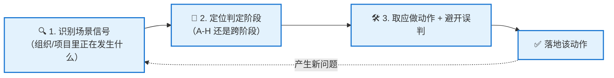

<!--module:
  parent: system-design
  slug: system-design/togaf/scenario-judgment
  type: article
  category: 主模块子文章
  summary: TOGAF 情景判据表：按场景信号定位 ADM 阶段、选定应做动作、避开常见误判；覆盖阶段 A-H 与跨阶段共 31 条判据。
  depth: ⭐⭐⭐⭐
  status: active
-->

# 第五章：情景判据表（ADM 阶段选择 + 常见误判）

> ⬅️ [返回 TOGAF 10 总览](README.md)

---

## 🎯 一句话定位

**判据表 = 把"我遇到一个架构难题"翻译成"我现在该停在 ADM 的哪一步、该做哪个动作、别踩哪个坑"**——已有的四篇讲"是什么"与"怎么治"，本章只补最后一层：**给场景 → 定阶段 → 选动作 → 避误判**。

> **注意边界**：本章不重复 ADM 阶段的职责定义（见[第一章](adm.md)），也不重复治理 6 维与 ADR 模板（见[第四章](architecture-governance.md)）。章节职责与交付物只做**引用**，正文主体是"看到什么信号 → 做什么"的判断本身。
>
> **应考请读[第六章](exam-method.md)**：本章判据面向**实践**（我该做什么）；OGEA-102 考试面向**排序**（四个合理选项里选 5 分的那个），做题流水线见第六章。

---

## 一、为什么需要判据层

### 1.1 现有四篇的覆盖边界

| 篇目 | 回答的问题 | 没回答的问题 |
|------|-----------|-------------|
| [README](README.md) | TOGAF 10 是什么、模块化结构、核心概念速查 | 具体某个场景该怎么走 |
| [第一章](adm.md) | ADM 9 阶段各自做什么 | 我这个场景**该进哪个阶段**、进错了会怎样 |
| [第二章](business-capability.md) | 业务能力 / 价值流怎么建模 | 什么时候**必须**建模、什么时候是弯路 |
| [第三章](conway-and-team-topology.md) | 组织结构如何决定系统架构 | 组织分歧算不算架构问题 |
| [第四章](architecture-governance.md) | 怎么治理、按规模怎么裁剪 | 治理动作在 ADM 的**哪一步**落地 |

四篇合起来仍缺一层：**没有"场景 → 阶段"的判定规则**。实践中最常见的失败不是"不知道 TOGAF 有这个阶段"，而是**知道有这个阶段、却不知道此刻该不该进它**。

### 1.2 判据的使用三步

**第一步：认信号。** 场景信号是**组织里可观察的事实**，不是抽象的"需求复杂"。例如"董事会已定新战略方向，但 EA 团队没有共享愿景文档"是信号，"我们需要一个灵活架构"不是信号。

**第二步：定阶段。** 判据表给出的是**判定阶段**，不是"必须从 A 走到 H"。ADM 是迭代方法，可以从任意阶段切入（见[第一章 §3.1](adm.md)）。

**第三步：取动作、避误判。** 动作列给出官方交付物级的具体做法，误判列给出该场景下最典型的错误路径。**误判列比动作列更值钱**——动作可以在别处查到，误判只能靠经验积累。

### 1.3 两条路径：基线优先 vs 目标优先

判据表里大量条目区分了两条起点，判断场景属于哪条路径是**第一个岔路口**：

| 路径 | 起点 | 适合的信号 | 典型风险 |
|------|------|-----------|---------|
| **基线优先**（baseline-first） | 现有架构已成型，先摸清现状 | 存量系统多、变更以局部演进为主 | 被现状绑架，把历史约束当成目标 |
| **目标优先**（target-first） | 目标状态已明确，反推需要什么 | 新业务、新市场、并购整合 | 忽略现状能力，方案不可落地 |

- 判据中"**先做差距分析**"的动作属于基线优先；
- 判据中"**从价值主张出发建模**"的动作属于目标优先；
- 二者在阶段 B 之后合流，共同产出目标架构。

### 1.4 判据表的适用边界

判据表不是流程强制清单，用之前先确认三件事：

| 边界 | 说明 |
|------|------|
| **组织规模** | 判据描述的是**完整 ADM** 下的动作。中小团队按[第四章 §3](architecture-governance.md)裁剪后，条目依然成立，但产出物可以大幅简化（例如"利益相关者地图"可以是一页人名与关注点列表） |
| **裁剪不改变判据逻辑** | 裁剪掉的是**产出物的规模**，不是**判据本身**。阶段选错、误判路径不会因为团队小就不存在 |
| **不覆盖交付执行** | 本文到"该做什么"为止。**怎么做**（模型怎么画、合同怎么签、代码怎么写）属于各章与工程实践，不在判据层 |

> **判据层最容易的误用**：把判据表当成 checklist 逐条打勾，然后声称"TOGAF 阶段已覆盖"。判据用于**定位**，不是用于**证明合规**——合规性评估是阶段 G 的专门产出（见[第四章](architecture-governance.md)）。

---

## 二、判据表总览

| 场景族 | 主要判定阶段 | 判据条数 |
|--------|-------------|--------:|
| 愿景与利益相关者对齐 | A（架构愿景） | 5 |
| 业务能力与价值流重构 | B（业务架构） | 3 |
| 系统与技术架构落地 | C（信息系统架构）/ D（技术架构） | 5 |
| 方案拆解与投资排序 | E（机会与解决方案） | 5 |
| 迁移与增量交付 | F（迁移规划） | 3 |
| 实施合规与供应商治理 | G（实施治理） | 4 |
| 变更与演进 | H（架构变更管理） | 2 |
| 跨阶段：权衡 / 准备度 / 角色 / 外部协作 | A / E / F / G 组合 | 4 |
| **合计** | — | **31** |

> 各场景族的判据条目编号在下文按族顺序连续编排，便于引用与复核。

---

## 三、场景族一：愿景与利益相关者对齐（阶段 A）

| 场景信号 | 判定阶段 | 应做动作 | 常见误判 |
|---------|---------|---------|---------|
| 战略方向已由 CEO / 董事会拍板，但 EA 团队既无共享愿景也无明确需求 | A | 先定义**变更参数**，再识别需求 / 驱动因素 / 问题 / 约束 | 从现有技术架构基线入手，先评估基础设施容量够不够 |
| 多方利益相关者关注点互相冲突（上市时间 vs 客户体验 vs 降本） | A → B | 先确保问题定义明确 → 识别有根本利益的利益相关者与已做出的决定 → 制定架构愿景 → 取得共识后再往下推进 | 把现有 CRM 架构当作方法基线；或只听"离问题最近"的业务人员意见 |
| 存在多个利益相关者偏好 + 多种可行架构 | A | 产生并比较**多个候选架构**，各自针对不同关注点优化；用**过渡架构**管理迁移的不确定性 | 只做一个"标准化最优"方案，把其他关注点当噪声丢掉 |
| 并购后组织重组，双方团队互不了解 | A → B | 识别双方关键利益相关者 → 按职务与影响力分类 → 记入**利益相关者地图**；沟通尽早开始并保持频繁 | 只与新收购方沟通，把原团队当"被通知方" |
| 利益相关者之间存在价值偏好冲突 | A | 用**利益相关者代理**代表客户与业务伙伴；个体内部冲突与该个体协商解决，个体间冲突借上级架构或放松偏好化解 | 凭自己对上级架构的理解，替利益相关者做选择 |

**这一族的一句话**：阶段 A 的产物不是文档，是**共识**。愿景写完但没达成共识，等于没进阶段 A。

---

## 四、场景族二：业务能力与价值流重构（阶段 B）

| 场景信号 | 判定阶段 | 应做动作 | 常见误判 |
|---------|---------|---------|---------|
| 业务架构评审已确认：当前价值流 / 信息流造成不良体验 | B | 按 TOGAF 业务架构技术为**业务能力、价值流、组织地图、信息地图**四类模型建模 → 组成集成业务架构 → 做现状与目标的**差距分析** → 建立架构视图 | 只对现状建模，再"改模型迎合目标"；或从差距直接反推变革动作 |
| 目标客户群体与价值主张需要重新界定 | B | 建模识别客户群体，刻画每群的价值主张 / 成本 / 收入；用**价值流映射**分解活动；调查不同目标业务架构的**替代方案** | 直接扩展现有应用架构去"承接数字化" |
| 变革范围需要界定 | B | 说明变革备选项及**变更成本**，让利益相关者在信息充分的基础上决策；识别需权衡的决策点并共同解决 | 先锁定方案，再补需求文档 |

**这一族的一句话**：阶段 B 回答的是"业务上要变成什么样"，不是"技术上要换什么"。价值流与业务能力的建模方法见[第二章](business-capability.md)。

---

## 五、场景族三：系统与技术架构落地（阶段 C / D）

| 场景信号 | 判定阶段 | 应做动作 | 常见误判 |
|---------|---------|---------|---------|
| 业务架构已定，需要落到系统实现 | C | 建**逻辑应用组件 + 逻辑数据组件**模型；识别**信息流**（数据实体）层面的问题；取利益相关者对应用开发 / 数据结构 / 接口的优先级 | 只建目标架构模型，再倒推差距 |
| 涉及多方数据共享与合规约束 | C | 明确**数据监管**与**数据驻留**要求，并落到逻辑数据组件上 | 忽略驻留要求，等到部署阶段才发现违规 |
| 需要评估架构改动的成本 | C | 区分**一次性成本 vs 持续成本**，并与利益相关者确认"为改善体验付一次性成本是否值得" | 只算持续成本（运维、许可），漏掉一次性改造投入 |
| 目标架构需要健壮性 / 安全性保障 | D | 架构开发必须覆盖**非功能性需求**（性能、可用性、安全、可维护性） | 跳过非功能性需求直接进阶段 E |
| 技术架构需与组织现状衔接 | D | 评估当前基础设施的容量与能力 | — |

**这一族的一句话**：阶段 C 解决"系统怎么切、数据怎么放"，阶段 D 解决"跑在什么上面、扛不扛得住"。非功能性需求不是阶段 E 的加分项，是阶段 D 的准入条件。

---

## 六、场景族四：方案拆解与投资排序（阶段 E）

| 场景信号 | 判定阶段 | 应做动作 | 常见误判 |
|---------|---------|---------|---------|
| 已有目标架构，需拆解为可执行项 | E | 建**综合差距、解决方案与依赖关系矩阵** → 每个差距配提议方案并分类（**新开发 / 采购 / 基于现有产品**）→ 相似活动归并为**工作包** → 识别包间依赖与时间表约束 → 重分组为**能力增量** → 排入一系列**过渡架构** | 用 CRUD 矩阵归并工作包；只做矩阵不识别依赖与时间表 |
| 需要排定实施优先级 | E → F | 用**业务价值评估技术**估算每个项目 / 增量的业务价值（重点是投资回报与绩效评估标准），据此排序；过渡架构阶段用**架构定义增量表**排定（该表为阶段 F 产出） | 只按成本排序；或先做合规评估再排序 |
| 目标业务架构需要替代方案 | B → E | 目标业务架构 + 价值流映射 → 客户细分 / 价值主张 / 成本收入 → 调查不同**替代方案**；用**权衡法**比较 → 正式利益相关者审查 → 确定资金 | 强行单一方案；只做视图不做权衡 |
| 组织变革被广泛质疑（"太激进""收益不足"） | A → E → F（跨阶段） | 做 **BTRA（业务转换准备度评估）**：识别准备度因素 → 用成熟度模型呈现 → 评估就绪状态 → 评估各因素的风险与改进措施 → 记录到**能力评估**；并评估各转型的业务价值 / 工作量 / 风险 | 只写一份风险登记；或用互操作性分析替代准备度评估 |
| 需要确定交付方式与治理组织方式 | E | 产出**架构路线图** + 实施提案；明确目标架构支撑哪些项目、依赖与协同 | 把工作包当成彼此独立的项目 |

**这一族的一句话**：阶段 E 是"把架构变成项目组合"的地方——**工作包是执行单元，能力增量是价值单元，过渡架构是节奏单元**，三者不能混用。BTRA 是跨阶段技术，不是阶段 E 专属动作。

---

## 七、场景族五：迁移与增量交付（阶段 F）

| 场景信号 | 判定阶段 | 应做动作 | 常见误判 |
|---------|---------|---------|---------|
| 实施与迁移计划大纲已批准，需要细化 | F | **业务规划 + 项目组合管理 + 运营管理**三方与 EA 团队共同参与 → 详估资源 → 规划过渡架构并纳入利益相关者优先事项 → 计划定稿 → 交付物完成则 ADM 周期闭环 | EA 团队独自完成迁移规划 |
| 需要增量交付可衡量的业务价值 | F | 识别变更间的依赖 → 归并为弥合差距的**工作包** → 评估价值 / 工作量 / 风险 → 确立一系列过渡架构以增量交付 → 在**架构路线图**中文档化记录 | 修订全部现有项目范围去对齐新架构 |
| 需要列出过渡架构的演进过程 | F | 用**过渡架构状态演变表**呈现各阶段过渡架构的状态演变 | — |

**这一族的一句话**：阶段 F 的关键约束是**增量交付**——每一轮迁移都要能说出"这一波交付了什么可衡量的业务价值"。迁移不是一次性切换。

---

## 八、场景族六：实施合规与供应商治理（阶段 G）

| 场景信号 | 判定阶段 | 应做动作 | 常见误判 |
|---------|---------|---------|---------|
| 第三方供应商参与开发 | G | **架构合同**须覆盖项目目标、有效性指标、验收标准与风险管理；第三方合同须具**法律强制性**；在关键节点安排**合规性评估**；架构委员会审查合同偏差并决定是否授予许可 | 用谅解备忘录（MoU）替代法律合同 |
| 过渡架构已批准，实施小组即将开工 | G | 把架构（含每个项目的**架构需求规格 ARS**）发布到**存储库 / EA 资源库** → 定期跟进实施团队进度 → 确保实施符合 ARS 规定的实施指南 / 实施规格 / 互操作性需求 | 为每个团队重写一份架构需求规格与一致性测试 |
| 需要监控实施是否符合架构 | G | 做**合规性评估**并按合同监控绩效；未达绩效目标时走变更流程 | 只做一次性检查 |
| 实施团队要求超出架构合同范围 | G | 走**变更请求**流程，由架构委员会决策 | 实施团队自行扩展范围 |

**这一族的一句话**：阶段 G 的产物是**合规性评估**与**变更请求**——治理不是"审一次"，是"持续度量 + 按流程纠偏"。治理机制与委员会设计见[第四章](architecture-governance.md)。

---

## 九、场景族七：变更与演进（阶段 H）

| 场景信号 | 判定阶段 | 应做动作 | 常见误判 |
|---------|---------|---------|---------|
| 出现需立即处理的架构变更（安全事件 / 业务连续性风险） | H | 确定业务连续性要求 → 对当前架构做**差距分析** → 提出变更要求建议 → 创建**变更请求** → 架构委员会评估批准 → 批准后产出新的 **Request for Architecture Work** 启动 ADM 周期 | 把变更管理收敛在基础设施层 |
| 试验性架构要转为生产 | H | 评估扩展到企业架构的影响 → 做**需求影响评估** → 提交**架构委员会**决策 | 另起独立项目绕开现有路线图 |

**这一族的一句话**：阶段 H 不是"修补"，是**重新发起点**——变更批准后产出新的 Request for Architecture Work，ADM 周期才真正闭环。

---

## 十、跨阶段判据：权衡、准备度、角色与外部协作

| 场景信号 | 判定阶段 | 应做动作 | 常见误判 |
|---------|---------|---------|---------|
| 架构师角色要从"实施执行者"转向"治理者" | E / F / G 跨阶段 | 把**差距、工作包、架构需求规格、控制记录在案** → 把精力集中到制定目标架构 → 汇集利益相关者资源管理变革 | 继续直接下沉参与每个实施项目 |
| 变革被质疑且工作量大 | A / E / F 跨阶段 | 逐年规划之前先取得利益相关者指导（偏好 / 优先级 / 价值衡量标准），避免被历史路径绑定 | 沿用去年的方法与节奏 |
| 需与外部供应商协作的数据共享场景 | A / D / G 跨阶段 | 按《在 TOGAF 企业架构中集成风险与安全》系列指南的做法，在同一安全政策下管理处于同等保护级别的资产；与合作伙伴建立协作安排（合同 + 交换数据的责任区域与安全影响定义）→ 做风险评估 | 只关注数据质量与数据集分类；只建信任框架而不定义合同与责任边界 |
| 需对多个备选方案做取舍 | A / E 跨阶段 | **权衡法**：按关注点 / 所需变更 / 成本 / 收益逐项权衡，并与利益相关者共同选择 | 由架构师单方裁定 |

**这一族的一句话**：跨阶段问题（取舍、准备度、角色、外部协作）**不能靠单阶段解决**，强行塞进某一个阶段是这类场景最常见的失败原因。

---

## 十一、术语边界：哪些是官方用法，哪些不是

判据表最容易引入事实错误的不是逻辑，而是**术语**。以下几条是硬边界。

### 11.1 官方 8 项 ADM 技术

TOGAF 核心内容中的 ADM 技术共 8 项：

| # | 技术 | 本文判据中的对应场景 |
|:-:|------|-------------------|
| 1 | 架构原则（Architecture Principles） | 预备阶段产物，贯穿全部阶段 |
| 2 | 业务场景（Business Scenarios） | 阶段 A 开场方法 |
| 3 | 差距分析（Gap Analysis） | 阶段 B、E、H 均出现 |
| 4 | 互操作性分析（Interoperability Analysis） | 阶段 C / D |
| 5 | 基于能力的规划（Capability-Based Planning） | 阶段 E |
| 6 | 迁移规划技术（Migration Planning Techniques） | 阶段 F |
| 7 | 业务转换准备度评估（BTRA） | 跨阶段 A → E → F |
| 8 | 风险管理（Risk Management） | 跨阶段 |

> **官方清单里没有安全专属技术**。安全相关内容属于《在 TOGAF 企业架构中集成风险与安全》系列指南的范围，与 **SABSA** 同属该系列的方法血统。

### 11.2 ARS 与 ADR：两回事

| 缩写 | 全称 | 归属 | 用途 |
|------|------|------|------|
| **ARS** | Architecture Requirements Specification | **TOGAF 交付物** | 含量化验收标准、约束与合规判据，随架构发布到存储库 |
| **ADR** | Architecture Decision Record | **工程实践（Nygard）** | 轻量记录单个架构决策的理由 |

- 阶段 G 随架构发布的是 **ARS**，不是 ADR；
- [第四章](architecture-governance.md)讲的 ADR 模板属于**轻量工程实践**，与 TOGAF 的 ARS 是不同文档，**不可混称**；
- 在架构合同语境下，二者可以配合：**ADR 记录"为什么这么定"，ARS 规定"做成什么样算合格"**。

### 11.3 常见被误当作官方技术名的说法

| 说法 | 事实 | 正确写法 |
|------|------|---------|
| "实施因素目录（Implementation Factor Catalog）" | **不是** TOGAF 10 官方 ADM 技术名 | 阶段 E 的官方产出是**架构路线图 + 实施提案**；最接近"实施相关因素"的官方构造是架构路线图与实施迁移计划 |
| "安全域模型（Security Domain Model）""安全联合体（Security Consortium）" | **不是**核心内容 8 项 ADM 技术之一 | 写作"按集成风险与安全的系列指南做法"，并说明官方 8 项技术清单不含安全专属技术 |

### 11.4 阶段产出归属速查（避免阶段归属写错）

| 交付物 | 归属阶段 |
|-------|---------|
| 利益相关者地图（Stakeholder Map） | A / B |
| 架构路线图（Architecture Roadmap） | E 产出，F 定稿 v1.0 |
| 实施与迁移计划（Implementation & Migration Plan） | E 草案 → F 定稿 v1.0 |
| 能力增量（Capability Increment） | E（工作包重分组结果） |
| 能力评估（Capability Assessment） | E（更新） |
| **架构定义增量表**（Architecture Definition Increments Table） | **F** |
| 过渡架构状态演变表（Transition Architecture State Evolution Table） | F |
| 合规性评估（Compliance Assessment） | G |
| 变更请求（Change Request） | G / H |
| 架构合同（Architecture Contract） | E 起草 → F 正式化 → G 监控 → H 修订 |
| 架构委员会（Architecture Board） | 架构变更与偏差的决策机构 |
| Request for Architecture Work | 驱动架构变更的三大逻辑文档之一（另两个：Statement of Architecture Work、Architecture Contract） |

> **BTRA 不是阶段 E 专属**：阶段 A「评估业务转型准备度」→ 阶段 E「确认业务转型的准备度与风险」→ 阶段 F「把改进措施纳入实施与迁移计划」，三个阶段接力完成。**BTRA 也不等于风险登记**——它有专门的核心动作链（识别准备度因素 → 成熟度模型呈现 → 评估就绪状态 → 评估各因素风险与改进措施 → 记入能力评估）。

---

## 十二、判据自检清单

在进入某个阶段前，逐条对照：

- [ ] 我能指出**触发这个阶段的具体组织事实**（而不是抽象需求）吗？
- [ ] 我选这个阶段，是因为它解决**当前的主要矛盾**，还是因为"流程走到这一步了"？
- [ ] 该阶段的**官方产出物**我打算交付什么？（说不出产出物 = 阶段选错了）
- [ ] 该阶段的**常见误判**我是否正在犯？（尤其"先锁定方案再补文档"类误判）
- [ ] 我是在走**基线优先**还是**目标优先**？两条路径的产物不可混用
- [ ] 这个场景是否其实是**跨阶段**问题？我是否硬塞进了单一阶段？

---

## 十三、误判的四个根因

把 31 条判据的"常见误判"列归类，会发现错误远少于想象的种类——它们基本落在四个根因上。识别根因比记住 31 条判据更可迁移。

| 根因 | 表现 | 判据表中的典型对应 | 纠正动作 |
|------|------|----------------|---------|
| **先有方案，后补流程** | 方案已定，才回头补愿景、需求、差距分析 | 阶段 B「先锁定方案再补需求文档」 | 回到阶段 A / B，把备选项与变更成本摆到利益相关者面前 |
| **阶段锚定** | "流程走到 E 了，所以该做 E 的事"，哪怕场景根本不属于 E | 阶段 E「用 CRUD 矩阵归并工作包」 | 用场景信号重新定位阶段，允许从任意阶段切入 |
| **产出物当目标** | 为了"交文档"而建模，模型不驱动决策 | 阶段 B「只对现状建模，再改模型迎合目标」 | 每个产出物都必须回答一个具体决策问题，否则不产 |
| **单方裁定** | 架构师替业务定价值偏好、替供应商接受偏差 | 阶段 A「凭自己对上级架构的理解，替利益相关者做选择」、阶段 G「实施团队自行扩展范围」 | 把选择权交回利益相关者与架构委员会，架构师负责摆选项 |

> 四条根因指向同一个结论：**ADM 的价值不在文档，在"决策被显式化"**。判据表本质上是"该在什么时刻做决策"的清单。

---

## 十四、章节思考

1. **你最近一次"跳阶段"**：跳过的是哪一步？事后补上的代价是什么？
2. **基线优先还是目标优先**：你所在团队默认走哪条？这条默认值带来过什么偏差？
3. **最贵的一条误判**：本文 31 条判据里，哪一条最像你们团队现在的状态？
4. **BTRA 的三段接力**：阶段 A / E / F 三个动作分别由谁负责？跨部门交接点在哪？
5. **交付物倒推法**：如果你说不出"这一步该交付什么官方产出物"，是不是阶段选错了？

---

## 相关章节

- ⬅️ [返回 TOGAF 10 总览](README.md)
- ⬅️ [第一章：核心思想 + ADM 详解](adm.md) — 9 阶段职责定义与迭代节奏
- ⬅️ [第二章：BCAT + 业务能力 + 价值流](business-capability.md) — 阶段 B 的建模方法
- ⬅️ [第三章：康威定律 + 团队拓扑](conway-and-team-topology.md) — 组织分歧如何进入架构判据
- ⬅️ [第四章：架构治理 + 落地实践](architecture-governance.md) — 治理 6 维、架构委员会与裁剪
- ➡️ [第六章：OGEA-102 情景题速答法](exam-method.md) — 本章判据的应试版：五步流水线 + 0 分死法黑名单 + 题族绑定表
- [架构描述语言 ArchiMate 3.2](../archimate/README.md) — 判据落到图上：能力、价值流与视点
- [IT 价值流参考架构 IT4IT 3.0](../it4it/README.md) — 同属 Open Group 标准组合的实施层参照
- [领域驱动设计 DDD](../ddd/README.md) — 阶段 C 的数据架构到限界上下文的映射

## 📖 外部参考

- [The Open Group TOGAF 官方页](https://www.opengroup.org/togaf)
- [TOGAF Standard v10 在线文档](https://pubs.opengroup.org/togaf-standard/)
- [The Open Group 中国](https://www.opengroup.org.cn)
- [The Open Group 标准库（含集成风险与安全系列指南）](https://www.opengroup.org/togaf-library)

← [返回 TOGAF 10 总览](README.md)
