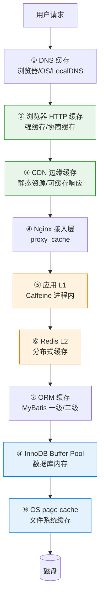
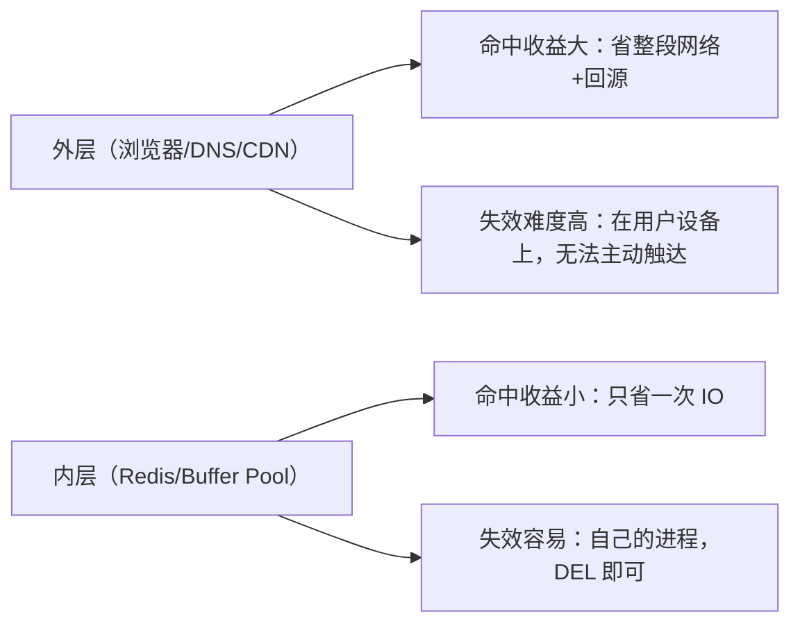
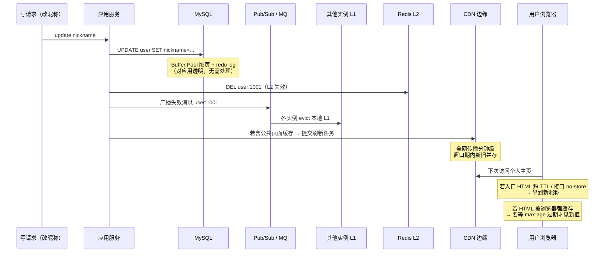

<!--module:
  parent: system-design
  slug: system-design/cache-layers
  type: article
  category: 主模块子文章
  summary: 全链路缓存分层：DNS/浏览器/CDN/接入层/L1/L2/ORM/Buffer Pool/OS page cache 九层缓存的命中语义、失效机制与一致性代价，破「多级缓存=Redis+Caffeine」误区
  depth: ⭐⭐⭐⭐
  tags: [多级缓存, 全链路缓存, CDN, 浏览器缓存, Buffer Pool, page cache, 缓存失效]
  status: active
-->

# 全链路缓存分层架构

> **一句话定位**：多级缓存 = 请求全链路每一跳的缓存分层——Redis + Caffeine 只是其中两层，一个请求到达 Redis 前可能已被 DNS/浏览器/CDN/Nginx 接住。

---

## 目录

- [一、为什么「Redis + 本地缓存」不是多级缓存的全部](#一为什么redis--本地缓存不是多级缓存的全部)
- [二、九层缓存全景](#二九层缓存全景)
- [三、缓存分层的设计权衡](#三缓存分层的设计权衡)
- [四、失效链路实战](#四失效链路实战)
- [五、反模式清单](#五反模式清单)
- [交叉引用](#交叉引用)

---

## 一、为什么「Redis + 本地缓存」不是多级缓存的全部

### 1. 面试常见答法 vs 完整图景

被问「什么是多级缓存」，多数人的答案是：

> 「L1 用 Caffeine 本地缓存，L2 用 Redis 分布式缓存，读时 L1 → L2 → DB，写时双清。」

这个答案**没错，但只覆盖了服务端进程视角的两层**。真实世界里，一个用户请求从发出到落到磁盘，途经的每一跳都可能有缓存：

```text
用户输入 URL
  → DNS 缓存（浏览器内 + OS + 本地 DNS 服务器）        ← 第 1 跳就可能命中
  → 浏览器 HTTP 缓存（强缓存直接不发请求）             ← 命中则后面全部不发生
  → CDN 边缘节点（静态资源/可缓存响应）                 ← 命中则不回源
  → Nginx 接入层（proxy_cache / 限流页缓存）           ← 命中则不到应用
  → 应用进程 L1（Caffeine）                            ← 「多级缓存」通常从这里才开始讲
  → Redis L2
  → ORM 缓存（MyBatis 一级/二级）
  → InnoDB Buffer Pool（数据库自己的内存缓存）
  → OS page cache（操作系统自己的文件缓存）
  → 磁盘                                               ← 真正走到这里的 IO 是少数
```

**认为「Redis + Caffeine 就叫多级缓存」是初学者误区**——它把「应用架构里的两级缓存」错当成了「缓存分层的全部」。完整的心智模型是：**缓存不属于某个组件，而属于链路上的每一跳**。

### 2. 缓存的本质定义适用于每一跳

缓存的通用定义：**用空间换时间，以一致性/新鲜度为代价，把「重新计算/重新获取」的成本摊薄**。这个定义在每一跳都成立，只是代价形态不同：

| 跳 | 空间放在谁那里 | 一致性代价的形态 |
|----|---------------|-----------------|
| DNS 缓存 | 用户设备 + 运营商 DNS | TTL 内域名切换不生效（故障迁移变慢） |
| 浏览器缓存 | 用户设备 | 发布了新版本用户看不到（需要版本化 URL） |
| CDN | 边缘节点 | 源站更新后全网刷新有分钟级延迟 |
| Nginx | 接入层机器 | 与 CDN 同理，但可控性更强 |
| L1/L2 | 应用服务器 | 双清顺序、广播失效、主从延迟 |
| Buffer Pool / page cache | DB / OS | 刷盘时机（redo log、脏页异步刷） |

**关键推论**：越靠外的层，缓存离用户越近、命中收益越大，但你**越难主动触达它做失效**——这是第三节全部权衡的来源。

> Spring 视角的 L1+L2 落地实现（CompositeCacheManager、Caffeine+Redis 代码、三大防护）见 [多级缓存与防护（Spring 落地）](../../../04.spring-backend/04-data/cache/multi-level.md)——本文写全链路架构总览与每层原理，那篇写进程内两层的工程实现，分工不重复。

---

## 二、九层缓存全景



> 绿色 = 用户侧/边缘（无法主动失效，靠 TTL + URL 版本化）；橙色 = 应用可控（可主动删）；蓝色 = 存储引擎/OS 自动管理（对应用透明）。

### ① DNS 缓存

| 维度 | 说明 |
|------|------|
| **缓存什么** | 域名 → IP 的解析结果（A/AAAA/CNAME 记录） |
| **命中语义** | 命中则**跳过整个解析链路**（根 → 顶级 → 权威的递归查询），直接拿到 IP 发起连接 |
| **失效机制** | 记录 TTL 到期；浏览器有自己的短 TTL 上限，OS（如 Windows DNS Client）按记录 TTL；本地 DNS 服务器缓存同样受 TTL 约束 |
| **延迟量级** | 命中：内存查表，微秒级；未命中：递归解析可达几十毫秒~秒级 |
| **一致性代价** | TTL 内换 IP 不生效——蓝绿切换/故障迁移时必须提前把 TTL 调低，否则旧 IP 流量会持续到各级缓存自然过期 |

多级缓存的链路从这一跳就开始了：**解析都没发生，后面所有层都不会被访问**。CDN 的智能调度（GSLB 按用户位置返回最优节点）正是构建在 DNS 这一层之上。

> 解析链路、递归/迭代查询、TTL 设计详见 [DNS 专文](../../../02.cs-foundations/03-network/03-dns/README.md)。

### ② 浏览器 HTTP 缓存

| 维度 | 说明 |
|------|------|
| **缓存什么** | GET 响应体 + 响应头（HTML/JS/CSS/图片/部分 API 响应） |
| **命中语义** | **强缓存**（`Cache-Control: max-age` / `Expires` 未过期）：不发请求，直接读本地缓存（DevTools 显示 from disk/memory cache）；**协商缓存**（过期后带 `If-None-Match`/`If-Modified-Since` 询问服务器）：未变则 304，只回响应头不回体 |
| **失效机制** | max-age 到期 → 转协商；`no-cache`（每次协商）/ `no-store`（禁止缓存）；用户强刷（绕过强缓存）；URL 变化 |
| **延迟量级** | 强缓存命中：0 网络往返；304：1 次往返但无响应体传输；未命中：完整请求 |
| **一致性代价** | **缓存在用户设备上，服务端无法主动触达**——发布新版本后旧 HTML/JS 可能继续被使用。唯一可靠解法是**内容寻址**：文件名带 hash（`app.3f2a1b.js`），内容变则 URL 变，配合入口 HTML 短 TTL |

这一层是**命中率收益最大、也最失控**的一层：命中时连 TCP 连接都不需要建立。

> 强缓存/协商缓存判定流程、Cache-Control 全指令、ETag 生成策略详见 [HTTP 专文](../../../02.cs-foundations/03-network/02-http/README.md) 与 [前端面试题：HTTP 缓存](../../../12.interview/09.front-end/http-cache/README.md)。

### ③ CDN 边缘缓存

| 维度 | 说明 |
|------|------|
| **缓存什么** | 静态资源（图片/JS/CSS/视频切片）为主；配置得当也可缓存公共动态响应（如商品详情页 HTML） |
| **命中语义** | 边缘节点按 Cache Key（通常是 URL + 部分 header/query）查本地缓存；命中直接返回（HIT），未命中回源拉取并按 `Cache-Control`/TTL 缓存（MISS） |
| **失效机制** | TTL 到期自动回源；**主动刷新**（提交 URL/目录刷新任务，全网生效需分钟级）；**预热**（发布前推送到边缘） |
| **延迟量级** | 边缘命中：用户到边缘节点的一次往返（毫秒级）；回源：边缘到源站，可能跨地域（几十毫秒起） |
| **一致性代价** | 刷新是**异步全网传播**，存在窗口期内不同节点新旧版本并存；缓存键配置不当（忽略用户态 Cookie/query）会把 A 用户的响应发给 B 用户——**缓存污染事故**的主要来源 |

> 节点选择（GSLB）、回源策略、缓存键设计、TTL 配置参考表详见兄弟篇 [CDN](../cdn/README.md)。

### ④ Nginx 接入层缓存（proxy_cache）

| 维度 | 说明 |
|------|------|
| **缓存什么** | 上游（应用服务器）的响应，按 `proxy_cache_key`（如 `$scheme$proxy_host$request_uri`）落盘/落内存 |
| **命中语义** | 命中则 Nginx 直接返回，**请求根本不到应用进程**；响应头 `X-Cache-Status: HIT/MISS/EXPIRED` 可观测 |
| **失效机制** | `proxy_cache_valid` 设定的 TTL；`proxy_cache_purge`（商业版/第三方模块）主动清除；缓存目录 LRU 淘汰（`max_size` + `inactive`） |
| **延迟量级** | 命中：接入层本地读，毫秒级以内；未命中：完整转发到应用 |
| **一致性代价** | 与 CDN 同类但可控性更强（自己的机器、可 purge）；典型用途是**热点兜底**——秒杀详情页、限流降级静态页，把洪峰挡在应用之前 |

接入层是「公共可缓存内容」与「应用私有逻辑」的分界线：**能在这层命中的请求，对应用来说等于不存在**。

> Nginx 反向代理、负载均衡与配置实战见 [Nginx 专文](../../../07.devops-and-tools/01-tools/04-nginx/README.md)。

### ⑤⑥ 应用 L1（Caffeine）+ L2（Redis）

| 维度 | L1 进程内 | L2 分布式 |
|------|----------|----------|
| **缓存什么** | 热点对象（反序列化后的 Java 对象，可直接持有引用） | 序列化后的数据（字符串/Hash），多实例共享 |
| **命中语义** | 本地 Map 查找，命中则**零网络 IO** | 一次 Redis 往返（含序列化/反序列化） |
| **失效机制** | TTL / maximumSize（W-TinyLFU 淘汰）/ 手动 evict / **消息广播失效**（Redis Pub/Sub 或 MQ 通知其他实例） | TTL / DEL（Cache-Aside 双清）/ 主动更新 |
| **延迟量级** | 纳秒~微秒级 | 亚毫秒~毫秒级（网络 + 序列化开销） |
| **一致性代价** | **每个实例一份副本**——不广播则各实例 TTL 窗口内数据不一致；广播则有延迟与广播风暴风险 | 主从架构下读写分离有复制延迟；双清顺序不当有脏数据窗口 |

这两层就是通常说的「多级缓存」，也是面试默认口径。要点：L1 解决**热点的重复网络往返**，L2 解决**多实例共享与容量**；L1 必须小而精（容量有限 + 不一致窗口），L2 承担主力。

> Spring 落地实现（CompositeCacheManager、Caffeine+Redis 组合配置、穿透/击穿/雪崩三大防护）见 [多级缓存与防护](../../../04.spring-backend/04-data/cache/multi-level.md)；Redis 本身的数据结构、持久化与单线程模型见 [Redis 专文](../../../03.data-stack/01-database/07-redis/README.md)。

### ⑦ ORM 缓存（MyBatis 一级/二级）

| 维度 | 说明 |
|------|------|
| **缓存什么** | 一级缓存：SqlSession 内的查询结果（PerpetualCache，默认开启）；二级缓存：Mapper 命名空间级、跨 SqlSession（需手动开启） |
| **命中语义** | 相同 Statement ID + 相同参数 + 相同 SQL → 直接返回缓存对象，**不发 SQL** |
| **失效机制** | 一级：session 关闭/提交/执行 update 即清空；二级：命名空间内任何增删改清空整个缓存区，TTL 可配 |
| **延迟量级** | 命中：进程内查找，纳秒~微秒级；未命中：完整 SQL 执行 |
| **一致性代价** | 二级缓存**按命名空间隔离**——跨 namespace 的关联查询会读到脏数据；多实例部署时本地二级缓存互不感知（分布式场景需接 Redis 作为二级缓存实现）；与 Spring 事务整合后生命周期语义有坑 |

ORM 缓存常与 L1 重复（都在进程内），**同时开 Caffeine L1 和 MyBatis 二级缓存通常是无意义的叠加**，一般二选一。

> MyBatis 一级/二级缓存与 Redis/Caffeine 整合的细节见 [二级缓存整合专文](../../../04.spring-backend/04-data/mybatis/03-spring-integration/05-secondary-cache-integration.md)。

### ⑧ InnoDB Buffer Pool

| 维度 | 说明 |
|------|------|
| **缓存什么** | 数据页（16KB 为单位）+ 索引页 + 自适应哈希索引 + Change Buffer；建议占可用内存 70~80% |
| **命中语义** | 读页先查 Buffer Pool，命中则**不产生磁盘 IO**；未命中从磁盘加载页（可能触发预读） |
| **失效机制** | 改进版 LRU（young/old 分区，防全表扫描冲刷热点）淘汰冷页；写操作改的是 Buffer Pool 中的脏页，由后台线程异步刷盘 |
| **延迟量级** | 命中：内存访问，微秒级；未命中：磁盘随机 IO，毫秒级（SSD）~十毫秒级（HDD） |
| **一致性代价** | 对应用**透明**——SQL 层看到的永远是「已提交语义」下的数据；代价体现在崩溃恢复（靠 redo log 重放）与刷盘时机（双 1 配置 vs 性能取舍） |

Buffer Pool 是「数据库自己的多级缓存」：**你以为查库是查磁盘，其实绝大多数时候是查数据库进程的内存**。这也是「Redis 比 MySQL 快」的真正原因之一——不是 MySQL 慢，而是它命中 Buffer Pool 时同样是内存速度，只是多了 SQL 解析与协议开销。

> Buffer Pool 结构、young/old LRU、Change Buffer、redo log 协作详见 [MySQL 专文](../../../03.data-stack/01-database/05-mysql/README.md)（见其 §三 InnoDB 内部机制）。

### ⑨ OS page cache

| 维度 | 说明 |
|------|------|
| **缓存什么** | 文件内容的内存映射（以页为单位）——数据库数据文件、日志文件、普通文件读写都经过它 |
| **命中语义** | `read()` 命中 page cache 则不产生真实磁盘 IO；`write()` 默认先写 page cache（脏页），由内核异步刷盘（writeback） |
| **失效机制** | 内核 LRU 回收（内存压力下）；脏页按 `dirty_ratio`/`dirty_expire_centisecs` 等策略刷盘；`fsync()` 强制落盘 |
| **延迟量级** | 命中：内存拷贝，微秒级；未命中：块设备 IO；`fsync` 强制刷盘：毫秒级（这也是 redo log 每次提交 fsync 成为瓶颈的原因） |
| **一致性代价** | 应用视角「写成功」≠「已落盘」——机器掉电时 page cache 中的脏页丢失，数据库靠 redo log + doublewrite 保证页级持久性；`O_DIRECT` 绕过 page cache 是数据库避免双重缓存的手段（InnoDB 数据文件默认 O_DIRECT，redo log 不用） |

page cache 是**最后一道也是唯一无法关闭的缓存**（除非 O_DIRECT）：即使 Buffer Pool 未命中，读磁盘也可能命中 OS 层——**MySQL 之下还有一层你看不见的缓存**。

> page cache 读写路径、脏页回写、mmap 与 IO 模型详见 [文件系统专文](../../../02.cs-foundations/02-os/filesystem/README.md)（见其 §六 Linux Page Cache）。

### 逐层速查表

| # | 层 | 缓存位置 | 命中延迟量级 | 可主动失效？ | 主要失效手段 |
|---|-----|---------|-------------|:----------:|-------------|
| ① | DNS | 用户设备/运营商 | 微秒（命中） | ❌ | TTL |
| ② | 浏览器 | 用户设备 | 0 往返（强缓存） | ❌ | TTL + URL 版本化 |
| ③ | CDN | 边缘节点 | 毫秒 | ⚠️ 异步 | 刷新接口（分钟级全网）+ TTL |
| ④ | Nginx | 接入层 | 毫秒以内 | ✅ | purge + TTL |
| ⑤ | L1 Caffeine | 应用进程 | 纳秒~微秒 | ✅（需广播） | evict + Pub/Sub + TTL |
| ⑥ | L2 Redis | 缓存集群 | 亚毫秒~毫秒 | ✅ | DEL + TTL |
| ⑦ | ORM | 应用进程 | 纳秒~微秒 | ⚠️ 粗粒度 | namespace 清空 + 事务边界 |
| ⑧ | Buffer Pool | DB 进程 | 微秒 | ❌（透明） | LRU 自动 |
| ⑨ | page cache | OS 内核 | 微秒 | ❌（透明） | 内核 LRU 自动 |

> 延迟量级为通用数量级口径（纳秒 < 微秒 < 毫秒 < 几十毫秒），实际值取决于硬件、数据大小与网络拓扑，**不要背具体 benchmark 数字**。

---

## 三、缓存分层的设计权衡

### 1. 两条随层数变化的曲线



- **命中率逐层递减**：外层命中的请求根本不会到达内层，所以内层看到的是「被外层筛剩下的」更难命中的流量
- **失效难度逐层递增**（从内到外）：内层可以精确 DEL 一个 key；外层只能等 TTL，或用「换 URL」让旧缓存整体作废

**核心策略**：外层用**内容寻址 + 长 TTL**（内容变 → URL 变 → 旧缓存自然死亡），内层用**主动失效 + 短 TTL 兜底**。

### 2. 每层该不该加：决策表

| 数据特征 | 适合的层 | 不适合的层 | 原因 |
|---------|---------|-----------|------|
| 静态资源（JS/CSS/图片） | 浏览器 + CDN + Nginx | L1/L2 | 内容不变，外层长缓存收益最大 |
| 公共动态内容（首页/详情页 HTML） | CDN（短 TTL）+ Nginx | 浏览器强缓存 | 可缓存但需较快感知更新 |
| **用户态动态数据**（个人订单/余额） | L1/L2（进程内+Redis） | **CDN/浏览器/Nginx** | 外层缓存键难区分用户 → **缓存污染事故**（A 的数据发给 B） |
| 热点读、写少的业务对象 | L1 + L2 | ORM 二级缓存 | ORM 缓存粒度粗（namespace 级清空），与 L1 重复 |
| 高频写（计数器/库存） | L2（Redis 原子操作） | L1/外层 | 本地副本与写一致性冲突，必须集中式 |
| 数据库页/文件 | Buffer Pool + page cache（自动） | 无需应用操心 | 存储引擎与 OS 已做好，重复缓存浪费内存 |

**判断口诀**：数据是**静态还是动态**、**公共还是用户态**、**读多还是写多**——三个维度决定它应该停在哪一层。公共 + 静态 + 读多 → 尽量往外推；用户态 + 动态 + 写多 → 收进内层。

### 3. 层数不是越多越好

每加一层的成本：一致性窗口变长（失效要传播更多跳）、排查链路变长（bug 定位要多验证一层）、内存冗余（同一份数据在 L1、ORM、Buffer Pool 各存一份）。**没有命中率监控支撑的加层是盲目的**——先测量每层命中率，再决定哪层值得加（见反模式 #5）。

---

## 四、失效链路实战

### 1. 一条数据变更如何逐层传播

场景：用户在 App 修改昵称，期望「所有地方尽快显示新昵称」。昵称出现在：个人主页 HTML（CDN 缓存过公共部分？）、接口响应（L1/L2 缓存）、数据库。



**分层失效能力总结**：

| 层 | 这次变更中的失效动作 | 生效时间 |
|----|---------------------|---------|
| Buffer Pool / page cache | 无需动作（DB 自己保证读己之写） | 即时 |
| Redis L2 | DEL | 即时 |
| 各实例 L1 | Pub/Sub 广播 evict | 秒级（广播延迟） |
| CDN | 刷新接口 | 分钟级（全网传播） |
| 浏览器 | **无法触达**，只能等 TTL 过期 | 取决于 max-age |

**结论**：整条链路的新鲜度 = **最慢那一层**决定的。想让昵称快速生效，正确做法不是「每层都刷」，而是**一开始就别让这类数据在外层被长缓存**——用户态接口 `Cache-Control: no-store`（或短 max-age + 协商缓存），公共 HTML 入口短 TTL，静态资源才用长 TTL + hash URL。

### 2. 「昵称 10 分钟才生效」的排查顺序

原则：**从外到内逐层验证命中**，找到「哪一层还在吐旧数据」。

```text
1. 浏览器 DevTools → Network 面板
   - 该请求是 (from disk cache) / (from memory cache)？→ 浏览器强缓存问题，查响应的 Cache-Control
   - 状态码 304？→ 协商缓存，服务器认为没变，继续往里查
   - 200 且响应体就是旧数据？→ 不是浏览器层，进入 2

2. CDN 控制台/日志
   - 响应头 X-Cache / Age：HIT 且 Age 很大？→ 边缘节点缓存了旧响应
   - 处理：提交刷新任务；反思：这个 URL 该不该被 CDN 缓存（是否含用户态）

3. Nginx 接入层
   - 响应头 X-Cache-Status: HIT？→ proxy_cache 命中旧数据
   - 处理：purge 对应 cache key；检查 proxy_cache_valid 是否设置过长

4. 应用命中率指标
   - L1（Caffeine recordStats：hitRate/evictionCount）与 L2（Redis INFO keyspace_hits/misses）
   - 请求到了应用但返回旧值 → 查 L1 是否漏广播（多实例中某台还有旧副本 → 表现为「时好时坏」，
     因为负载均衡轮到不同实例）

5. Redis
   - GET 对应 key 直接看值；TTL 还剩多久
   - 旧值还在 → 双清逻辑漏删 / 删了又被并发读回填旧值（缓存一致性经典问题）

6. 数据库
   - SELECT 确认库里已是新值（排除「写根本没成功」）
   - 库里是新的但 Redis 是旧的 → 回到 5 查写路径的失效代码
```

**高频真凶排名**（经验口径）：浏览器/CDN 缓存了用户态响应 > L1 广播失效漏了某实例 > 双清竞态回填旧值 > proxy_cache 配置过激。

> 双清竞态、延迟双删、binlog 订阅失效等一致性方案的完整对比见 [缓存一致性面试题](../../../12.interview/04.system-design/cache-consistency/README.md)。

---

## 五、反模式清单

| # | 反模式 | 症状 | 纠正 |
|---|--------|------|------|
| 1 | **两级缓存心智模型**：认为多级缓存 = Caffeine + Redis，设计时完全忽略外层 | 静态资源全部打到源站；发布后用户长时间看到旧页面；DB 压力莫名其妙高（浏览器/CDN 本可挡掉的请求全进来了） | 按九层全景逐层审视：每类数据「最外能停在哪一层」 |
| 2 | **CDN/Nginx 缓存用户态响应** | A 用户的个人信息出现在 B 用户的页面上（缓存污染），安全事故级 | 用户态接口 `no-store`；确需边缘缓存公共内容时，严格设计 Cache Key（Vary: Cookie 慎用，通常改为「公共部分静态化 + 用户态接口分离」） |
| 3 | **ETag 多实例不稳定** | 负载均衡到不同实例时 ETag 不一致，协商缓存永远 MISS（304 命中率异常低），白白传全量响应体 | ETag 基于内容生成（如内容 hash）而非实例本地状态（inode/时间戳/实例 ID）；或在接入层统一生成 |
| 4 | **L1 失效只靠 TTL 不广播** | 改完数据后「时好时坏」——轮到已失效实例是新值，轮到未失效实例是旧值，直到 TTL 到期 | 短 TTL 兜底 + Redis Pub/Sub / MQ 广播失效；接受广播延迟则明确写进一致性 SLA |
| 5 | **层数堆砌无命中率监控** | 加了 5 层缓存但说不清命中发生在哪层；某层命中率为 0（形同虚设）或某层吃掉全部流量（其他层白加）都无人知晓 | 每层暴露命中指标：浏览器（RUM/前端埋点）、CDN（控制台命中率）、Nginx（X-Cache-Status 日志聚合）、Caffeine（recordStats）、Redis（INFO）；按数据定期裁剪无效层 |
| 6 | **内外层 TTL 倒挂** | 外层（CDN）TTL 比内层（Redis）还长——内层删了数据，外层还在吐旧值，主动失效形同虚设 | TTL 从外到内递减或相等；外层长 TTL 只给内容寻址（hash URL）的静态资源 |

---

## 交叉引用

- **面试题（30 秒话术版）**：[多级缓存分层](../../../12.interview/04.system-design/multi-level-cache-layers/README.md) — 本文的高频面试浓缩版（⏳ 并行落地中，路径为约定位置）
- **缓存一致性**：[缓存一致性](../../../12.interview/04.system-design/cache-consistency/README.md) — 双删/延迟双删/binlog 订阅，内层失效的方案对比
- **缓存模式**：[缓存设计模式](../cache-patterns/README.md) — Cache-Aside / Read-Through / Write-Behind，每一层的读写策略选型
- **CDN 专项**：[CDN](../cdn/README.md) — 第 ③ 层的展开：GSLB 调度、回源、缓存键
- **Spring 落地**：[多级缓存与防护](../../../04.spring-backend/04-data/cache/multi-level.md) — 第 ⑤⑥ 层的工程实现：CompositeCacheManager + 三大防护
- **MySQL 内核**：[MySQL](../../../03.data-stack/01-database/05-mysql/README.md) — 第 ⑧ 层的展开：Buffer Pool / redo log / 刷盘
- **OS 内核**：[文件系统](../../../02.cs-foundations/02-os/filesystem/README.md) — 第 ⑨ 层的展开：page cache / 脏页回写 / O_DIRECT
- **HTTP 缓存**：[HTTP](../../../02.cs-foundations/03-network/02-http/README.md) + [前端面试题](../../../12.interview/09.front-end/http-cache/README.md) — 第 ② 层的展开
- **DNS**：[DNS](../../../02.cs-foundations/03-network/03-dns/README.md) — 第 ① 层的展开

---

← [返回: 高性能设计](../README.md)
