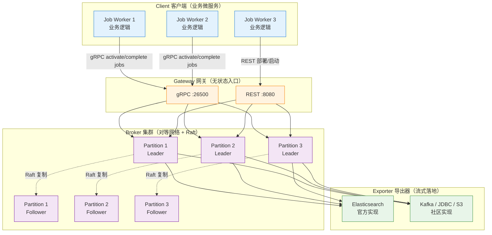

<!--module:
  parent: workflow
  slug: workflow/zeebe
  type: article
  category: 主模块子文章
  summary: Zeebe
  depth: ⭐⭐⭐⭐⭐
  status: active
-->

# Zeebe

> ⬅️ [返回 07 工作流](../../../README.md) | [流程引擎](../../README.md) | [Camunda 8](../README.md) | [微服务编排](../../../../workflow-and-microservice-orchestration/README.md) | [事件驱动](../../../../apache-eventmesh/README.md)

## 🎯 一句话定位

**Zeebe = BPMN 2.0 引擎内核 + 事件驱动架构（EDA）+ Raft 共识 + 水平扩展**——Camunda 8 的分布式流处理引擎底座，单集群 10K+ 流程实例/秒。

---

## 📚 章节导航（6 节 + 实战代码）

| 节 | 内容 | 何时读 |
|:---|:-----|:------|
| **概述** | Zeebe 是什么 / 核心特性 | 第一次了解 |
| **一、核心特性** | 可见性 / 编排 / 容错 / 横向扩容 | 评估是否够用 |
| **二、4 大组件** | Client / Gateway / Broker / Exporter | 理解架构 |
| **三、gRPC 客户端实战** | Java 客户端代码（部署/启动/Worker）| 第一次写代码 |
| **四、集群部署** | K8s + Raft + ES 最小生产配置 | 准备生产部署 |
| **五、真实案例** | 跨境电商 10K+/秒 + Uber/Cadence 对比 | 看生产参考 |

---

## ⚡ 4 大组件速查

| 组件 | 角色 | 一句话定义 | 何时关心 |
|:-----|:-----|:----------|:---------|
| **Client** | 业务侧 | gRPC 库 + Job Worker 拉任务 | 写业务代码 / 多语言集成 |
| **Gateway** | 入口侧 | 无状态 HTTP/gRPC 反向代理 | 负载均衡 / 多网关水平扩展 |
| **Broker** | 引擎侧 | 解析 BPMN + Raft 共识 + 分区存储 | 集群部署 / 性能调优 / 故障恢复 |
| **Exporter** | 数据侧 | 流式落地到 ES / Kafka / JDBC | 历史数据 / Operate UI / 审计 |

**关键记忆点**：

- **Gateway 无状态**——任意水平扩展，客户端可负载均衡到任意一个
- **Broker 才有状态**——Raft 集群 + 追加日志，节点故障自动重新分配
- **Exporter 解耦查询**——状态写入与查询分离，ES 任意规模扩展
- **Job Worker 拉模式**——Worker 主动 `activateJobs`，背压可控

> 📌 完整架构图 + Java 客户端代码见 [§二 4 大组件](#二zeebe-架构)。

---

## 概述

Zeebe 是 Camunda 8 的工作流引擎内核：一个面向微服务编排的开源 BPMN 2.0 引擎。它与传统嵌入式引擎（如 Camunda 7）最大的区别是**把 EDA（事件驱动架构）的思路做进了引擎本身**——流程状态以事件日志形式存储，Worker 以拉模式消费任务，从而天然支持水平扩展与背压。

工程视角的能力清单：

- 用 BPMN 2.0 图形化定义流程，开发与业务共用同一套模型语言
- 无外部数据库依赖：状态直接写入节点本地文件系统，集群内分布式计算
- 单集群可承载 10K+ 流程实例/秒的吞吐
- 可消费来自 Kafka 等消息平台的事件驱动流程
- 通过 Exporter 把流程数据流式导出，用于监控与分析
- Docker / Kubernetes 部署，副本机制容错

## 一、Zeebe 核心特性

核心特性可以分成两组：一组回答"引擎给你什么"，一组回答"引擎怎么扛住规模"。

**引擎给你什么（编排与可观测）**：

- **运行状态可见**：随时能查到运行中的流程实例数量、平均耗时、故障与错误——这是排障和 SLA 监控的基础
- **事件式编排**：引擎按流程当前状态以事件形式发布指令（command），由一个或多个微服务消费执行，保证任务按 BPMN 定义流转
- **超时与错误处理**：任务超时/失败可配置有状态重试，或升级为 incident 交人工处理，流程不会"卡死无人知"

**怎么扛住规模（分布式设计）**：

- **横向扩容**：按分区（partition）扩展，不依赖外部数据库，吞吐随节点数增长
- **容错**：分区多副本 + Raft 共识，节点故障自动选主，数据不丢
- **追加写日志**：所有流程事件写入 append-only log，状态可重放、可审计
- **发布-订阅 + 拉模式**：Worker 按自身处理能力 `activateJobs` 主动拉取任务，自带背压，流量高峰不会压垮下游
- **语言无关客户端**：官方 Java/Go 客户端 + 社区多语言实现，通过 gRPC/OpenAPI 生成器接入任意语言

## 二、Zeebe 架构

### 架构总览图



### 4 大组件详解

#### （一）Client 客户端

Client 是嵌在业务微服务里的库，负责三类操作：

- **发布流程**（deploy workflows）
- **执行业务逻辑**（carry out business logic）：启动流程实例、发布消息、激活/完成/失败作业（job）
- **处理运维问题**（handle operational issues）：更新流程变量、解决 incident

关键设计：**业务逻辑全部在 Client 侧，Broker 不执行任何业务代码**。这意味着客户端可以完全独立于 Zeebe 集群扩缩容——引擎只管流程状态流转，计算压力留在你自己的微服务里。

连接方式上，Client 通过 REST + gRPC 混合协议接入 Gateway：REST 走任意 HTTP 版本，gRPC 部分要求 HTTP/2。官方客户端为 Java 和 Go，社区另有 C#、Ruby、JavaScript 等实现；借助 gRPC 代码生成器和 OpenAPI 规范，几乎任何语言都能接入。

**Job Worker**：最常见的一类 Client——先 `activateJobs` 拉取一批作业，执行完业务逻辑后 complete（成功）或 fail（失败，触发重试）。拉模式让 Worker 按自身处理能力取任务，天然背压。

#### （二）Gateway 网关

Gateway 是集群的统一入口：接收 Client 请求并转发给 Broker 节点。它**无状态、无会话**，因此可以随负载任意加节点，配合负载均衡实现高可用——客户端连哪个 Gateway 都一样。

#### （三）Broker 节点

> 术语说明：Broker 保留英文（部分中文文档译作"代理"，易与 Gateway 混淆，本篇统一称 **Broker 节点**）。

Broker 节点才是真正的工作流引擎：跟踪活动流程实例的状态。Broker 按**分区（partition）**切分实现水平扩展，按**副本（replication）**实现容错，生产部署通常由多个 Broker 节点组成。

Broker 节点内不运行任何业务代码，它的职责只有三件事：

- 处理 Client 发来的命令（command）
- 存储和管理活动流程实例的状态
- 把作业（job）分派给 Job Worker

所有 Broker 构成对等网络（peer-to-peer），集群没有单点：每个节点职责相同，某节点不可用时，其分区由 Raft 副本自动接管，任务透明地重新分配到其余节点。

#### （四）Exporter 导出器

Exporter 把 Broker 内部的状态变化以事件流形式导出，典型用途：

- 监控运行中流程实例的实时状态
- 历史数据供审计、BI 分析
- 跟踪引擎抛出的 incident

它提供简洁的插件式 API，可以把事件流写入任意存储。官方开箱提供 Elasticsearch Exporter（Operate UI 的数据源），社区另有 Kafka、JDBC、S3 等实现——查询侧因此与写入侧解耦，ES 可独立扩容。

---

## 三、gRPC 客户端实战（Java）

### 3.1 部署 + 启动流程

```java
// 1. 创建 Zeebe Client
ZeebeClient client = ZeebeClient.newClientBuilder()
    .gatewayAddress("zeebe-gateway:26500")
    .usePlaintext()  // 生产环境用 TLS
    .build();

// 2. 部署 BPMN 模型（一次）
DeploymentEvent deployment = client.newDeployCommand()
    .addResourceFromClasspath("order-approval.bpmn")
    .send()
    .join();
long processDefinitionKey = deployment.getProcesses().get(0).getProcessDefinitionKey();

// 3. 启动流程实例
ProcessInstanceEvent instance = client.newCreateInstanceCommand()
    .processDefinitionKey(processDefinitionKey)
    .variables(Map.of(
        "orderId", "ORD-20260614-001",
        "amount", 15000.0,
        "customer", "张三"
    ))
    .send()
    .join();
long instanceKey = instance.getProcessInstanceKey();
```

### 3.2 Job Worker 拉模式

```java
// 监听 Service Task "validate-order"，最长处理 60s
client.newWorker()
    .jobType("validate-order")
    .handler((client1, job) -> {
        // 业务逻辑
        Map<String, Object> vars = job.getVariablesAsMap();
        String orderId = (String) vars.get("orderId");
        boolean valid = orderService.validate(orderId);

        // 完成 Job 并回传结果
        client1.newCompleteCommand(job.getKey())
            .variables(Map.of("validationPassed", valid))
            .send();
    })
    .timeout(Duration.ofSeconds(60))
    .open();
```

### 3.3 AI Worker（包装 LLM/Agent）

```java
client.newWorker()
    .jobType("ai-classify-complaint")
    .handler((client1, job) -> {
        Map<String, Object> vars = job.getVariablesAsMap();
        String text = (String) vars.get("complaintText");

        // 调 Dify Workflow 或 LangGraph Agent
        String result = difyClient.runWorkflow("complaint-classify",
            Map.of("text", text));

        Map<String, Object> parsed = parseJson(result);
        client1.newCompleteCommand(job.getKey())
            .variables(Map.of(
                "category", parsed.get("category"),
                "priority", parsed.get("priority")
            ))
            .send();
    })
    .open();
```

> 📌 完整 Zeebe AI Worker 模式见 [BPMN+AI 融合 §模式 B](../../../../../../09.ai-applications/agent/architecture/bpmn-ai-integration.md#22-模式-b自研-zeebe-ai-worker)。

---

## 四、K8s 集群部署（最小生产配置）

### 4.1 部署清单

| 组件 | 副本数 | 资源 | 用途 |
|:-----|:-----|:-----|:-----|
| **Gateway** | 3 | 1C 2G | 无状态入口，水平扩展 |
| **Broker** | 3-5 | 4C 8G + 100G SSD | 状态节点，Raft 集群 |
| **Elasticsearch** | 3 | 8C 16G + 200G SSD | Operate / Tasklist / Optimize 后端 |
| **Operate** | 2 | 2C 4G | 运维面板（流程实例监控）|
| **Tasklist** | 2 | 2C 4G | 人工待办 Web UI |
| **Optimize** | 2 | 2C 4G | 流程分析（可选）|

### 4.2 Helm 快速部署

```bash
# Camunda 8 Self-Managed
helm repo add camunda https://helm.camunda.io
helm install camunda-platform camunda/camunda-platform \
  --set zeebe.clusterSize=3 \
  --set zeebe.partitionCount=3 \
  --set elasticsearch.masterReplicas=3
```

### 4.3 关键调优参数

```yaml
# zeebe-cluster.yaml
zeebe:
  clusterSize: 3
  partitionCount: 3          # 等于 clusterSize 起步
  replicationFactor: 3       # Raft 副本数（生产必须 3）
  logSegmentSize: 512MB
  logIndexDensity: 100
  exporters:
    elasticsearch:
      className: io.camunda.zeebe.exporter.ElasticsearchExporter
      args:
        url: http://elasticsearch:9200
        bulk:
          delay: 5            # 批量延迟 5s（吞吐 ↑ 延迟 ↑）
          size: 1000          # 批量大小
```

**容量规划（参考）**：

- 单 Broker 节点：~2K-3K 实例/秒（取决于流程复杂度）
- 3 Broker 集群：~10K+ 实例/秒（生产验证）
- 100K+/秒：10+ Broker + ES 分片扩展

---

## 五、真实案例

### 案例 1：某东南亚跨境电商订单履约

| 维度 | 数据 |
|------|------|
| **业务** | 6 国跨境电商履约 |
| **规模** | 订单峰值 10K+/秒 |
| **技术栈** | K8s + Camunda 8.5 (Zeebe) + ES + Kafka + 8 个微服务 |
| **流程** | 8.5+ AI Agent Sub-process 解析多语言地址 + 商品类目 |
| **效果** | 单集群 10K+ 并发，吞吐 8 倍于 Camunda 7 上一代 |

**关键设计**：

- 8 个微服务（订单 / 支付 / 履约 / 物流 / 海关 / 库存 / 价格 / 风控）订阅 Zeebe Job
- 失败时 AI Agent 自动重试 3 次 + 人工兜底
- Exporter 数据流入 ES 供 Operate 实时监控 + Optimize 流程挖掘

### 案例 2：与 Uber Cadence / Temporal 对比

| 引擎 | **Zeebe** | **Cadence / Temporal** |
|------|----------|----------------------|
| **使用方** | Camunda / 跨境电商 | **Uber（Cadence）/ 字节 / 阿里（Temporal）** |
| **DSL** | BPMN 2.0（业务可读）| 代码 DSL（开发者友好）|
| **流量** | 10K+ 实例/秒 | **PB 级（Uber 7 年验证）** |
| **学习曲线** | 中（需懂 BPMN）| 中（需理解 async/await）|

**选型口诀**：**业务可读 + 合规** 选 Zeebe；**工程灵活 + 极致吞吐** 选 Temporal。

---

## 🤔 思考

1. **为什么 Zeebe 不用传统关系型 DB？** Raft + 追加日志 + 分区是云原生的最优解——单写入器避免锁竞争，分区支持水平扩展，ES 通过 Exporter 解耦查询。这与 Kafka 的设计哲学一脉相承。
2. **Gateway 是不是单点？** 不是。Gateway 是无状态 + 无会话的，可以任意水平扩展，客户端可负载均衡到任意一个 Gateway；背后所有 Broker 节点都是对等的。
3. **Job Worker 拉模式 vs 推模式？** Zeebe 用**拉模式**（Worker 调用 `activateJobs` 拉任务）——好处是 Worker 背压可控（不超负载），且任何语言都能实现。代价是短轮询延迟。
4. **为什么官方只支持 Java 和 Go 客户端？** gRPC + Protocol Buffers 自动生成 100+ 语言客户端；官方只维护最常用的两个，其余交给社区（参考 [awesome-zeebe](https://github.com/zeebe-io/awesome-zeebe)）。
5. **Zeebe 与 Temporal/Cadence 的关系？** 都是分布式工作流引擎；Zeebe 走 BPMN 2.0 标准路线（业务可读），Temporal/Cadence 走代码 DSL 路线（开发者友好）。详见 [微服务编排](../../../../workflow-and-microservice-orchestration/README.md)。
6. **Zeebe 单 Broker 性能瓶颈在哪？** 主要在**磁盘 IO**（追加日志）+ **Raft 复制延迟**。生产建议：① 用 NVMe SSD ② replicationFactor=3 起步 ③ 监控 `zeebe_log_appender_latency` 指标。

---

## 相关章节

- ⬅️ [返回 07 工作流](../../../README.md)
- [工作流定义](../../../../define/README.md) — BPMN 三要素
- [流程引擎](../../README.md) — Zeebe 在主流引擎中的定位
- [Camunda 8](../README.md) — Zeebe 是 Camunda 8 的内核
- [Camunda 7 实战](../../camunda-7/README.md) — 上一代 Java 嵌入式引擎
- [微服务编排](../../../../workflow-and-microservice-orchestration/README.md) — Zeebe/Temporal/Cadence 三大编排引擎对比
- [事件驱动与 Serverless Workflow](../../../../apache-eventmesh/README.md) — 事件驱动作为工作流的神经系统

---

## 📊 本节统计

| 维度 | 数据 |
|------|------|
| **覆盖节数** | 6 节（特性 / 架构 / gRPC / 部署 / 案例） |
| **核心组件** | 4（Client / Gateway / Broker / Exporter） |
| **典型部署** | Gateway × 3 + Broker × 3-5 + ES × 3 |
| **典型吞吐** | 单集群 10K+ 流程实例/秒 |

← [返回 07 工作流](../../../README.md)
