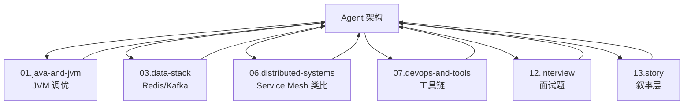

<!--module:
  parent: ai
  slug: ai/agent-architecture
  type: article
  category: 主模块子文章
  summary: Agent 架构全景综述 + 深化索引：DAG vs ReAct vs Plan-and-Execute 选型 + 真实案例 + 面试速查；深化内容拆分为多 Agent 模式 / 通信协议与演进史 / 框架源码对比 3 篇专文。
  depth: ⭐⭐⭐⭐
  status: active
-->

# Agent 架构全景：从单 Agent 到 Agent Mesh

← 返回 [架构设计](../README.md)

> 复杂 Agent 为什么越来越多采用 DAG？ReAct 循环与 DAG Workflow 是两大主流架构 —— 它们是互补关系（探索 vs 执行），而非替代关系。生产环境通常是 DAG + Loop 混合。

---
---

## 一、核心结论（TL;DR）

| 架构 | 模式 | 适用场景 |
|------|------|---------|
| **ReAct 循环** | 思考 → 行动 → 观察 → 循环 | 探索性任务 |
| **DAG Workflow** | 有向无环图，节点 + 边 | 确定性流程 |
| **Plan-and-Execute** | 先规划再执行 | 复杂任务 |
| **Multi-Agent** | 多个 Agent 协作 | 复杂业务 |

> 一句话：**ReAct 用于"探索"，DAG 用于"执行"；生产级 Agent 通常是 DAG + Loop 混合**。

---

## 二、ReAct 循环的本质

ReAct（Reasoning + Acting）是最经典的 Agent 循环模式：

```text
Thought: 我需要先查询订单
Action: getOrder(order_id="20260628")
Observation: 订单状态：已支付

Thought: 订单已支付，我应该给用户返回结果
Action: 返回订单信息给用户
Observation: 完成
```

**代码示例**：

```python
while not task_completed:
    thought = llm.think(context)        # 思考下一步
    action = llm.choose_tool(thought)   # 选择工具
    observation = execute(action)       # 执行工具
    context.add(thought, action, observation)  # 更新上下文
```

**优点**：
- 灵活：Agent 自己决定下一步
- 适合开放性问题
- 实现简单

**缺点**：
- 不可预测：每次执行路径可能不同
- 调试困难：循环路径不固定
- 容易"迷路"：Context 越长越混乱
- Token 消耗大：每次都要重新"思考"

---

## 三、DAG Workflow 的本质

DAG（Directed Acyclic Graph）是把任务拆成节点，用有向无环图组织：

```text
[用户输入]
    ↓
[意图识别] ─→ [订单查询] ─→ [结果格式化] ─→ [返回]
    ↓
[退款申请] ─→ [审核] ─→ [执行退款] ─→ [通知]
```

**代码示例（LangGraph）**：

```python
from langgraph.graph import StateGraph

workflow = StateGraph(State)

# 定义节点
workflow.add_node("intent_classify", classify_intent)
workflow.add_node("query_order", query_order)
workflow.add_node("request_refund", request_refund)
workflow.add_node("format_response", format_response)

# 定义边（流程）
workflow.add_edge("intent_classify", "query_order")
workflow.add_edge("intent_classify", "request_refund")
workflow.add_edge("query_order", "format_response")
workflow.add_edge("request_refund", "format_response")

workflow.set_entry_point("intent_classify")
```

**优点**：
- 可预测：每次执行路径固定
- 易调试：节点 + 边可视化
- 易优化：可以并行执行独立节点
- Token 友好：每个节点只处理自己的子任务

**缺点**：
- 不灵活：固定流程，无法应对未知情况
- 开发成本：需要预先设计节点和边
- 难以处理"未定义流程"

---

## 四、4 大主流 Agent 架构对比

| 架构 | 代表项目 | 优势 | 劣势 |
|------|---------|------|------|
| **ReAct** | BabyAGI, AutoGPT | 灵活、探索 | 不可预测、Token 消耗大 |
| **DAG** | LangGraph, Temporal | 稳定、高效 | 不灵活 |
| **Plan-and-Execute** | Plan-and-Execute Agent | 规划清晰 | 规划可能错误 |
| **Multi-Agent** | CrewAI, AutoGen | 协作能力强 | 通信开销大 |

---

## 五、为什么复杂 Agent 越来越多采用 DAG？

### 1. 稳定性需求

生产环境要求 99.9% 可用，DAG 流程固定、行为可预测。

### 2. 成本控制

ReAct 循环每次调用 LLM，Token 成本不可控；DAG 每个节点只调用一次。

### 3. 调试可观测性

DAG 的执行路径可以用 Trace 工具完整记录，ReAct 循环的路径难以复现。

### 4. 合规需求

金融、医疗等行业要求 Agent 行为可审计，DAG 满足需求。

### 5. 大模型能力提升

2026 年的 LLM 足够强，DAG 的"灵活性不足"问题被 Context Engineering 和 Harness Engineering 弥补。

---

## 六、真实案例

| 产品 | Agent 架构 | 选择理由 |
|------|-----------|---------|
| **Cursor** | DAG（Composer） | 代码生成是确定性流程 |
| **Claude Code** | DAG + Loop | 主流程 DAG + 错误重试 Loop |
| **Devin** | Plan-and-Execute + DAG | 先规划再执行 |
| **ChatGPT Agent** | DAG | 产品化需求 |
| **AutoGPT** | ReAct | 探索性研究 |

---

## 七、何时选 DAG vs ReAct？

```text
Q1: 任务流程是否明确？
├── 是 → DAG Workflow
└── 否 → Q2

Q2: 是否需要探索未知信息？
├── 是 → ReAct Loop
└── 否 → DAG Workflow

Q3: 是否有合规/审计要求？
├── 是 → DAG Workflow
└── 否 → Q4

Q4: 是否需要灵活性 > 稳定性？
├── 是 → ReAct Loop
└── 否 → DAG Workflow
```

**推荐**：生产环境用 DAG + Loop 混合（确定性节点用 DAG，探索性节点用 Loop）。

---

## 八、面试陷阱速览

> 完整陷阱 + 反直觉 + 30 秒话术见 [12.interview/11.ai/agent-dag-vs-react](../../../12.interview/11.ai/agent-dag-vs-react/README.md) + [12.interview/11.ai/react-vs-plan-execute](../../../12.interview/11.ai/react-vs-plan-execute/README.md)；本文 §九 面试题精选 + §十 30 秒话术为速查版。

---

## 文章清单（深化专文）

> 本文是**综述 + 索引**；深化内容按主题拆分为 3 篇专文 + 1 个子目录（原「BPMN × AI 融合」目录的多 Agent 深化段已归并至此，消除双源）。

| # | 文章 | 深度 | 核心内容 |
|---|------|------|---------|
| 1 | [multi-agent-patterns.md](multi-agent-patterns.md) | ⭐⭐⭐⭐⭐ | 多 Agent 6 大模式（Supervisor/Swarm/Graph/Pipeline/Hierarchical/Blackboard）+ 4 拓扑决策矩阵 + 选型决策树（Q1-Q6）+ Anthropic/CrewAI/AutoGen/Magentic-One 生产案例 + 7 大反直觉误区 |
| 2 | [communication-protocols.md](communication-protocols.md) | ⭐⭐⭐⭐⭐ | 4 种通信方式（消息队列/共享内存/黑板/A2A）+ A2A vs MCP 正交对比 + 单 Agent → 多 Agent → Agent Mesh 演进史（3 阶段 + 逐事件时间线 + 驱动力） |
| 3 | [framework-source-comparison.md](framework-source-comparison.md) | ⭐⭐⭐⭐⭐ | 6 大框架源码级对比（LangGraph/AutoGPT/MetaGPT/ChatDev/CrewAI/AutoGen）+ LangGraph Supervisor 完整示例 + 手搓 vs 框架（抽象税 4 层 + 7 信号决策树 + 5 大手搓开源项目）+ 生产建议清单 |
| 4 | [llm-control-evolution/](llm-control-evolution/README.md) | ⭐⭐⭐ | LLM 驾驭演进史：Prompt → Context → Harness → Loop 4 阶段演进叙事 |

> BPMN × AI 融合（确定性流程骨架嵌入 AI 节点）见 [../architecture/bpmn-ai-integration.md](../architecture/bpmn-ai-integration.md)。

---

## 深度扩展

🆕 **4 模式 6 维深度对比**：[agent-execution-patterns 专题](../agent-execution-patterns/README.md) —— ReAct Thought/Action/Observation 5 硬伤 + Plan-and-Execute 3 大重规划机制（RePlan / Adaptive / Plan Repair）+ 6 维完整打分 + 5 分钟决策树 + 7 道面试题。

🆕 **Agent 评测专题**：[../agent-evaluation/](../agent-evaluation/README.md) —— Agent 评测 6 维（任务 40% / 步骤 20% / 工具 10% / 成本 10% / 满意 15% / 稳定 5%）+ 5 种方法 + 4 阶段 Pipeline。面试精选 [12.interview/11.ai/agent-performance-evaluation](../../../12.interview/11.ai/agent-performance-evaluation/README.md)。

---

## 九、面试题精选（5 道）

### Q1：ReAct vs Plan-and-Execute 的本质区别？

**参考答案**：
- **ReAct**：边思考边行动，每步都要 LLM 决策（**动态**）
- **Plan-and-Execute**：先规划再执行，规划后是确定性执行（**静态**）
- 复杂任务 Plan-and-Execute 更快（少 60% LLM 调用）
- 探索任务 ReAct 更灵活

**30 秒话术**：
> "ReAct 像'边走边看地图'，每步决定下一步；Plan-and-Execute 像'先看完整地图再走'，规划后是确定性路径。"

### Q2：多 Agent 通信方式有哪些？各自适用场景？

**参考答案**（详见 [通信协议与演进史](communication-protocols.md)）：
- **消息队列**：大规模分布式、异步（Kafka / RabbitMQ）
- **共享内存**：单机、紧密协作（Redis）
- **黑板**：事件驱动、解耦（Blackboard 模式）
- **A2A 协议**：跨厂商、标准化（HTTP/JSON-RPC）

### Q3：A2A 协议解决了什么问题？

**参考答案**：
- **Agent 发现**（Agent Card，类似 OpenAPI Spec）
- **任务委托**（Task Lifecycle 状态机）
- **流式响应**（Streaming，SSE / WebSocket）
- **异步通知**（Push Notifications，Webhooks）

### Q4：Supervisor 模式有什么缺点？如何优化？

**参考答案**（详见 [多 Agent 模式 §1.1 / §5.4](multi-agent-patterns.md)）：
- **缺点**：单点瓶颈、上下文窗口压力大、误判风险
- **优化**：
  1. 多 Supervisor 备份（Multi-Master）
  2. 状态持久化（Redis Checkpointer）
  3. 限制 Supervisor 职责（单一领域）
  4. 监控 Supervisor Token 消耗

### Q5：为什么生产环境越来越多采用 DAG？

**参考答案**：
1. **稳定性**（99.9% 可用，DAG 流程固定）
2. **成本**（Token 可控，每节点 1 次 LLM 调用）
3. **可观测**（Trace 完整记录，LangGraph Studio）
4. **合规**（可审计，金融、医疗刚需）
5. **LLM 能力提升**（2026 年 LLM 足够强，DAG 灵活性不足被 Context/Harness 弥补）

---

## 十、面试 30 秒话术（速查表）

| 问题 | 30 秒话术 |
|------|-----------|
| ReAct vs Plan-and-Execute？ | "ReAct 边走边看，Plan-and-Execute 先看完整地图再走。复杂任务后者快 2-3x。" |
| 多 Agent 通信方式？ | "消息队列、共享内存、黑板、A2A 协议四种，分别适合大规模/单机/解耦/跨厂商场景。" |
| 为什么生产用 DAG？ | "稳定、成本可控、可观测、可审计、LLM 能力提升弥补灵活性。" |
| A2A 协议核心？ | "Agent Card 发现 + Task Lifecycle 状态机 + Streaming + Push Notifications。" |
| Supervisor 缺点？ | "单点瓶颈 + 上下文压力 + 误判。优化：多 Master + 持久化 + 限职责。" |
| 多 Agent 一定好？ | "不一定。通信开销 2-3x Token，简单任务用多 Agent 反而效率低。" |
| 手搓 vs 框架？ | "重是现象不是理由：抽象税 4 层（调用栈/版本/黑盒/冗余提示词）。延迟敏感+动态工具+插桩需求 2 命中即手搓；原型期用框架。心脏手写，四肢借用。"（详见 [framework-source-comparison.md](framework-source-comparison.md)） |

---

## 十一、跨模块反向链（深度联动）

> 本节列出与本文强相关的其他模块文章，**形成跨模块知识网络**（显示文本 = 链接目标路径）。

### 11.1 本模块内（09.ai-applications/agent/）

- [../agent-execution-patterns/](../agent-execution-patterns/README.md) — Agent 4 大执行模式（ReAct / Plan-and-Execute / DAG / Multi-Agent），架构落地的执行层选择
- [../agent-spec-tools/](../agent-spec-tools/README.md) — Superpowers / Spec-Kit / OpenSpec 规范工具，多 Agent 协作时的需求侧管理
- [../production-agent-system-design/](../production-agent-system-design/README.md) — 高可用 Agent 架构 + 容量评估 + 容灾，架构的工程化延伸
- [../case-studies/](../case-studies/README.md) — Salesforce Agentforce / Shopify AI Agent 等真实案例
- [../../llm-inference/README.md](../../llm-inference/README.md) — LLM 推理层（KV Cache / Flash Attention），架构的性能底座
- [../architecture/bpmn-ai-integration.md](../architecture/bpmn-ai-integration.md) — BPMN × AI 融合（确定性骨架嵌入 AI 推理节点）

### 11.2 → 01.java-and-jvm

- [01.java-and-jvm/README.md](../../../01.java-and-jvm/README.md) — LangGraph 的 state 设计借鉴 FSM（状态机思维）
- [01.java-and-jvm/02-jvm/README.md](../../../01.java-and-jvm/02-jvm/README.md) — Agent 系统 GC 调优（**长生命周期的 Agent 实例容易触发 Full GC**，G1/ZGC 选择）+ JIT 优化对 Agent 延迟的影响

### 11.3 → 03.data-stack

- [03.data-stack/01-database/07-redis/README.md](../../../03.data-stack/01-database/07-redis/README.md) — **Agent 状态持久化**（Redis Checkpointer，RDB vs AOF 选择）
- [03.data-stack/02-big-data/03-realtime-compute/README.md](../../../03.data-stack/02-big-data/03-realtime-compute/README.md) — **多 Agent 消息队列**（Kafka / Flink 异步通信，Exactly-Once 语义）

### 11.4 → 04.spring-backend

- [04.spring-backend/01-core/README.md](../../../04.spring-backend/01-core/README.md) — pub-sub 模式与 Blackboard 通信的设计模式类比

### 11.5 → 06.distributed-systems（核心反向链）

- [06.distributed-systems/02-distributed/rpc/README.md](../../../06.distributed-systems/02-distributed/rpc/README.md) — **Agent Mesh 与 Service Mesh / sidecar 通信模式类比**（核心反向链：Service Mesh 是服务间通信基础设施，Agent Mesh 是 Agent 间通信基础设施 = A2A + MCP）
- [06.distributed-systems/02-distributed/README.md](../../../06.distributed-systems/02-distributed/README.md) — **Agent Event Sourcing / CQRS**（完整重放 Agent 执行、读写分离的 Agent 设计）
- [06.distributed-systems/03-high-availability/circuit-break/README.md](../../../06.distributed-systems/03-high-availability/circuit-break/README.md) — **Agent 熔断机制**（Agent 失败时的兜底）
- [06.distributed-systems/08-observability/04-tracing/README.md](../../../06.distributed-systems/08-observability/04-tracing/README.md) — **分布式追踪 → Agent Trace**（Langfuse / LangSmith 的方法论源头）

### 11.6 → 07.devops-and-tools

- [07.devops-and-tools/01-tools/README.md](../../../07.devops-and-tools/01-tools/README.md) — Agent 运维工具链（监控指标：Token QPS / Latency / Cost）

### 11.7 → 12.interview（面试精选）

- [12.interview/11.ai/multi-agent-system-design/README.md](../../../12.interview/11.ai/multi-agent-system-design/README.md) — **多 Agent 系统设计面试题**
- [12.interview/11.ai/acp-protocol/README.md](../../../12.interview/11.ai/acp-protocol/README.md) — **Agent 通信协议面试题**
- [12.interview/11.ai/llm-monitoring/README.md](../../../12.interview/11.ai/llm-monitoring/README.md) — **LLM/Agent 监控面试题**（Langfuse / Trace / 漂移检测）

### 11.8 → 13.story（叙事层联动）

- [13.story/30-agent-harness.md](../../../13.story/30-agent-harness.md) — **阿明餐厅的"Agent 调度"叙事**（用餐厅类比多 Agent 协作）
- [13.story/33b-a2a-protocol.md](../../../13.story/33b-a2a-protocol.md) — **A2A 协议的诞生故事**

> 注：Agent Mesh 从 Service Mesh 演化这一主题在 13.story 暂无对应篇章（叙事缺口，非占位）。

### 11.9 反向链全景图



---

## 相关章节

- 上游：[智能系统分层](../intelligent-system-layers/README.md) — Agent 在分层架构中的位置
- 关联：[Agent Memory 架构](../agent-memory/README.md) — Memory × Agent 执行架构（DAG/ReAct/Plan 的 Memory 特殊要求）
- 关联：[手搓 vs 框架决策](framework-source-comparison.md) — 抽象税 4 层拆解 + 7 信号决策树 + 5 大手搓开源项目学习地图（🆕 2026-10）
- 关联：[Loop Engineering](../loop-engineering/README.md) — DAG 的兜底机制
- 关联：[Harness Engineering（面试版）](../../../12.interview/11.ai/harness-engineering/README.md) — DAG 是 Harness 的强约束（叙事版见 [llm-control-evolution](llm-control-evolution/README.md)）
- 关联：[LLM 驾驭演进史](llm-control-evolution/README.md) — Prompt → Context → Harness → Loop 4 阶段演进叙事
- 实战：[生产级 Agent](../production-agent/README.md) — DAG 在生产环境的落地

---

← 返回 [架构设计（Agent MOC）](../README.md)
