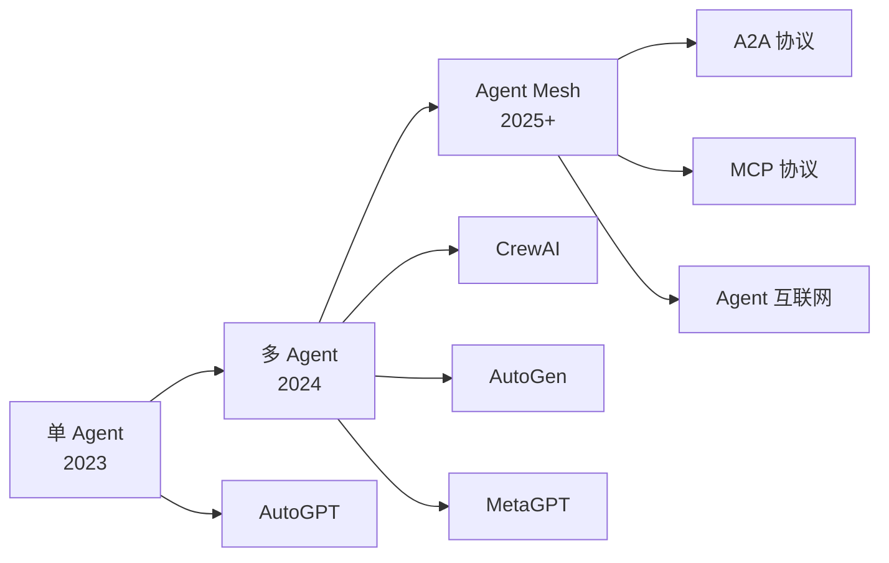
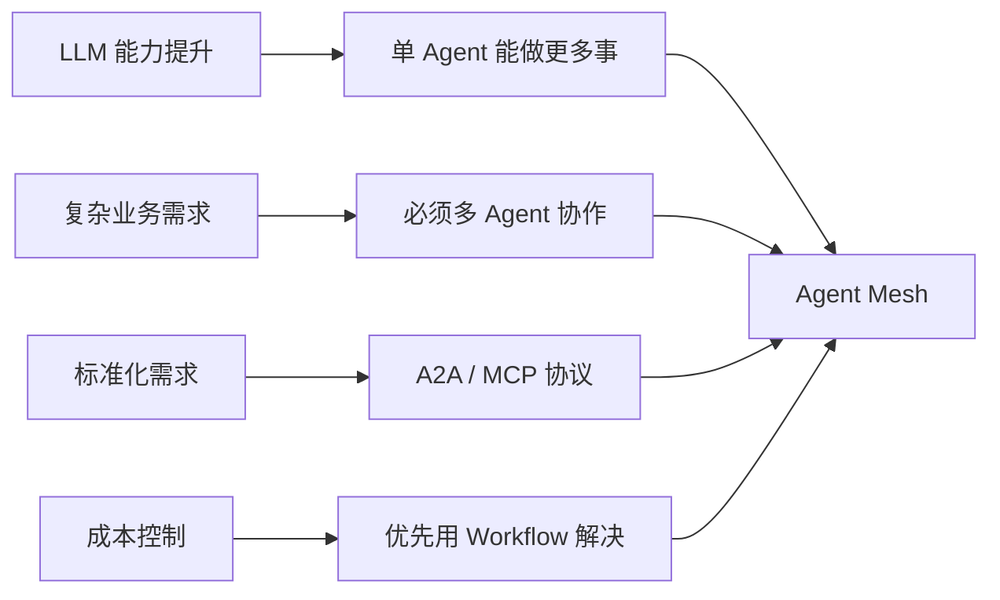

<!--module:
  parent: ai
  slug: ai/agent-architecture/communication-protocols
  type: article
  category: 主模块子文章
  summary: Agent 通信协议 4 种方式（消息队列/共享内存/黑板/A2A）+ A2A vs MCP 对比 + Agent Mesh 协议栈 + 单 Agent → 多 Agent → Agent Mesh 演进史时间线与驱动力。
  depth: ⭐⭐⭐⭐⭐
  status: active
-->

# Agent 通信协议与演进史：从单 Agent 到 Agent Mesh

← [返回: Agent 架构全景](README.md)

> 多 Agent 拓扑（见 [多 Agent 架构模式](multi-agent-patterns.md)）选定后，下一个决策是 **Agent 之间怎么通信**。本文覆盖 4 种通信方式 + A2A / MCP 协议对比，并把「单 Agent → 多 Agent → Agent Mesh」的演进史与协议标准化脉络放在一起讲——演进史是协议的来龙，协议是演进的去脉。

---

## 一、演进史：从单 Agent 到 Agent Mesh

### 1.1 阶段 1：单 Agent 时代（2023-2024）

**代表项目**：AutoGPT（2023-03）、BabyAGI（2023-04）、ChatGPT Plugins（2023-11）

**典型架构**：
- 单 Agent 循环 + 工具调用
- 长期记忆（Pinecone / Milvus）
- 自我反思（Self-Criticism）

**局限**：
- Context 窗口有限（GPT-4 仅 8K → 128K）
- 任务复杂时容易"迷路"（Context 越长越混乱）
- 无法处理需要多领域知识的任务

**标志性事件**：
- 2023-03：AutoGPT GitHub Stars 突破 10 万（最快达成）
- 2023-11：ChatGPT Plugins 开放（Agent 商业化起点）

### 1.2 阶段 2：多 Agent 时代（2024-2025）

**代表项目**：CrewAI（2024-01）、AutoGen v0.4（2024-12）、MetaGPT（2023-07）、LangGraph（2024-06）

**典型架构**：
- 角色分工（模拟组织）
- 协作流程（Sequential / Hierarchical / GroupChat）
- 共享状态（Memory / Blackboard）

**优势**：
- 解决复杂任务（多领域知识）
- 模块化清晰（每个 Agent 单一职责）
- 可观测性提升（Trace 工具）

**问题**：
- 通信开销（多 Agent Token 消耗 2-3 倍单 Agent）
- 调试困难（多 Agent 执行路径不可预测）
- 协议不统一（每个框架私有协议）

**标志性事件**：
- 2024-01：CrewAI 发布，简化多 Agent 编程
- 2024-06：LangGraph 发布，主打生产级 Graph
- 2024-12：AutoGen v0.4 重写，支持分布式多 Agent

### 1.3 阶段 3：Agent Mesh 时代（2025-2026+）

**代表项目**：Google A2A Protocol（2025-04）、Anthropic MCP（2024-11）、LangGraph Platform（2025）

**典型架构**：
- 跨厂商互通（A2A 协议）
- 工具标准化（MCP 协议）
- Agent 服务化（Agent as a Service）

**趋势**：
- **Agent 之间通过 A2A 协议通信**（像 HTTP 一样）
- **工具通过 MCP 协议暴露**（像 OpenAPI 一样）
- **形成"Agent 互联网"**（Agent 之间可发现、可调用、可组合）

**标志性事件**：
- 2024-11：Anthropic 发布 MCP（Model Context Protocol）
- 2025-04：Google 发布 A2A（Agent-to-Agent Protocol）
- 2025-Q3：阿里云百炼、Anthropic、OpenAI 宣布 A2A 兼容

**演进全景图**：



**演进驱动力**：



### 1.4 演进史时间线（逐事件版）

| 时间 | 事件 | 关键创新 | 局限 |
|------|------|---------|------|
| 2023.3 | **AutoGPT** 发布 | 单 agent + 工具循环 + 记忆 | 单点瓶颈、循环死锁 |
| 2023.6 | **MetaGPT** | 多 agent + SOP（Standard Operating Procedure）| SOP 写死，灵活性低 |
| 2023.10 | **ChatDev** | 多 agent 对话链（软件开发模拟） | 仅限软件开发场景 |
| 2024.5 | **CrewAI 0.x** | `Agent + Task + Crew + Process` 抽象 | Process 选择影响 token 消耗 |
| 2024.12 | **Anthropic「Building Effective Agents」** | workflow vs agent 分类，5 种 workflow | 思想指引，无框架 |
| 2024.7 | **AutoGen 0.4** | Actor model 重构，分布式友好 | 学习曲线陡 |
| 2024.12 | **OpenAI Swarm** | handoff 协议，轻量 SDK | 实验项目，2025 后逐步被新框架吸收 |
| 2025.4 | **Google A2A 协议** | Agent Card + 标准化任务生命周期 | 生态早期，集成案例少 |
| 2025.6 | **LangGraph 1.0** | 生产级多 agent 编排 + Studio 可视化 | 配置复杂 |

> 注：Anthropic「Building Effective Agents」博客实际发布于 **2024-12**（原稿时间线误记为 2024.6，归并时已按事实修正）。案例深读见 [多 Agent 模式 · 生产案例](multi-agent-patterns.md)。

**关键转折点**：

- **2024**：Anthropic 博客让业界意识到「**workflow 优先**，agent 是兜底」
- **2024.12**：OpenAI Swarm 让 handoff 概念普及
- **2025.4**：A2A 协议让跨厂商 agent 互操作成为可能

---

## 二、Agent 通信协议（4 种方式）

| 协议 | 范式 | 适用 | 典型实现 |
|------|------|------|---------|
| **消息队列（Pub-Sub）** | topic 订阅 + 异步分发 | 解耦、可扩展、大规模分布式 | Redis Streams / Kafka / RabbitMQ |
| **共享内存** | 共享可变 store + 主动查询 | 紧耦合、短生命周期、低延迟 | Redis / Hazelcast / Python `multiprocessing.Manager` |
| **黑板（Blackboard）** | 共享状态 + 事件监听 | 事件驱动、高度解耦 | 自实现 / 部分多 Agent 框架 |
| **A2A 协议（RPC）** | 同步远程调用 + Agent Card | 跨组织、跨语言、跨厂商 | Google A2A（2025.4，HTTP/JSON-RPC） |

> Agent ↔ Tool 方向的通信由 **MCP** 承载（JSON-RPC，client-server），与 A2A 正交互补，见 §2.5。

### 2.1 消息队列（Message Queue / Pub-Sub）

**原理**：Agent 通过消息队列（Kafka / RabbitMQ / Redis Streams）异步通信。

```python
# Producer Agent 发送任务
from kafka import KafkaProducer
producer = KafkaProducer(bootstrap_servers='localhost:9092')
producer.send('agent_tasks', key=b'researcher', value=b'research AI trends')

# Consumer Agent 接收任务
from kafka import KafkaConsumer
consumer = KafkaConsumer('agent_tasks', group_id='researcher_group')
for msg in consumer:
    task = msg.value.decode()
    result = process(task)
    producer.send('agent_results', value=result)
```

**Redis Streams 异步版（async Pub-Sub）**：

```python
import redis.asyncio as redis

r = redis.Redis()
stream = "agent_events"

# Agent A 写入
await r.xadd(stream, {"agent": "researcher", "event": "data_ready", "payload": "..."})

# Agent B 消费
async def consume():
    while True:
        events = await r.xread({stream: "$"}, block=1000, count=10)
        for stream_name, msgs in events:
            for msg_id, data in msgs:
                handle(data)
```

**优点**：
- 完全解耦（生产者和消费者无依赖）
- 可靠（持久化 + 重试，Kafka Exactly-Once 语义）
- 可扩展（水平扩展 Consumer）

**缺点**：
- 延迟高（毫秒到秒级）
- 需要基础设施（Kafka 集群）
- 不适合紧密协作场景

**适用场景**：大规模分布式 Agent 集群、跨服务异步任务

### 2.2 共享内存（Shared Memory）

**原理**：所有 Agent 访问同一块内存（Redis / Memcached / 进程内 dict），**pull 模式**（Agent 主动查询）。

```python
import redis
r = redis.Redis()

# Agent A 写入
r.set("task:001:result", json.dumps({"status": "done", "data": data}))

# Agent B 读取
result = json.loads(r.get("task:001:result"))
```

**优点**：
- 低延迟（微秒级）
- 简单（API 直观）
- 适合紧密协作

**缺点**：
- 竞争问题（需要锁 / 乐观锁）
- 扩展性差（单机内存有限）
- 不适合跨数据中心

**适用场景**：单机多 Agent、紧密协作、低延迟场景

### 2.3 黑板（Blackboard）

**原理**：所有 Agent 共享一个状态空间并**监听变化事件**，是一种**事件驱动**的共享状态机制（完整实现与优缺点见 [多 Agent 模式 §1.6](multi-agent-patterns.md)）。

**对比共享内存**：黑板是 **push 模式**（Agent 被通知），共享内存是 **pull 模式**（Agent 主动查询）。

**异步实现示例**：

```python
import asyncio
from dataclasses import dataclass, field
from typing import Any

@dataclass
class Blackboard:
    state: dict = field(default_factory=dict)
    subscribers: list = field(default_factory=list)

    def update(self, key: str, value: Any):
        old = self.state.get(key)
        self.state[key] = value
        for sub in self.subscribers:
            if sub.filter(old, value):
                asyncio.create_task(sub.callback(key, value))

# worker 监听特定 key 变化
class Worker:
    def __init__(self, name: str, watch_keys: list):
        self.name = name
        self.watch_keys = watch_keys

    def filter(self, old, new):
        return self.watch_keys

    async def callback(self, key, value):
        print(f"[{self.name}] saw {key}={value}")
        # 触发下一阶段 agent
```

### 2.4 A2A 协议（Agent-to-Agent Protocol）

**原理**：Google 在 2025 年（2025-04）提出的 Agent 通信协议，基于 HTTP + JSON-RPC 2.0 + SSE，**解决跨厂商 Agent 互通**。

```json
// A2A 协议消息示例
{
  "jsonrpc": "2.0",
  "method": "agent.send_task",
  "params": {
    "agent_card": "https://research-agent.example.com/.well-known/agent.json",
    "task_id": "research-001",
    "skill": "web_research",
    "input": { "query": "AI agent architectures" },
    "caller": "agent://planner-001",
    "callback_url": "https://planner.example.com/agent-callback"
  },
  "id": "req-001"
}
```

**A2A 协议 4 大关键能力**：

1. **Agent Card**（类似 OpenAPI Spec / LLM 的 model card）：每个 Agent 暴露 `.well-known/agent.json` 描述自身能力
2. **Task Lifecycle**：任务状态机（`submitted` → `working` → `input-required` → `completed` / `failed` / `canceled`）
3. **Streaming**：流式响应（SSE / WebSocket）
4. **Push Notifications**：异步通知（Webhooks）

另支持**多模态**：文本、文件、结构化数据。

**Agent Card 示例**：

```json
{
  "name": "Research Agent",
  "description": "Performs web research and fact-checking",
  "url": "https://research-agent.example.com",
  "skills": [
    {
      "id": "web_research",
      "name": "Web Research",
      "description": "Search the web for a query",
      "input_schema": {
        "type": "object",
        "properties": {
          "query": { "type": "string" }
        }
      },
      "output_schema": {
        "type": "object",
        "properties": {
          "sources": { "type": "array" },
          "summary": { "type": "string" }
        }
      }
    }
  ],
  "authentication": {
    "type": "bearer",
    "scopes": ["research:read"]
  }
}
```

**优点**：
- 标准化（跨厂商 Agent 互通）
- 类比 HTTP（Agent 互联网的基础协议）
- 与 MCP 协议互补（MCP 暴露工具，A2A 通信）

**缺点**：
- 协议刚起步（2025 年提出）
- 生态不成熟、集成案例少
- 实现复杂度高

**未来趋势**：A2A 可能是 **Agent 互联网的 HTTP**——未来 Agent 之间像 Web 服务一样互联。

**真实案例**：Google A2A 开源实现（github.com/google/A2A）、阿里云百炼、Anthropic 实验性支持

### 2.5 A2A vs MCP：正交互补

MCP（Model Context Protocol，Anthropic 2024-11）专注 **agent ↔ tool** 通信（与 A2A 互补）：

| 维度 | A2A | MCP |
|------|-----|-----|
| 通信对象 | agent ↔ agent | agent ↔ tool |
| 发起方 | 同侪（peer-to-peer） | client-server |
| 协议层 | JSON-RPC + SSE | JSON-RPC + stdio/SSE |
| 标准化 | Google + Linux Foundation | Anthropic 主导 |

```text
┌──────────┐  A2A  ┌──────────┐
│  Agent A │◄─────►│  Agent B │
└────┬─────┘       └────┬─────┘
     │ tool       tool  │
   MCP│               MCP
     ▼                   ▼
  ┌──────┐           ┌──────┐
  │Tool 1│           │Tool 2│
  └──────┘           └──────┘
```

---

## 三、反直觉：协议两大误区

### 3.1 A2A 协议 ≠ HTTP 网络协议

**误区**：以为 A2A 协议是 HTTP 那种**基础设施协议**。

**真相**：
- A2A 是 Agent 之间的**应用层协议**
- 底层仍依赖 HTTP/gRPC（基础设施）
- A2A 解决的是 **"Agent 发现 + 任务委托 + 状态同步"**

**类比**：
- A2A 之于 Agent ≈ **SMTP 之于邮件**（应用层协议）
- MCP 之于工具 ≈ **OpenAPI 之于 API**（接口描述）

### 3.2 A2A ≠ MCP

**误区**：以为 A2A 协议（2025.4）和 MCP（2024.11）是竞争关系或同一个东西。

**真相**：
- **A2A**：**agent ↔ agent** 通信（peer-to-peer，agent card）
- **MCP**：**agent ↔ tool** 通信（client-server，工具描述）

两者**正交而非竞争**（拓扑图见 §2.5）。生产系统通常同时使用：对内 MCP 挂工具，对外 A2A 连 Agent。

---

## 相关章节

- 上游综述：[Agent 架构全景](README.md) — 单 Agent 架构选型（DAG vs ReAct vs Plan-and-Execute）
- 姊妹篇：[多 Agent 架构模式与选型](multi-agent-patterns.md) — 拓扑选定后，通信协议是下一个决策
- 姊妹篇：[框架源码对比与手搓 vs 框架](framework-source-comparison.md) — 协议在各框架中的实现载体
- 关联：[LLM 驾驭演进史](llm-control-evolution/README.md) — Prompt → Context → Harness → Loop 的驾驭侧演进（与本文架构侧演进互为表里）
- 叙事版：[13.story/33b · A2A 协议 + 协议治理](../../../13.story/33b-a2a-protocol.md) — A2A 协议的诞生故事
- 分布式类比：[06.distributed-systems/02-distributed/rpc](../../../06.distributed-systems/02-distributed/rpc/README.md) — sidecar / RPC 通信模式类比 A2A
- 面试题版：[12.interview/11.ai/acp-protocol](../../../12.interview/11.ai/acp-protocol/README.md) — Agent 通信协议面试题

## 参考资源

- **A2A Protocol**：https://github.com/google/A2A
- **Google A2A Whitepaper**：https://google.github.io/A2A/
- **MCP Protocol**：https://modelcontextprotocol.io/
- **AutoGen**：Wu et al., 2023, "AutoGen: Enabling Next-Gen LLM Applications via Multi-Agent Conversation"

---

← [返回: Agent 架构全景](README.md)
