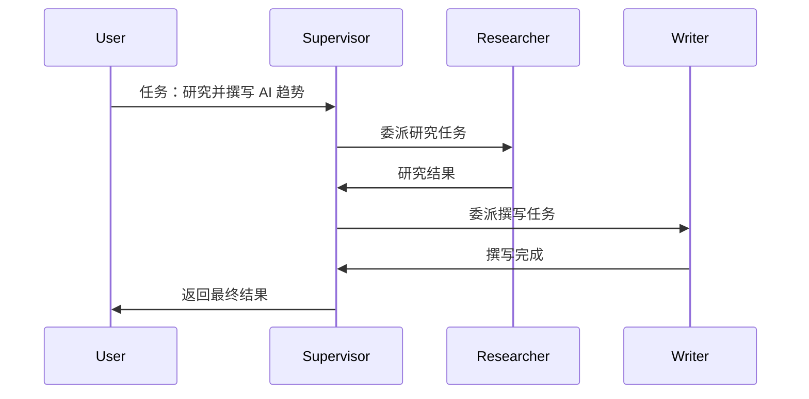
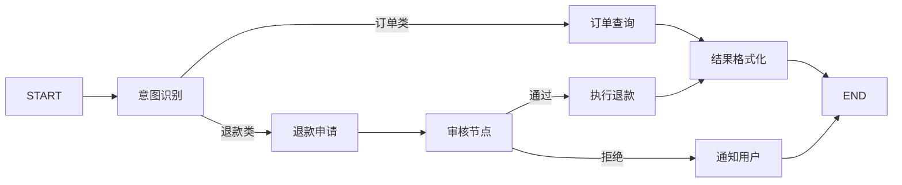
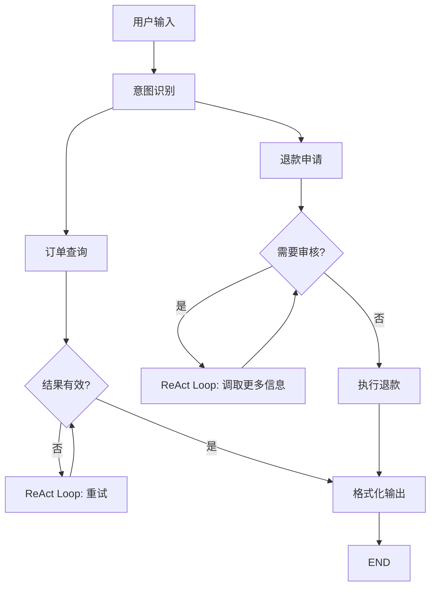
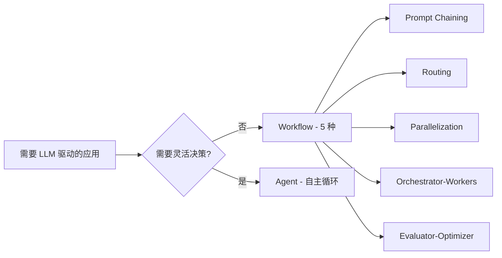

<!--module:
  parent: ai
  slug: ai/agent-architecture/multi-agent-patterns
  type: article
  category: 主模块子文章
  summary: 多 Agent 架构 6 大模式（Supervisor/Swarm/Graph/Pipeline/Hierarchical/Blackboard）深度对比 + 决策矩阵与选型决策树 + Anthropic/CrewAI/AutoGen/Magentic-One 生产案例 + 7 大反直觉误区。
  depth: ⭐⭐⭐⭐⭐
  status: active
-->

# 多 Agent 架构模式与选型：6 大模式 + 决策树 + 生产案例

← [返回: Agent 架构全景](README.md)

> 单 Agent 解决不了复杂业务时，必然走向多 Agent。**不同的协作模式适合不同的业务场景**——选错模式通信开销可能浪费 2-3 倍 Token（见 §五 反直觉 1）。本文归并了「Agent 架构全景」与「BPMN × AI 融合」两处深化段，是多 Agent 拓扑选型的单一权威来源。

---

## 一、6 大多 Agent 模式

### 1.1 Supervisor 模式（监督者模式，中心化）

**核心思想**：1 个 Supervisor Agent 管理多个 Worker Agent，Supervisor 负责任务分发、结果汇总、错误处理，是唯一的协调者。

**拓扑**：

```text
                ┌─────────────┐
                │ Supervisor  │ ← 决策中心
                └──────┬──────┘
            ┌──────────┼──────────┐
            ▼          ▼          ▼
       ┌────────┐ ┌────────┐ ┌────────┐
       │Worker A│ │Worker B│ │Worker C│
       └────────┘ └────────┘ └────────┘
```

**典型代表**：AutoGen GroupChat、CrewAI Hierarchical、LangGraph Supervisor

**通信模式**（Worker 上报 → Supervisor 决策 → 分发下一步）：

```json
{
  "type": "worker_report",
  "worker_id": "researcher",
  "task_id": "t_001",
  "result": {},
  "status": "done"
}
```

**代码示例（LangGraph Supervisor）**：

```python
from langgraph_supervisor import create_supervisor
from langgraph.prebuilt import create_react_agent
from langchain_anthropic import ChatAnthropic

llm = ChatAnthropic(model="claude-sonnet-4-5")

# Worker 1: 研究员
research_agent = create_react_agent(
    llm,
    tools=[search_tool, wikipedia_tool],
    name="researcher",
    prompt="你是一名研究员，专注于网络检索和事实核实。"
)

# Worker 2: 撰写员
writer_agent = create_react_agent(
    llm,
    tools=[],
    name="writer",
    prompt="你是一名内容撰写员，擅长将研究结果组织成结构化文档。"
)

# Supervisor 协调
workflow = create_supervisor(
    [research_agent, writer_agent],
    model=llm,
    prompt=(
            "你是团队协调者：根据当前对话决定下一个 Worker。"
            "可用 worker：researcher（需要事实时调用）、writer（需要成文时调用）。"
            "任务完成后回复 FINISH。"
        )
)

app = workflow.compile()
result = app.invoke({
    "messages": [{"role": "user", "content": "调研 AI Agent 架构并写一篇综述"}]
})
```

> 需要「研究 → 撰写 → 校对」三角色时，再补一个 `editor` Worker 即可（`create_react_agent(llm, tools=[], prompt="You are an editor...")`），Supervisor prompt 中写明三步委派顺序。

**协作时序**：



**优点**：
- 决策中心化，全局状态可控，角色清晰
- **审计便利**：所有决策经过 Supervisor（金融/合规场景友好）
- 易于实现和调试，错误处理集中
- Worker 可单一职责

**缺点**：
- Supervisor 是**单点故障**（SPOF）+ 单点性能瓶颈（每条消息都过它）
- Supervisor 上下文窗口压力大（所有 Worker 的对话都会汇总到它）
- 任务分配可能不合理（Supervisor 误判）
- 不适合大规模（> 10 Worker）场景

> Supervisor 并非注定是单点故障——持久化 + 备胎接管方案见 §五 反直觉 4。

**真实案例**：Anthropic Research 多 Agent 系统、Cursor Composer（代码生成 + 测试 Supervisor）、Microsoft Magentic-One（见 §4.4）

### 1.2 Swarm 模式（群体模式，去中心化）

**核心思想**：多个 Agent 之间**点对点通信**，没有中心节点，Agent 之间通过 **handoff 协议**动态切换控制权，根据动态场景自主协商。

**拓扑**：

```text
     ┌──────┐         ┌──────┐
     │Agent1│◄────────┤Agent2│
     └──┬───┘         └──┬──┘
        │    ┌──────┐    │
        └───►│Agent3│◄───┘
             └──┬───┘
                ▼
             ┌──────┐
             │Agent4│
             └──────┘
```

**典型代表**：OpenAI Swarm（2024 实验项目，handoff 范式源头）、AutoGen Swarm、LangGraph Swarm（2025）、swarms 框架

**Handoff 范式（OpenAI Swarm SDK）**：

```python
# OpenAI Swarm 风格（2024.12）
from swarm import Swarm, Agent

client = Swarm()

def transfer_to_writer():
    return writer_agent  # handoff：控制权交给 writer

def transfer_to_editor():
    return editor_agent

researcher = Agent(
    name="Researcher",
    instructions="Gather information and handoff to Writer.",
    functions=[transfer_to_writer],
)
writer = Agent(
    name="Writer",
    instructions="Draft article and handoff to Editor.",
    functions=[transfer_to_editor],
)
editor = Agent(
    name="Editor",
    instructions="Polish final output. No further handoff.",
)

# 启动：用户消息进入 researcher
response = client.run(
    agent=researcher,
    messages=[{"role": "user", "content": "Write about RAG"}],
)
```

**共识循环范式（swarms 框架）**：

```python
from swarms import Agent, Swarm

# 定义去中心化 Agent
researcher = Agent(
    agent_name="Researcher",
    system_prompt="负责网络检索，输出原始事实。",
    llm=llm
)
analyst = Agent(
    agent_name="Analyst",
    system_prompt="负责分析数据，输出结构化结论。",
    llm=llm
)
writer = Agent(
    agent_name="Writer",
    system_prompt="负责撰写最终内容。",
    llm=llm
)

# Swarm 协作
swarm = Swarm(
    agents=[researcher, analyst, writer],
    max_loops=5,           # 最大循环次数（防死循环）
    termination_threshold=0.8  # 达成共识阈值
)
result = swarm.run("分析 AI 行业趋势并撰写报告")
```

**优点**：
- **无单点故障**（任何 Agent 挂掉，handoff 可绕过），水平扩展性好
- 动态角色切换，Agent 可「变身」，能应对动态任务
- 适合**开放探索类**任务（客服分流、研究协作、个性化推荐链，无固定 SOP）

**缺点**：
- **emergent behavior 难预测**（Agent 可能循环 handoff），调试困难
- 容易陷入循环（必须严格限制 `max_loops`），token 消耗可能指数增长（无终止保险）
- 需要 consensus 机制防止 Agent 之间互锁
- 全局状态难追踪——「去中心化 ≠ 无状态」，仍需共享 context store（见 §五 反直觉 6）

**真实案例**：OpenAI Swarm（实验性项目，已停止维护但 handoff 设计思想被 LangGraph Swarm / OpenAI Agents SDK 吸收，影响深远）

### 1.3 Graph 模式（图状 / DAG）

**核心思想**：用有向图（不一定是 DAG，可有循环）显式定义 Agent 之间的转移关系；节点是 Agent，边是数据依赖，典型实现为 DAG + state reducer。

**典型代表**：LangGraph、LlamaIndex Workflow、Vertex AI Reasoning Engine



**多 Agent 图编排示例（Planner → Researcher → Drafter → Critic 循环）**：

```python
from langgraph.graph import StateGraph, END
from typing import TypedDict, Annotated
import operator

class State(TypedDict):
    messages: Annotated[list, operator.add]
    draft: str
    revision_count: int

def planner(state: State):
    plan = llm.invoke(f"Plan article based on: {state['messages']}")
    return {"messages": [plan]}

def drafter(state: State):
    draft = llm.invoke(f"Draft from plan: {state['messages']}")
    return {"draft": draft, "revision_count": 0}

def critic(state: State):
    feedback = llm.invoke(f"Critique: {state['draft']}")
    return {"messages": [feedback]}

def should_revise(state: State) -> str:
    if state["revision_count"] >= 2 or "approve" in state["messages"][-1]:
        return END
    return "drafter"

# 构建 DAG
workflow = StateGraph(State)
workflow.add_node("planner", planner)
workflow.add_node("drafter", drafter)
workflow.add_node("critic", critic)
workflow.add_edge("planner", "drafter")
workflow.add_edge("drafter", "critic")
workflow.add_conditional_edges("critic", should_revise, {"drafter": "drafter", END: END})
workflow.set_entry_point("planner")
app = workflow.compile()
```

**DAG + Loop 混合架构**（生产最常见形态：确定性节点用 DAG，探索性节点用 Loop）：



**优点**：
- 流程**可视化**（Mermaid / LangGraph Studio 可视化调试）
- 支持条件边（conditional edge）实现分支；支持并行节点（fan-out/fan-in）
- **可版本化**：图状态可 checkpoint、可回放（Time Travel）
- **可观测性强**（Trace 完整记录每个节点），适合复杂业务流（多分支、多重试）

**缺点**：
- 开发成本高（需要预先设计图，节点定义繁琐，高于 Pipeline）
- 不够灵活（图结构改起来麻烦）
- **cycle 处理复杂**：需要显式 state 防止无限循环
- 调试需要 trace 工具（LangSmith）

**真实案例**：LangGraph Studio 可视化调试工具、生产 Agent 系统

### 1.4 Pipeline 模式（流水线模式）

**核心思想**：每个 Agent 处理一个固定步骤，顺序链 `agent1 → agent2 → ... → agentN`，类似工厂流水线，无回环、无分支。

**典型代表**：MetaGPT、ChatDev；典型应用：CI/CD code review（lint → test → security → review）

```text
[Code Submit] → [Lint Agent] → [Test Agent] → [Security Agent] → [Review Agent] → [Approve]
```

**模拟组织范式（MetaGPT / ChatDev）**：

```python
# MetaGPT 软件开发流水线（简化）
class SoftwareCompany:
    def __init__(self):
        self.architect = Architect()      # 架构师
        self.pm = ProjectManager()         # 产品经理
        self.engineer = Engineer()          # 工程师
        self.qa = QAEngineer()              # 测试
    
    def run(self, requirement: str) -> str:
        design = self.architect.design(requirement)   # 1. 设计
        plan = self.pm.plan(design)                    # 2. 规划
        code = self.engineer.code(plan)                # 3. 编码
        tests = self.qa.test(code)                     # 4. 测试
        return tests

# ChatDev 多 Phase 串联（伪代码）
chat_chain = ChatChain([
    DesignPhase(),    # 设计
    CodingPhase(),    # 编码
    TestingPhase(),   # 测试
    DocumentationPhase()  # 文档
])
result = chat_chain.run("开发一个贪吃蛇游戏")
```

**CI/CD 最小示例**：

```python
# 简单 pipeline：每步 agent 接收上一步结果
def lint_agent(code: str) -> dict:
    issues = run_linter(code)
    return {"stage": "lint", "issues": issues, "code": code}

def test_agent(result: dict) -> dict:
    test_results = run_tests(result["code"])
    return {**result, "stage": "test", "test_results": test_results}

def security_agent(result: dict) -> dict:
    vulns = scan_security(result["code"])
    return {**result, "stage": "security", "vulnerabilities": vulns}

def review_agent(result: dict) -> dict:
    verdict = "approve" if not result["issues"] and not result["vulnerabilities"] else "reject"
    return {**result, "stage": "review", "verdict": verdict}

pipeline = lint_agent | test_agent | security_agent | review_agent
final = pipeline.invoke(code="def add(a,b): return a+b")
```

**优化变体：fan-out + join（并行预处理）**：

```python
# pipeline 的并行优化：lint 和 security 并行
from concurrent.futures import ThreadPoolExecutor

def parallel_pipeline(code: str):
    with ThreadPoolExecutor() as ex:
        lint_future = ex.submit(lint_agent, code)
        security_future = ex.submit(security_agent, code)
        lint = lint_future.result()
        security = security_future.result()
    test = test_agent({"code": code, **lint, **security})
    return review_agent(test)
```

**优点**：
- 角色分工明确（模拟真实公司），输出标准化
- **低延迟**（无调度开销）、**易调试**（线性日志）
- 适合确定性流程（编译、审批链、流程化业务）

**缺点**：
- 步骤固定，不够灵活，无法应对长尾分支
- **上游错误会污染下游**（lint 漏检 → test 全过 → 上线炸），单步错误导致整条流水线失败（需要重试机制）
- 上下文传递有损失（每步只看上游输出）
- 全部同步串行时性能差（可加 fan-out 并行优化，见 §五 反直觉 7）

**真实案例**：MetaGPT 软件开发、ChatDev 协作开发、阿里通义晓蜜客服流水线

### 1.5 Hierarchical 模式（分层模式）

**核心思想**：多个 Supervisor 层级嵌套，上层 Supervisor 管理下层 Supervisor。

**典型代表**：CrewAI Hierarchical、AutoGen NestedChat

```text
顶层 Supervisor（战略层，CEO）
    ├── Supervisor A（领域 A，CTO）
    │   ├── Worker A1（架构师）
    │   └── Worker A2（工程师）
    └── Supervisor B（领域 B，CFO）
        ├── Worker B1（财务分析师）
        └── Worker B2（审计员）
```

**优点**：
- 大规模任务可分解为多层子任务
- 责任清晰，支持权限分层
- 可对应现实组织结构（CEO/CTO/CFO）

**缺点**：
- 层级深时延迟高（多层 LLM 调用）
- 跨层级通信复杂
- Supervisor 链上的错误会向下扩散

**真实案例**：复杂电商客服（顶层意图分流 → 子领域 Supervisor → 具体 Worker）

### 1.6 Blackboard 模式（黑板模式）

**核心思想**：所有 Agent 共享一个"黑板"（数据结构），Agent 监听黑板变化并响应。

**典型代表**：传统 AI 系统（HEARSAY-II 语音识别系统，1980 年代），现代 LLM 多 Agent 框架的部分实现

```python
class Blackboard:
    """共享状态空间"""
    def __init__(self):
        self.data = {}
        self.subscribers = []
    
    def post(self, key: str, value: any):
        self.data[key] = value
        for sub in self.subscribers:
            sub.notify(key, value)
    
    def subscribe(self, agent):
        self.subscribers.append(agent)

class BaseAgent:
    def __init__(self, blackboard: Blackboard, name: str):
        self.bb = blackboard
        self.bb.subscribe(self)
        self.name = name
    
    def notify(self, key, value):
        """黑板变化时触发"""
        if self.should_respond(key, value):
            result = self.process(value)
            self.bb.post(f"{self.name}_result", result)
    
    def should_respond(self, key, value) -> bool:
        raise NotImplementedError
    
    def process(self, value) -> any:
        raise NotImplementedError

# 多 Agent 监听 Blackboard
bb = Blackboard()
ResearchAgent(bb)   # 监听"query" → 输出"raw_data"
AnalysisAgent(bb)   # 监听"raw_data" → 输出"analysis"
WritingAgent(bb)    # 监听"analysis" → 输出"final_article"

# 启动
bb.post("query", "AI agent architectures")
```

**优点**：
- 高度解耦（Agent 之间不直接调用）
- 易于扩展（加 Agent 不改其他 Agent）
- 天然事件驱动

**缺点**：
- 黑板竞争问题（多个 Agent 同时改同一字段）
- 调试困难（事件链难追溯）
- 需要 Schema 治理

**真实案例**：HEARSAY-II 语音识别、部分 RAG 系统的回调机制

> Blackboard 作为**通信机制**（push 模式 vs 共享内存 pull 模式）的对比见 [通信协议与演进史](communication-protocols.md)；作为过时设计的误区辨析见 §五 反直觉 5。

### 1.7 6 大模式速览对比表

| 模式 | 中心化 | 灵活性 | 调试性 | 适用场景 | 代表项目 |
|------|--------|--------|--------|---------|---------|
| **Supervisor** | 强 | 中 | 高 | 中等复杂、需要清晰决策 | AutoGen GroupChat |
| **Swarm** | 无 | 高 | 低 | 去中心化、探索性 | OpenAI Swarm |
| **Graph（DAG）** | 弱 | 中 | 高 | 生产业务、确定性 | LangGraph |
| **Pipeline** | 弱 | 低 | 中 | 流程化任务 | MetaGPT |
| **Hierarchical** | 强（多层） | 中 | 中 | 大规模、多领域 | CrewAI Hierarchical |
| **Blackboard** | 无 | 高 | 低 | 事件驱动、解耦 | 传统专家系统 |

---

## 二、决策矩阵：4 大主流拓扑深度横向对比

| 维度 | **Supervisor** | **Swarm** | **Graph (DAG)** | **Pipeline** |
|------|---------------|-----------|----------------|--------------|
| **拓扑** | 1 + N 中心化 | N 全互连 / 局部 | DAG 节点 + 边 | 顺序链 |
| **通信** | RPC / 函数调用 | handoff | state + 边 | 数据透传 |
| **适用** | 任务分工明确、SLA 严格 | 开放探索、动态角色 | 复杂业务流、可视化 | 确定性流水线（CI/CD）|
| **失败模式** | supervisor 宕即全挂 | 循环 handoff / token 失控 | cycle 死循环 | 上游污染下游 |
| **典型框架** | LangGraph Supervisor / CrewAI hierarchical | OpenAI Swarm / LangGraph Swarm | LangGraph / LlamaIndex Workflows | 自实现 / Airflow |
| **复杂度** | 中（需写 supervisor 逻辑）| 中（需防止循环） | 高（需设计图） | 低（线性代码） |
| **调试难度** | 中（trace supervisor） | 高（emergent behavior） | 低（可视化 + checkpoint） | 低（线性日志） |
| **Token 消耗** | 中（每步经 supervisor） | 中-高（循环风险） | 中（图遍历） | 低（最少 LLM 调用） |
| **可扩展性** | 中（supervisor 瓶颈） | 高（无中心） | 中（图节点管理） | 低（改链需重写） |
| **审计便利** | 高（中心化决策点） | 低（分布式） | 高（图节点明确） | 高（线性可追溯） |

**快速选型指南**：

| 场景 | 推荐架构 |
|------|---------|
| 客服工单分流 | Swarm（路由 + 转交）|
| CI/CD code review | Pipeline（确定性 + 低延迟）|
| 自动化研究助手 | Supervisor（researcher + writer + editor）|
| 复杂审批工作流（含分支/重试）| Graph（DAG + conditional edge）|
| 多 agent 协作做软件（SWE-bench）| Supervisor + Graph 混合 |

---

## 三、决策树：选哪种架构？（深度版）

```text
Q1: 任务是否能用 Workflow 描述？
├── 是 → 用 Workflow（Prompt Chaining / Routing / Parallel）
│        - 路由式选 Routing
│        - 线性式选 Prompt Chaining
│        - 并行式选 Parallelization
└── 否 → Q2

Q2: 任务是否需要探索未知？
├── 是 → ReAct Loop（AutoGPT / BabyAGI 风格）
└── 否 → Q3

Q3: 任务步骤是否可预测？
├── 是 → DAG Workflow（LangGraph / LlamaIndex）
│        - 单一职责 → DAG
│        - 需要审计 → LangGraph（Checkpointer）
│        - 需要人工介入 → LangGraph（Human-in-the-loop）
└── 否 → Q4

Q4: 是否需要角色分工？
├── 是 → Multi-Agent（选择 Supervisor / Swarm / Pipeline）
│        - 角色清晰 + 中等复杂 → Supervisor
│        - 去中心化 + 探索 → Swarm
│        - 流程化任务 → Pipeline
│        - 多层级领域 → Hierarchical
│        - 高度解耦 + 动态 → Blackboard
└── 否 → ReAct + 工具（单 Agent）

Q5: 是否跨组织 / 跨厂商？
├── 是 → A2A 协议（Google A2A / MCP）
└── 否 → 内部多 Agent

Q6: 是否需要长期记忆？
├── 是 → 加 Memory（向量数据库）
└── 否 → 无状态 Agent
```

**推荐组合（生产环境）**：

- **简单任务**：Routing + Prompt Chaining（纯 Workflow）
- **中等任务**：DAG + 1 个 Supervisor（混合）
- **复杂任务**：Hierarchical Supervisor + Worker + A2A
- **探索任务**：Swarm + ReAct Loop

---

## 四、生产案例深度

### 4.1 案例 1：Anthropic「Building Effective Agents」（2024-12）

Anthropic 发布的 Agent 设计哲学博客，**成为业界生产 Agent 的设计指南**。

**核心分类**：



**核心观点 1：Workflow vs Agent 的本质区别**：

| 维度 | Workflow | Agent |
|------|----------|-------|
| 决策者 | 预定义代码路径 | LLM 自主决定 |
| 行为可预测 | 高 | 低 |
| 成本 | 低 | 高（多次 LLM 调用） |
| 适用 | 流程明确 | 开放复杂 |

**核心观点 2：5 大 Workflow 模式**：

1. **Prompt Chaining**（提示链）：线性链路，每步处理前一输出（适合可分解任务）
   ```text
   输入 → [LLM 1] → 验证 → [LLM 2] → 输出
   ```
   *用例*：先写大纲 → 验证大纲 → 基于大纲写正文

2. **Routing**（路由）：分类后路由到不同处理路径（适合多类输入）
   ```text
   输入 → [分类 LLM] → 路径 1 / 路径 2 / 路径 3
   ```
   *用例*：客服意图分流（订单/退款/咨询）

3. **Parallelization**（并行）：并行执行（Sectioning / Voting）
   ```text
   输入 → [LLM 1] + [LLM 2] + [LLM 3] → 聚合
   ```
   *用例*：多视角评估、投票决策

4. **Orchestrator-Workers**（编排-工作器）：中央 LLM 拆分任务，分发给 Worker（Supervisor 范式）
   ```text
   输入 → [Orchestrator] → [Worker 1] + [Worker 2] → 汇总
   ```
   *用例*：复杂研究任务拆分、复杂检索 → 多 LLM 并行 → 合并

5. **Evaluator-Optimizer**（评估-优化）：生成 → 评估 → 优化循环
   ```text
   [生成] → [评估] → 不达标 → [优化] → [生成] → ...
   ```
   *用例*：翻译质量优化（翻译 + 评估 + 重译循环）、代码生成优化

**核心观点 3：何时用 Agent vs Workflow**

关键原文观点（引用）：

> "When building LLM-powered applications, **evaluate whether you can achieve your goal with workflows that combine multiple LLM calls before committing to fully autonomous agents**. Agents trade off predictability and consistency for adaptive capability, and they tend to work best for open-ended problems where the right answer isn't easily characterizable."

→ 简言之：**"能用 Workflow 解决的不用 Agent"**（先 workflow 后 agent，能不用 agent 就别用）—— Anthropic 原话。

**Anthropic 的 3 条生产建议**：

1. **保持简单**：Agent 设计要透明（步骤清晰）
2. **优先透明而非智能**：清晰的 5 步 Workflow 优于混乱的 1 步 Agent
3. **失败兜底**：Agent 必然失败，设计降级方案（如人工接管）

> 详见 Anthropic 官方：[anthropic.com/research/building-effective-agents](https://www.anthropic.com/research/building-effective-agents)

### 4.2 案例 2：CrewAI 多 Agent 内容创作

**架构**：Sequential Process + Researcher + Writer + Editor

- **research_crew**（CrewAI 官方文档示例）：Researcher + Writer 双 agent，用于自动化研究简报
- **code_crew**：Engineer + Code Reviewer，用于自动化代码开发
- 关键模式：4 种 Process（sequential / hierarchical / consensual / asynchronous）切换演示

**生产数据**（CrewAI 官方）：
- 单篇文章生成时间：~5 分钟
- Token 成本：~$0.10/篇（GPT-4o）
- 准确率：~85%（人工评估 Top-1 命中率）

**关键设计**：
- Researcher：使用 SerperDevTool + WebsiteSearchTool
- Writer：纯 LLM，无工具（专注内容生成）
- Editor：负责最终校对和格式调整

**教训**：
- Sequential Process 比 Hierarchical 更稳定（Hierarchical 的 Supervisor 容易误判）
- 角色 backstory 要具体（"Expert at finding..." 而非 "Helpful assistant"）
- expected_output 字段很重要（强制 LLM 输出结构化）

### 4.3 案例 3：AutoGen 多 Agent 协作（Microsoft）

**架构**：UserProxy + 多个 Assistant + GroupChat Manager

**真实案例**：股票分析系统（Assistant 生成代码，UserProxy 执行并返回结果）

**关键能力**：
- 代码执行原生支持（Docker 沙箱）
- Human-in-the-loop 自然集成（`human_input_mode="TERMINATE"`）
- 多轮对话支持（GroupChat 自动选下一个发言者）

**生产教训**：
- GroupChat 的发言顺序由 LLM 决定，可能陷入循环（必须限制 `max_round`）
- Docker 沙箱是生产必备（防止 LLM 生成恶意代码）
- UserProxy 的 `human_input_mode` 要谨慎选择：
  - `ALWAYS`：每次都问（成本高）
  - `NEVER`：从不问（危险）
  - `TERMINATE`：仅终止时问（推荐）

### 4.4 案例 4：Microsoft Research Magentic-One（AutoGen 0.4）

Magentic-One 是 Microsoft Research 2024 发布的多 agent 编排系统：

- **Orchestrator**：规划 + 监控进度（类似 Supervisor）
- **WebSurfer**：浏览器操作 agent
- **FileSurfer**：本地文件操作 agent
- **Coder**：代码生成与执行 agent
- **ComputerTerminal**：shell 执行 agent

> 4 agent + 1 orchestrator 的标准 Supervisor 范式，应用于 GAIA / WebArena 基准测试。

---

## 五、反直觉点 + 误区（深度版）

### 5.1 反直觉 1：多 Agent 不一定更好（越多不一定越强）

**误区**：以为多 Agent 一定比单 Agent 强（"人多力量大"）。

**真相**：
- 多 Agent 引入了通信开销（可能浪费 2-3 倍 Token）
- 简单任务用多 Agent 反而效率低
- 通信失败会导致整个任务失败
- 实验显示 agent 数 > 5 后，**通信成本指数增长**，任务完成率反而下降

**实验数据**（Anthropic 内部）：
- 单 Agent 处理客服任务：平均 4 次 LLM 调用
- 3 Agent 协作处理同样任务：平均 11 次 LLM 调用（2.75x）
- 准确率提升仅 5%（不值得 2.75x 成本）

**佐证**（Microsoft Research Magentic-One 论文）：4 agent 系统已能处理 80%+ GAIA 任务；8 agent 反而引入更多协调问题。

**建议**：
- **单 Agent 能解决的不要上多 Agent**（Anthropic 第一原则）
- 多 Agent 必须有清晰的角色分工（不能职责重叠）
- 从 2-3 agent 起步，按需扩展
- 监控通信开销（>30% Token 占比 → 优化信号）

### 5.2 反直觉 2：Plan-and-Execute 不一定比 ReAct 慢

**误区**：以为 Plan-and-Execute 多了规划步骤，比 ReAct 慢。

**真相**：
- Plan-and-Execute 规划后是**确定性 DAG 执行**
- ReAct 每步都要重新"思考"（每步都是 LLM 调用）
- 复杂任务 Plan-and-Execute 反而更快（少 60% 的 LLM 调用）

**数据**（MetaGPT 论文）：
- 8 步任务：Plan-and-Execute 比 ReAct 快 **2x**
- 20 步任务：Plan-and-Execute 比 ReAct 快 **3.5x**
- 短任务（<3 步）：ReAct 更快（规划开销不值得）

**建议**：
- 任务步骤 ≥ 5：优先 Plan-and-Execute
- 任务步骤 < 3：用 ReAct 更灵活

### 5.3 反直觉 3：DAG ≠ 传统 Workflow Engine

**误区**：以为 DAG Workflow 就是传统 Workflow Engine（Airflow、Temporal）。

**真相**：

| 维度 | 传统 Workflow（Airflow） | Agent DAG（LangGraph） |
|------|--------------------------|------------------------|
| 节点执行 | 确定性 Python/SQL | LLM 调用（**不确定**） |
| State | 简单（变量） | 复杂（Context + Memory） |
| 调试 | 日志 + 重跑 | Trace + Token 分析 |
| 失败恢复 | 重试节点 | **重新规划**（Re-Plan） |
| 监控 | DAG Run 状态 | Token 消耗 + Latency |

**关键差异**：
- 传统 Workflow 节点是**确定性代码**（结果可预测）
- Agent DAG 节点是**LLM 调用**（结果不确定）
- Agent DAG 必须有 **Checkpointer**（崩溃恢复）
- Agent DAG 需要 **Trace 工具**（调试 LLM 决策）

> BPMN × AI 融合（确定性骨架嵌入 AI 推理节点）正是弥合这一张力的企业级范式，见 [../architecture/bpmn-ai-integration.md](../architecture/bpmn-ai-integration.md)。

### 5.4 反直觉 4：Supervisor 不一定是单点故障

**误区**：以为 Supervisor 模式的 Supervisor 是**单点故障**（SPOF），或反过来以为"Supervisor 中心化 = 稳定"。

**真相**：
- Supervisor 失败可由**另一个 Supervisor 接管**（Multi-Master / primary-standby）
- Supervisor 状态可**持久化**（崩溃后恢复）
- Supervisor 可**水平扩展**（多 Supervisor 轮询）
- 不做上述设计时，supervisor 失败即整个系统挂——**必须设计 backup supervisor** 或熔断降级到单 agent 模式

**实践方案**：
1. **持久化 Supervisor 状态**（Redis Checkpointer）
2. **Supervisor 心跳监控**（30 秒无响应告警）
3. **备用 Supervisor 接管**（Consul / ZooKeeper 选主）
4. **任务级幂等性**（重做不产生副作用）

```python
# LangGraph 中加 backup supervisor
workflow.add_node("primary_supervisor", primary_logic)
workflow.add_node("backup_supervisor", simplified_logic)
workflow.add_conditional_edges(
    "primary_supervisor",
    lambda s: "backup_supervisor" if s.get("primary_failed") else "next",
    {"backup_supervisor": "backup_supervisor", "next": "next_node"}
)
```

### 5.5 反直觉 5：Blackboard 模式不是过时设计

**误区**：以为 Blackboard 是 1980 年代的过时 AI 设计模式。

**真相**：
- Blackboard 模式在现代 LLM 多 Agent 系统中**重新焕发活力**
- 事件驱动 + 共享状态 = **高度解耦**
- 适合**大规模、动态场景**（Agent 数量 > 10）

**现代应用**：
- **实时协作系统**（多 Agent 监听同一黑板）
- **流式处理**（Agent 监听流式事件）
- **事件溯源系统**（Agent 触发 Event Sourcing）

### 5.6 反直觉 6：Swarm 去中心化 ≠ 无状态

**真相**：实际仍需**共享 context store**（如 Redis / 内存 dict），否则 agent 互相看不见。

```python
# 反例：纯去中心化但无共享 store
agent_a = Agent(tools=[])  # 看不到 agent_b 的工作
agent_b = Agent(tools=[])  # 看不到 agent_a 的工作
# → 两个 agent 各自为战，全局信息丢失

# 正例：共享 blackboard
shared_state = Blackboard()
agent_a = Agent(tools=[], blackboard=shared_state)
agent_b = Agent(tools=[], blackboard=shared_state)
```

### 5.7 反直觉 7：Pipeline 简单 ≠ 慢

**真相**：各阶段可**并行预处理**大幅优化（如 lint + security 并行 → test → review）。

```python
# 反例：纯串行（慢）
def pipeline(code):
    lint = lint_agent(code)
    test = test_agent(code)
    security = security_agent(code)
    return review_agent([lint, test, security])

# 正例：fan-out + join
def pipeline_parallel(code):
    with ThreadPoolExecutor() as ex:
        f1 = ex.submit(lint_agent, code)
        f2 = ex.submit(security_agent, code)
        test = test_agent(code)
        return review_agent([f1.result(), f2.result(), test])
```

> 协议类反直觉（A2A ≠ HTTP 基础设施协议、A2A ≠ MCP）见 [通信协议与演进史 · 反直觉](communication-protocols.md)；框架类反直觉（CrewAI Process 选择）见 [框架源码对比](framework-source-comparison.md)。

---

## 相关章节

- 上游综述：[Agent 架构全景](README.md) — DAG vs ReAct vs Plan-and-Execute 单 Agent 层选型（本文决策树 Q1-Q3 的上游语境）
- 姊妹篇：[通信协议与演进史](communication-protocols.md) — 模式选定后的 Agent 间通信层（Q5 跨厂商 → A2A）
- 姊妹篇：[框架源码对比与手搓 vs 框架](framework-source-comparison.md) — 模式选定后的实现载体
- 关联：[Agent 执行模式专题](../agent-execution-patterns/README.md) — ReAct / Plan-and-Execute / DAG 单 Agent 4 模式 6 维深度对比
- 关联：[BPMN × AI 集成](../architecture/bpmn-ai-integration.md) — 确定性流程骨架嵌入 AI 节点的企业级范式
- 面试题版：[12.interview/11.ai/multi-agent-system-design](../../../12.interview/11.ai/multi-agent-system-design/README.md)

## 参考资源

### 论文

- **ReAct**：Yao et al., 2022, "ReAct: Synergizing Reasoning and Acting in Language Models"
- **Plan-and-Solve**：Wang et al., 2023, "Plan-and-Solve Prompting"
- **Reflexion**：Shinn et al., 2023, "Reflexion: Language Agents with Verbal Reinforcement Learning"

### 博客与指南

- **Anthropic "Building Effective Agents"**：https://www.anthropic.com/research/building-effective-agents
- **LangChain Blog**：https://blog.langchain.dev/

---

← [返回: Agent 架构全景](README.md)
