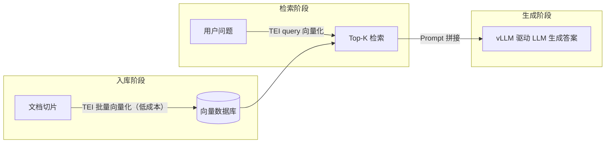

<!--module:
  parent: llm-inference
  slug: llm-inference/vllm-vs-tei
  type: deep-dive
  category: 工业级 LLM 部署
  summary: vLLM 与 TEI 分工对比——生成式推理 vs 向量化推理 / 5 维对比 / Pooling Models 口径修正 / RAG 三阶段互补架构
  depth: ⭐⭐⭐⭐
  status: active
  tags: [vLLM, TEI, Embedding 推理, Reranker, RAG 架构]
-->

# vLLM vs TEI · 生成式推理与向量化推理分工专题

> **一句话答案**：vLLM 是「文本生成引擎」（Decoder-only 自回归 + PagedAttention 管 KV Cache），TEI 是「文本向量化引擎」（Encoder 一次前向 + Rust 轻量运行时）——两者**不是竞争关系**，而是 RAG 链路里「**检索侧用 TEI、生成侧用 vLLM**」的互补分工。场景错配（拿 vLLM 跑纯向量化 / 拿 TEI 跑生成）会让成本和延迟都变差。

← [返回: LLM 推理](../README.md)

---

## 面试高频拷问

```text
Q：RAG 系统里 embedding 服务和生成服务都用 vLLM 统一托管，还是分开选型？
```

**回答框架（按 4 层递进）**：

1. **任务本质**：文本生成（自回归逐 token 解码）与文本向量化（一次前向 pooling）是两种计算图，资源模型完全不同
2. **专用 vs 统一**：vLLM 确实能跑 embedding（Pooling Models），但纯向量化高并发场景 TEI 通常更省资源、延迟更稳
3. **RAG 分工**：入库 / 检索用 TEI，生成用 vLLM——"专用工具做专用事"
4. **反模式**：为"统一技术栈"让 500 万文档切片向量化也走 vLLM 的 KV Cache 调度栈

> 📌 **面试深挖版**（30s/90s 话术 + 3 大陷阱 + 延伸追问）：[12.interview/11.ai/vllm-vs-tei](../../../12.interview/11.ai/vllm-vs-tei/README.md)。

---

## 一、vLLM 是什么：生成式推理引擎

**vLLM** 是开源高性能 LLM 推理与服务框架，服务 **文本生成任务（Generative Tasks）**：

- **核心技术**：**PagedAttention**（SOSP'23 论文）借鉴 OS 虚拟内存分页思想，对推理时的 **KV Cache** 动态分块管理，解决显存碎片化与浪费（详见 [paged-attention](../paged-attention/README.md) / [kv-cache](../kv-cache/README.md)）
- **主要优势**：极高的吞吐量（官方宣称最高 ~24x vs HuggingFace Transformers；库内统一实测口径见 [vllm-vs-ollama/06-benchmark-data](../vllm-vs-ollama/06-benchmark-data.md)，14-24x 区间，ShareGPT + LLaMA-7B + A10G 口径）+ **连续批处理**（[continuous-batching](../continuous-batching/README.md)）+ 无缝兼容 HuggingFace 模型生态
- **资源特征**：显存占用随生成长度**动态增长**——历史 token 的 KV Cache 必须常驻显存
- **适用场景**：智能对话、文本续写、代码生成、Agent 规划等**生成式任务**

## 二、TEI 是什么：Embedding / Reranker 专用推理运行时

**TEI（Text Embeddings Inference）** 是 Hugging Face 官方开源的**文本嵌入与序列分类**（Reranker）模型服务化工具包，服务**特征提取任务（Extractive Tasks）**：

- **核心技术**：**Rust** 编写，针对 **Encoder 架构**（BERT / BGE / GTE / E5 等）的计算特性深度优化——一次前向输出整段向量，**无自回归解码、无 KV Cache**
- **主要优势**：无需复杂模型图编译、部署轻量（单容器起服务）；高效的**动态批处理（Dynamic Batching）** + Rust 层 Tokenization，向量提取延迟低、吞吐高
- **资源特征**：显存占用**相对固定**——主要由最大序列长度 × 批处理大小决定，不随"生成长度"膨胀
- **适用场景**：RAG 文档切片向量化、语义检索 query 向量化、重排序（Reranking）、文本聚类

> 模型选型（BGE / E5 / GTE 怎么挑）见 [rag/embedding-models](../../rag/embedding-models/README.md)；Reranker 原理见 [rag/reranker](../../rag/reranker/README.md)。本篇聚焦**推理服务化运行时**的选型分工。

## 三、核心区别：5 维对比

| 维度 | vLLM | TEI |
| :--- | :--- | :--- |
| **核心任务** | 文本生成（Decoder-only 自回归）| 向量化 / 重排序（Encoder / Pooling）|
| **优化重点** | **KV Cache 管理**（PagedAttention）+ 连续批处理，优化自回归显存利用率 | **一次前向编码** + Tokenization / 动态批处理的极致效率，无 KV Cache |
| **实现语言** | Python / C++（CUDA 算子）| **Rust**（轻量、高并发、内存安全）|
| **资源特征** | 显存随生成长度动态增长，需大量显存存历史 KV Cache | 显存相对固定，取决于 max seq len × batch size |
| **典型场景** | 聊天机器人、内容创作、复杂推理、Agent 执行 | RAG 切片向量化、语义检索、Reranking |

## 四、常见疑问：vLLM 也能跑 Embedding 模型吗？

**可以，但定位不同。**

vLLM 支持 **Pooling Models**（池化模型）——即 embedding / reranker 这类"输出池化向量或分数"的 Encoder 模型：

- 池化任务类型：`embed`（向量表示，bi-encoder）/ `score`（reranker 打分，cross-encoder）/ `classify` / `token_embed` / `token_classify` 等，可用 `--pooler-config.task <task>` 显式指定
- 对外端点：`/v1/embeddings`（向量化）、`/v1/score` 与 `/v1/rerank`（Cohere Rerank 兼容）、`/pooling`（通用池化）
- 想用一个框架统一管理所有模型（生成 + 向量化 + 重排），vLLM 是可行选择

> ⚠️ **常见错误口径**：网上常见"`--task pooling` 参数支持 embedding"的写法——**"pooling"不是任务取值**。"Pooling Model"是模型类别名，任务取值是 `embed` / `score` / `classify` 等（来源：[vLLM 官方文档 · Pooling Models](https://docs.vllm.ai/en/latest/models/pooling_models.html)）。

**但是**，纯 Embedding 高并发生产场景中 **TEI 通常仍是更优选择**：

- TEI 是专为 Encoder 架构设计的独立运行时，**没有生成模型的历史包袱**（无需维护 KV Cache 调度、无需解码循环），纯向量化的延迟和资源利用率做了极致优化
- 社区基准的定性口径：**短序列下 TEI 延迟通常更优**，而 **vLLM pooling 吞吐随 Batch Size 增大提升显著**——两者随硬件 / 序列长度 / batch 大小互有胜负，上线前应以目标负载实测为准

**一句话**：统一托管、模型混部 → vLLM 可行；纯向量化、成本敏感 → TEI。

## 五、实际架构：RAG 三阶段互补分工

在企业级 RAG 架构中，vLLM 与 TEI 是**协作互补**关系：



1. **知识入库**：TEI 高效、低成本地把海量文档切片转化为向量，写入向量数据库
2. **检索**：用户提问时 TEI 快速向量化 query，向量库检索 Top-K 文档片段（复杂 rerank 场景可用 TEI rerank 端点）
3. **生成**：检索片段 + 问题拼接成 Prompt，交由 vLLM 驱动的 LLM 阅读理解、生成最终答案

这种"专用工具做专用事"的组合，最大化系统整体性能、稳定性和成本效益——生成侧吃 PagedAttention 的高吞吐，检索侧吃 TEI 的低延迟低资源。

---

## 反直觉点

- ⚠️ **vLLM 与 TEI 不是「同一赛道的两个产品」**：一个生成、一个编码，讨论"谁比谁快"本身是范畴错误——先问负载是生成还是向量化
- ⚠️ **「vLLM 能跑 embedding」≠「生产就该用 vLLM 跑 embedding」**：Pooling Models 是能力补齐，不是向量化负载的最优解——"能跑"与"跑得最优"是两回事
- ⚠️ **TEI 不是「小 vLLM」**：无 KV Cache、无自回归解码，连显存模型都不同（固定 vs 动态增长）——运维经验（如显存估算公式）不可直接迁移

---

## 速查 · 关联资源

- **同类对比**：[vllm-vs-ollama](../vllm-vs-ollama/README.md) — 生成式引擎内战（生产 vs 本地）· [inference-frameworks](../inference-frameworks/README.md) — 六大生成式推理框架横评
- **RAG 侧**：[embedding-models](../../rag/embedding-models/README.md) — Embedding 模型选型 · [reranker](../../rag/reranker/README.md) — 重排序原理与 vLLM 加速
- **餐厅叙事**：[39 · AI 私有化部署](../../../13.story/39-ai-private-deployment.md) — 阿明餐厅从 Ollama 本地试跑到 vLLM 上生产的演进
- **面试题**：[vllm-vs-tei](../../../12.interview/11.ai/vllm-vs-tei/README.md) — 面试深挖版（3 大陷阱 + 30s/90s 话术 + 追问）

---

## 📚 参考来源

- [vLLM 官方文档 · Pooling Models](https://docs.vllm.ai/en/latest/models/pooling_models.html) — 池化任务类型（embed / score / classify）与 `/v1/embeddings`、`/v1/score`、`/v1/rerank` 端点的**一手依据**（2026-10-28 联网核实；本文对"`--task pooling`"口径的修正以此为准）
- [vLLM Paper (SOSP'23)](https://arxiv.org/abs/2309.06180) — PagedAttention 原始论文；吞吐倍数的原始口径
- [TEI 官方仓库](https://github.com/huggingface/text-embeddings-inference) — Rust 实现 / Encoder 优化 / 动态批处理（**指针未联网核实**，TEI 侧细节建议对照官方 README 复核）
- **口径声明**：TEI 与 vLLM pooling 的延迟 / 吞吐对比为社区基准的**定性表述**，具体数字随硬件、batch 大小、序列长度变化，以官方 benchmark 与目标负载实测为准

← [返回: LLM 推理](../README.md)
