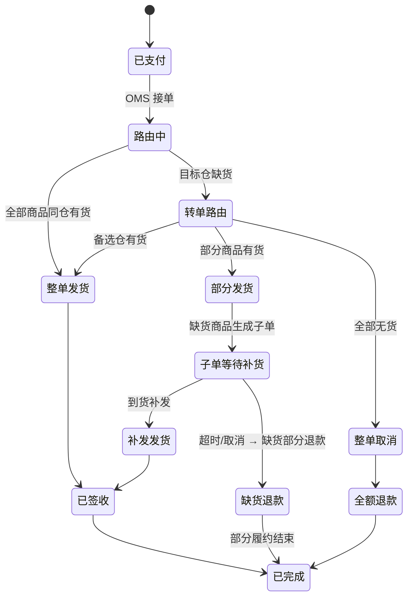

<!--module:
  parent: application-systems
  slug: application-systems/04-sales-service/oms
  type: article
  category: 主模块子文章
  summary: 一份按业务场景梳理的 OMS 速查手册：从"多渠道接单"到"全渠道订单中枢"。
  depth: ⭐⭐
  status: active
-->

# OMS · 订单管理系统

> 一份按业务场景梳理的 OMS 速查手册：从"多渠道接单"到"全渠道订单中枢"。

---

## 一、一句话定位

**OMS（Order Management System，订单管理系统）**：在全渠道零售场景下，把天猫、京东、抖音、小程序、自营 App 等所有渠道的订单统一接入、合并、路由到合适的仓库发货的系统。

---

## 二、为什么需要 OMS（电商场景）

```text
订单来源：
  ┌──────┐ ┌──────┐ ┌──────┐ ┌──────┐ ┌──────┐
  │ 天猫 │ │ 京东 │ │ 抖音 │ │小程序│ │ 自营 │
  └─┬────┘ └─┬────┘ └─┬────┘ └─┬────┘ └─┬────┘
    │         │         │         │         │
    └─────────┴─────────┴─────────┴─────────┘
                       ↓
                    ┌─────┐
                    │ OMS │  ← 统一订单中枢
                    └──┬──┘
                       ↓
       ┌───────────────┼───────────────┐
       ↓               ↓               ↓
   ┌──────┐       ┌──────┐       ┌──────┐
   │ 仓库A│       │ 仓库B│       │ 门店  │
   └──────┘       └──────┘       └──────┘
```

**没有 OMS**：每个渠道订单独立处理，库存不同步，超卖严重。
**有了 OMS**：订单统一管理，库存自动路由（最近仓库发货），降低物流成本。

---

## 三、核心功能（5 大模块）

| 模块 | 功能 | 价值 |
|------|------|------|
| **多渠道接单** | API/ERP 集成 30+ 平台 | 统一订单视图 |
| **订单合并/拆单** | 同用户多订单合并 | 降低运费（行业经验值约 10-30%，因企业而异）|
| **智能路由** | 最近仓库 / 库存最多 / 最便宜 | 提升物流时效（行业经验值约 20%，因企业而异）|
| **库存同步** | 实时库存共享 | 显著减少超卖（行业经验值可达 80%，因企业而异）|
| **异常处理** | 缺货 / 退货 / 拒收 | 自动化处理 |

> 上表"价值"列为行业经验值口径，实际收益随品类、仓网布局、单量规模差异很大，选型时应以自己业务的基线数据实测为准。

---

## 四、典型行业应用

| 行业 | 重点 |
|------|------|
| **电商** | 全渠道库存同步、跨平台发货 |
| **新零售** | 线上线下融合（OMO）、门店发货 |
| **跨境电商** | 多仓库路由（国内/海外） |
| **B2B** | 大宗订单、批次管理 |

---

## 五、主流厂商/产品对比

| 类型 | 代表产品 | 适用规模 |
|------|---------|---------|
| **国际大厂** | SAP OMS / Manhattan OMS / Sterling OMS | 大型集团 |
| **国内主流** | 巨沃 / 商派 / 管易云 / 旺店通 | 中大型 |
| **电商 ERP 集成** | 旺店通 / 店小秘 / 麦店 | 中小电商 |
| **SaaS 新势力** | 甄云 / 华为云 OMS | 中小 |

---

## 六、选型建议

| 场景 | 推荐 |
|------|------|
| 大型集团（全渠道零售）| Manhattan OMS / SAP |
| 中型电商（年 GMV 1-10 亿）| 巨沃 / 旺店通 / 商派 |
| 小型电商 | 店小秘 / 麦店（轻量级）|
| 跨境电商 | 旺店通跨境版 / 店小秘 |
| 跨境 + 海外仓 | 递四方 / 万邑通 |

---

## 七、核心能力：智能路由

| 策略 | 适用场景 |
|------|---------|
| **最近仓库** | 物流时效优先（次日达）|
| **库存最多** | 避免缺货 |
| **最便宜** | 成本优先（运费最低）|
| **最快发货** | 紧急订单 |
| **定制规则** | 品牌方指定仓库 |

---

## 八、订单合并/拆单规则

### 8.1 合并条件矩阵（合并发货 = 省运费）

同一买家的多笔订单要合并成一个发货单，**必须同时满足**以下条件（任一不满足即放弃合并、独立发货）：

| 条件维度 | 合并要求 | 不满足的后果 |
|---------|---------|-------------|
| **同店铺/同商家** | 是（跨店铺不能合并，结算主体不同）| 运费无法归集到一张面单 |
| **同收货人 + 同地址** | 姓名/手机/地址三要素一致 | 面单收件信息冲突 |
| **同仓库** | 智能路由后落到同一发货仓 | 需要拆单，各仓分别发货 |
| **下单时间窗** | 通常 ≤ 30-60 分钟（未进入拣货流程前）| 已拣货订单合并会造成回架浪费 |
| **重量/体积上限** | 合并后不超快递单件限制（如 ≤ 20kg）| 超限需拆成多包裹 |
| **支付状态** | 均已支付（COD 另按渠道规则）| 未支付订单不能占用库存路由 |
| **商品属性兼容** | 无互斥品类（如食品与化学品）| 合规/包装冲突 |
| **优惠归属** | 合并不影响各订单的优惠分摊与退款核算 | 财务对账无法拆回 |

> **工程要点**：合并在 OMS 内部是"多订单 → 一发货单"的**一对多映射**，订单主体不变；退款、发票、对账仍按原订单维度进行，只有物流面单是合并的。

### 8.2 拆单触发规则（一单变多单）

| 触发场景 | 拆单依据 | 典型例子 |
|---------|---------|---------|
| **多仓发货** | 库存分布在不同仓库 | 3 件商品分散在华东仓 + 华南仓 → 拆 2 单 |
| **超重/超体积** | 超过快递单件限制 | 大家电 + 配件 → 拆大件物流 + 小件快递 |
| **预售/现货混合** | 发货时间不同 | 现货立即发，预售到货再发 |
| **品类互斥** | 包装/合规要求 | 常温食品与冷链生鲜分箱 |
| **部分缺货** | 有货先发、缺货等待或取消 | 见第九节异常处理 |

> **拆单后的用户体验约束**：拆单要同步到渠道侧（如天猫拆单消息），运费只收一次，物流单号要能在订单详情全部展示，否则客诉率上升。

---

## 九、异常处理流程

### 9.1 缺货处理（转单 / 部分发货 / 整单取消）

```text
订单进入路由 → 目标仓库存不足
  ├─ ① 自动转单：其他仓有货 → 重新路由到备选仓（最常见问题自动消化）
  ├─ ② 部分发货：可发商品先发，缺货商品生成子单等待补货或退款
  └─ ③ 整单取消：全部无货且无补货计划 → 触发退款 + 渠道侧关单
优先级：① > ② > ③（尽量保履约率）
```

### 9.2 部分发货状态机



### 9.3 其他异常场景速查

| 异常 | 处理策略 |
|------|---------|
| **买家拒收** | 物流回传拒收 → OMS 生成退货入库单 → 质检后库存回滚 → 触发退款 |
| **退货/换货** | 逆向单关联原订单，换货生成新发货单（不重新收款）|
| **面单打印失败** | 重试 + 切换备用快递商（电子面单配额耗尽是常见原因）|
| **渠道关单（买家退款）** | 未发货：直接拦截；已发货：物流拦截（成功率有限）或等拒收 |
| **库存超卖已成单** | 协商换货/补偿，或调拨其他仓库存履约 |

> **实施要点**：异常处理的关键不是流程本身，而是**异常单不落地就没人管**——所有异常必须进异常工作台（工单队列 + 超时升级 + SLA 看板），否则大促期间靠人工翻单必漏。

---

## 十、实施关键点

1. **库存主数据**：所有渠道实时同步（避免超卖）
2. **订单合并规则**：见第八节合并条件矩阵（用户/地址/仓库/时间窗/重量体积）
3. **异常处理**：缺货时自动转单 / 部分发货（见第九节状态机），异常单进工作台
4. **对账规则**：与各渠道自动对账（财务结算）
5. **大促准备**：双 11/618 前必须压测（订单洪峰）

---

← [返回业务系统总览](../README.md)

**横向互链**：
- [CRM 客户关系管理](../crm/README.md) — 订单来源之一：会员/线索转化后的成交订单沉淀回 CRM 客户视图
- [SCRM 社交化客户关系](../scrm/README.md) — 私域渠道（企微/社群）订单入口与复购运营
- [ERP 企业资源计划](../../05-operations/erp/README.md) — OMS 的下游：订单履约后同步财务/采购/仓储主数据

## 📊 本节统计

- **核心模块**：5 大模块（多渠道接单 / 订单合并拆单 / 智能路由 / 库存同步 / 异常处理）
- **典型行业**：4 类（电商 / 新零售 / 跨境电商 / B2B）
- **智能路由策略**：5 类（最近仓库 / 库存最多 / 最便宜 / 最快发货 / 定制规则）
- **合并条件**：8 维矩阵；**拆单触发**：5 类场景
- **厂商分类**：4 类（国际大厂 / 国内主流 / 电商 ERP 集成 / SaaS 新势力）
- **典型收益**：行业经验值口径（运费约 -10~30% / 时效约 +20% / 超卖约 -80%，因企业而异）
- **所属价值链**：04 销售服务