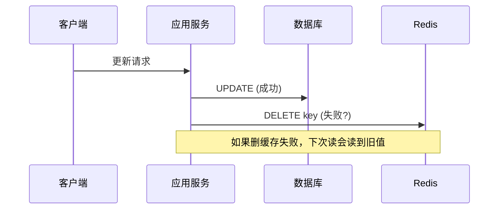
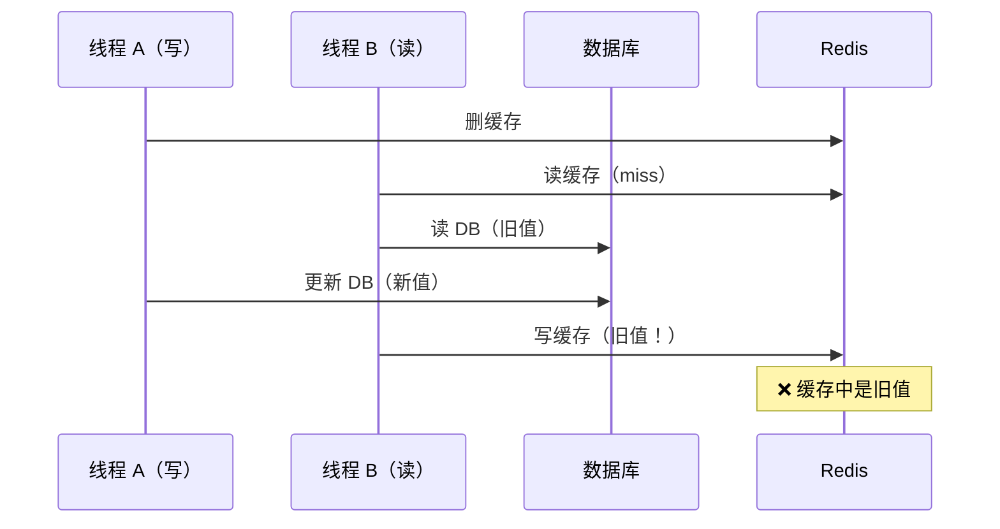
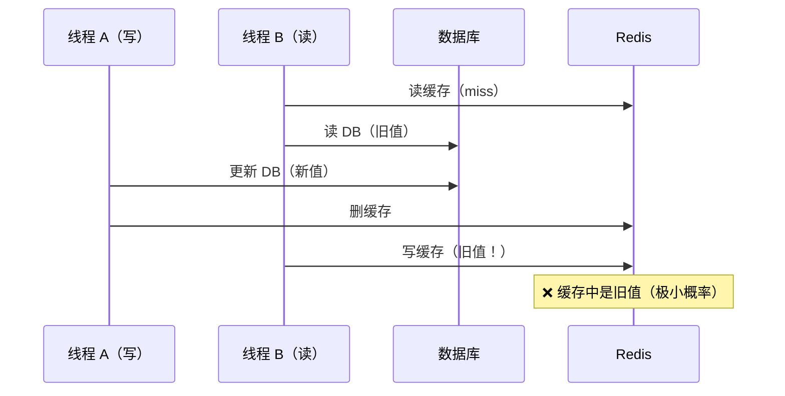

<!--question:
  id: 04.system-design-cache-consistency
  topic: 04.system-design
  difficulty: ⭐⭐⭐
  frequency: 中频
  scenario_type: 反直觉代码
  tags: [04.system-design, cache, consistency]
  status: active
-->

# 缓存与数据库双写一致性

> **一句话定位**：Cache Aside 是主流（先更 DB 再删缓存），删缓存失败靠延迟双删或 Canal 监听 Binlog 异步删。

## 引子：改了数据库，缓存还是旧数据

```java
// 更新用户信息
userMapper.update(user);     // ① 更新数据库
redis.del("user:" + userId); // ② 删除缓存

// 如果第 ② 步失败了？
// 数据库是新数据，缓存还是旧数据 → 不一致！
```

缓存是数据库的"影子"。数据更新时，两者必须保持一致。

但问题是：**数据库和缓存是两个独立的存储，无法原子更新**。必然存在短暂的不一致窗口。

怎么把这个窗口压到最小？

---

> 📚 **前置知识**：[Redis](../../../03.data-stack/01-database/07-redis/README.md)

## 一、核心问题

缓存是 DB 的"影子"，数据更新时必须保持两者一致。但缓存和 DB 是**两个独立存储**，无法原子更新 —— **必然存在短暂的不一致窗口**。

### 4 种更新策略对比

| 策略 | 操作顺序 | 一致性 | 问题 |
|------|---------|--------|------|
| **Cache Aside**（旁路缓存） | 先更新 DB，再删缓存 | ✅ 最终一致 | 删缓存失败 |
| Read Through | 读时由缓存层加载 | ✅ 一致 | 写操作复杂 |
| Write Through | 写时由缓存层同步写 DB | ✅ 强一致 | 写延迟高 |
| Write Behind | 写时只写缓存，异步写 DB | ⚠️ 可能丢数据 | 宕机丢数据 |

**业界共识**：**Cache Aside + 先更新 DB 再删缓存** 是主流方案。

---

## 二、先更新 DB 再删缓存



### 为什么"删缓存"而不是"更新缓存"？

**更新缓存的问题**：
1. 并发写入时可能覆盖（A 更新为 10，B 更新为 20，缓存可能被 A 覆盖成 10）
2. 计算成本高（如缓存是聚合计算结果）
3. 缓存可能还没被访问就更新了，浪费

**删缓存的优势**：
1. 懒加载（下次读时再计算，避免无效更新）
2. 避免并发覆盖问题
3. 实现简单

---

## 三、三种"不一致"场景

### 场景 1：删除缓存失败

```text
1. 更新 DB 成功
2. 删缓存失败（网络抖动 / Redis 宕机）
3. 下次读到旧数据 → 不一致
```

**解决方案**：重试机制（消息队列异步重试）

### 场景 2：先删缓存后更新 DB（错误做法）



**结论**：**绝对不要"先删缓存后更新 DB"**。

### 场景 3：先更新 DB 再删缓存的极端情况



**发生条件**：读操作慢于写操作（几乎不会发生，因为 DB 读比 Redis 写慢得多）

---

## 四、解决方案

### 方案 A：延迟双删

```java
public void updateData(Data data) {
    // 1. 先删缓存
    redis.del(key);

    // 2. 更新 DB
    db.update(data);

    // 3. 延迟 N 毫秒再删一次
    Thread.sleep(500);  // 或异步
    redis.del(key);
}
```

**原理**：第二次删除覆盖"场景 3"中可能写入的旧值。

**延迟时间**：建议 `读请求耗时 + 几百毫秒`。

**缺点**：
- 同步延迟影响接口性能
- 异步延迟需要消息队列

---

## 七、延时时长的反直觉追问：为什么不是固定一秒？

> **一句话定位**：「延迟双删」中的 N 毫秒不是固定值，而是**业务读链路 P99 耗时 + 安全 buffer** —— 固定 1 秒是初学者误区，面试官追问的"为什么"答案在这里。

### 引子：「1 秒」是初学者最爱说的数字

面试官问："你们项目用延迟双删，延时多久？"

候选人脱口而出：**"1 秒。"**

面试官继续追问：**"为什么是 1 秒？为什么不是 100 毫秒？为什么不是 2 秒？为什么不是 5 秒？"**

候选人卡壳。——这就是「固定 1 秒」思维陷阱。

---

### 一、为什么「固定 1 秒」是误区

**真相**：「延迟双删」中的 N 不是写死的魔法数字，而是**业务决定的工程参数**：

| 业务特征 | 延时应该 | 原因 |
|---------|---------|------|
| 读链路极快（< 10ms，如本地缓存） | N = **50-200ms** | 只需覆盖并发读写窗口 |
| 读链路中等（10-100ms，如单 Redis） | N = **500ms-1s** | 覆盖 Redis 写 + 读返回全程 |
| 读链路很慢（> 100ms，如 Redis Cluster + DB 回源） | N = **1-3s** | 必须等最坏情况读完成 |
| 强主从同步要求（金融 / 账务） | N = **读 P99 + 几百 ms buffer** | 留出主从同步窗口 |

**反直觉 1**：1 秒不是「行业标准」——它是 **Redis 单机 + 普通业务** 的经验值，不是普适答案。

**反直觉 2**：N 太小的风险 > N 太大的风险——N 太小会漏删并发旧值，N 太大只是浪费线程 sleep 时间。

---

### 二、延时公式推导

**核心公式**：

```text
N = 读请求耗时 P99 + 安全 buffer（几百毫秒）

其中：
- 读请求耗时 P99：覆盖 99% 的正常读链路（miss → DB → 回填缓存）
- 安全 buffer：覆盖主从同步、网络抖动、JVM GC 暂停
```

**为什么是 P99 而不是平均值？**

- 平均值会被大量快速请求拉低，**无法覆盖最坏情况**（P99 是 1% 的尾巴）
- 延迟双删的本质是「覆盖可能写入旧值的并发读」，**必须用最坏情况倒推**

**buffer 为什么是「几百毫秒」而不是具体数字？**

- 主从同步耗时：Redis 主从异步复制通常 < 50ms，但跨机房可到 100-200ms
- JVM GC 暂停：G1/ZGC 通常 < 100ms，但偶尔 Full GC 几百毫秒
- 网络抖动：跨可用区 RTT 通常 < 5ms，但偶发抖动可能几十毫秒
- → **几百毫秒**是这些不确定性的总兜底

---

### 三、业务场景适配

#### 场景 1：单 Redis + 单机房（最常见）

```java
Thread.sleep(500);  // 读 P99 ≈ 200ms + 300ms buffer
```

#### 场景 2：Redis Cluster 跨槽读 + 多机房

```java
Thread.sleep(2000);  // 读 P99 ≈ 800ms(跨机房) + 1200ms buffer(主从同步)
```

#### 场景 3：金融级强一致（避免 sleep 阻塞业务线程）

```java
// 改用 MQ 延时消息代替 Thread.sleep
rocketMQTemplate.sendDelay("cache-evict", key, delayLevel = 5); // 5 = 1 分钟
```

#### 场景 4：读链路是 L1 Caffeine + L2 Redis（多级缓存）

```java
// 注意：L1 Caffeine miss 后回查 L2 Redis 可能极快（<5ms），但 L2 miss 后回查 DB 仍是 ~100ms
// 必须用「L2 miss → DB 回填」 这条最坏路径的 P99，而不是 L1 miss → L2 命中的快路径
long p99 = monitorService.getL2MissToDBFillP99();  // 必须从监控拿
Thread.sleep(p99 + 300);
```

---

### 四、5 大反模式

#### ❌ 反模式 1：固定 1 秒，不管业务

- 错：`Thread.sleep(1000)` 写死在代码里，所有业务共用
- 对：根据读链路 P99 + 业务容忍窗口**动态配置**（Apollo / Nacos）

#### ❌ 反模式 2：用平均值算延时

- 错：`N = 读平均耗时 + buffer`（平均 50ms → 设 200ms，漏掉 P99=800ms 的尾巴）
- 对：`N = 读 P99 + buffer`（最坏情况倒推）

#### ❌ 反模式 3：同步 sleep 阻塞业务线程

- 错：在 update 接口里 `Thread.sleep(2000)` → 接口 P99 翻倍，吞吐量暴跌
- 对：用 **MQ 延时消息** / **异步线程池** / **延迟队列** 代替同步 sleep

#### ❌ 反模式 4：没测就读 P99，盲拍一个数字

- 错：上线前没压测，凭"感觉"写 `sleep(500)`
- 对：**压测拿到读 P99 后**，buffer 取 2-3 倍标准差

#### ❌ 反模式 5：延时设完不改

- 错：上线后从不复盘延时是否合理（业务增长、库变更、网络拓扑变化都影响读 P99）
- 对：**每季度 review 一次**，配合监控告警（不一致率上升时主动调参）

---

### 五、实测方法（4 步法）

```text
步骤 1：监控读链路耗时
  → 监控 Redis GET miss → DB 查询 → 缓存回填 的 P99
  → 用 Cat / SkyWalking / Prometheus 抓 trace

步骤 2：识别业务读链路的「最坏路径」
  → 单 Redis miss：~5ms
  → Redis Cluster miss 跨槽：~20ms
  → Redis miss + DB 查询 + 回填：~50-200ms
  → 跨机房读：~200-500ms

步骤 3：灰度调参
  → 先 10% 流量跑 1 天，看不一致率
  → 再扩到 100%
  → buffer 系数从 1.5x 调到 3x 观察效果

步骤 4：业务方兜底
  → 缓存设置短 TTL（30s-5min）兜底
  → 即使延时不到位，TTL 到期也能自愈
```

---

### 六、面试话术（90 秒版）

> "**关于延时双删的时长**——这不是固定 1 秒，而是 `读请求耗时 P99 + 几百毫秒 buffer`。原因：
>
> 1️⃣ **延时本质是覆盖并发读链路**：必须等「读 miss → DB → 回填缓存」这条最坏路径走完，否则第二次删除可能发生在读回填缓存之前，**没机会删**。
>
> 2️⃣ **为什么是 P99 不是平均**：平均值拉得太低，漏掉 1% 的慢请求，这 1% 的旧值就会脏缓存。
>
> 3️⃣ **业务适配**：
> - 单 Redis 单机房 → 500ms-1s
> - Redis Cluster 跨槽 → 1-2s
> - 跨机房主从 → 2-5s
> - 金融级 → 用 MQ 延时消息代替 sleep（避免阻塞业务线程）
>
> 4️⃣ **反模式**：固定 1 秒写死代码、用平均耗时算延时、同步 sleep 阻塞业务线程、上线后从不复盘。
>
> 5️⃣ **兜底**：即使延时不到位，缓存短 TTL（30s-5min）也能自愈——所以延时是「锦上添花」，**TTL 才是「最后防线」**。"

---

### 七、相关章节

- 同章节前置：[§方案 A 延迟双删](#方案-a延迟双删) —— 22 行代码块是本章的前置阅读
- 主模块深读：[`06.distributed-systems/04-high-performance/cache-patterns`](../../../06.distributed-systems/04-high-performance/cache-patterns/README.md) §2.7 —— 延时公式推导 + Java 代码示例
- 兄弟章节：[§五 选型决策](#五选型决策) —— 延迟双删 vs Binlog 监听的选择标准

---

### 方案 B：基于 Binlog 监听（推荐）


```java
// Canal 消费者
@RocketMQMessageListener(topic = "cache-sync")
public class CacheSyncConsumer {
    public void onMessage(BinlogMessage msg) {
        if (msg.isUpdate() || msg.isDelete()) {
            redis.del(buildKey(msg));
        }
    }
}
```

**优点**：
- ✅ 业务代码无侵入
- ✅ 保证最终一致
- ✅ 可重试（消息队列）

**缺点**：
- 引入额外组件（Canal + MQ）
- 有几秒延迟

**工具**：Canal（阿里开源）、Debezium、mysql-cdc-connector

### 方案 C：订阅 key 过期事件（兜底）

```text
设置缓存 TTL → key 过期自动删除 → 下次读从 DB 加载
```

**优点**：无需额外机制
**缺点**：TTL 期间数据不一致

---

## 五、选型决策

| 场景 | 推荐方案 |
|------|---------|
| **读多写少 + 容忍短暂不一致** | Cache Aside + TTL 兜底 |
| **强一致性要求** | 延迟双删 + 短 TTL |
| **大型企业级** | Canal + MQ（最终一致） |
| **金融/支付** | 避免缓存，直读 DB |

---

## 六、面试话术（90 秒版）

> "**单级缓存**（Redis + DB）：主流方案是 **Cache Aside：先更新 DB，再删缓存**。不一致场景有 3 种：删缓存失败（重试）、先删缓存后更新 DB（绝对避免）、读写并发旧值入缓存（延迟双删或 Binlog 监听）。生产方案：中小企业用 Cache Aside + TTL 兜底，大型企业用 **Canal 监听 Binlog + MQ 异步删缓存**。
>
> **多级缓存**（L1 Caffeine + L2 Redis + L3 DB）：核心难题是 L1 是 JVM 本地缓存，每个实例独立，更新后无法通知其他实例。4 种方案：**短 TTL**（最简单，接受短暂不一致）、**Redis Pub/Sub**（最常用，发布失效消息所有实例订阅清 L1）、**MQ 广播**（RocketMQ 广播消费）、**ZK Watcher**（强一致但复杂）。推荐 Pub/Sub + 短 TTL 兜底。
>
> 写操作顺序：更新 DB → 删 Redis → 发 Pub/Sub 失效消息 → 所有实例清 L1。Pub/Sub 丢消息靠 TTL 兜底，不一致窗口 ≤ TTL 时长。
>
> 本质上，**缓存一致性是最终一致**，多级缓存只是在'不一致窗口大小'和'系统复杂度'之间权衡。"

---

## 六级进阶：多级缓存一致性（L1 + L2 + L3）

> 上面讲的是 Redis-DB 单级一致性。面试官追问：**"如果加了本地缓存（Caffeine），怎么保证多级缓存一致？"**

### 多级缓存架构

```text
请求 → L1: Caffeine（JVM 本地，< 1ms）
          ↓ miss
       L2: Redis（分布式，< 10ms）
          ↓ miss
       L3: MySQL（数据库，< 100ms）
```

### 多级缓存的核心难题

单级缓存（Redis-DB）只有一致性窗口。**多级缓存多了一个维度**：L1 是每个 JVM 实例独立的，更新 DB 后**无法自动通知其他实例的 L1**。

```text
实例 A：更新 DB → 删 Redis → 清自己的 L1 ✅
实例 B：L1 还是旧值 → 读到过期数据 ❌（直到 TTL 过期）
```

### 4 种 L1 失效方案

| 方案 | 实现 | 一致性 | 复杂度 | 适用 |
|------|------|--------|--------|------|
| **短 TTL** | L1 设 1-30 秒 TTL | 弱（最多 TTL 内不一致） | 低 | 读多写少，可接受短暂不一致 |
| **Redis Pub/Sub** | 更新后发布失效消息，所有实例订阅并清 L1 | 中 | 中 | **最常用**，中型集群 |
| **MQ 广播** | 更新后发 MQ（RocketMQ 广播模式），消费者清 L1 | 中 | 中 | 已有 MQ 基础设施 |
| **Zookeeper Watcher** | ZK 节点变更触发所有实例失效 | 强 | 高 | 金融场景 |

### Redis Pub/Sub 方案（推荐）

```java
// 1. 更新数据时，发布失效消息
public void updateUser(User user) {
    userMapper.update(user);          // 写 DB
    redis.del("user:" + user.getId()); // 删 L2
    // 发布失效通知（包括自己和其他实例）
    redisTemplate.convertAndSend("cache:evict:user", user.getId().toString());
}

// 2. 所有实例订阅，清理 L1
@Component
public class L1CacheEvictListener {
    @Autowired private Cache<String, Object> caffeineCache;

    @Bean
    public RedisMessageListenerContainer listenerContainer(
            RedisConnectionFactory cf) {
        RedisMessageListenerContainer container = new RedisMessageListenerContainer();
        container.setConnectionFactory(cf);
        container.addMessageListener((msg, pattern) -> {
            String key = new String(msg.getBody());
            caffeineCache.invalidate("user:" + key);  // 清本地 L1
        }, new ChannelTopic("cache:evict:user"));
        return container;
    }
}
```

### 多级缓存的写操作顺序

```text
推荐顺序（Cache Aside 多级版）：
1. 更新 DB（先保证持久化）
2. 删除 L2（Redis DEL）
3. 发布 Pub/Sub 失效消息 → 所有实例清 L1

注意：
- 不要先清 L1 再更新 DB（并发读写会导致旧值回填）
- Pub/Sub 消息是 fire-and-forget，丢消息时靠短 TTL 兜底
```

### 多级缓存面试加分点

| 问题 | 高分回答 |
|------|---------|
| "Pub/Sub 消息丢了怎么办？" | L1 短 TTL（30s）兜底，不一致窗口 ≤ 30 秒 |
| "实例很多（>100）Pub/Sub 扛得住吗？" | 换 MQ 广播模式（RocketMQ 广播消费），或只对热点 key 做 L1 |
| "L1 用强一致方案行不行？" | Zookeeper Watcher 可以，但延迟高 + 运维成本大，大多数场景不值得 |
| "怎么验证多级缓存一致性？" | 监控 L1/L2 命中率 + 定时对账脚本（对比 L1 值 vs DB 值）|

> 📚 **深度阅读**：[`缓存设计模式 §9.2`](../../../06.distributed-systems/04-high-performance/cache-patterns/README.md) — 5 大反模式 + Java/Spring 视角深度分析 | [`Spring 多级缓存实现`](../../../04.spring-backend/04-data/cache/multi-level.md) — CompositeCacheManager + 自定义 TwoLevelCache

---

## 七、交叉引用

- 主模块：[`03.database`](../../../03.data-stack/01-database/README.md) — 数据库与缓存
- [缓存穿透/击穿/雪崩](../../../03.data-stack/01-database/06-cache/README.md) — 缓存设计模式与问题解决方案
- [分布式事务](../distributed-transaction/README.md) — 跨服务一致性方案
- [缓存设计模式 §9.2](../../../06.distributed-systems/04-high-performance/cache-patterns/README.md) — 多级缓存 5 大反模式 + Java/Spring 深度分析
- [Spring 多级缓存实现](../../../04.spring-backend/04-data/cache/multi-level.md) — CompositeCacheManager + TwoLevelCache 代码实现
- [缓存降级](../../../04.spring-backend/04-data/cache/cache-degradation-and-recovery.md) — Redis 故障时的降级策略

## 相关章节

- 深度阅读：[`04.system-design`](../../../06.distributed-systems/README.md) — 主模块详细内容

> 📅 2026-09-01 · 咬文嚼字 · 缓存一致性 · ⭐⭐⭐（中频面试 + 实战必会）

← [返回系统设计咬文嚼字](../README.md)
