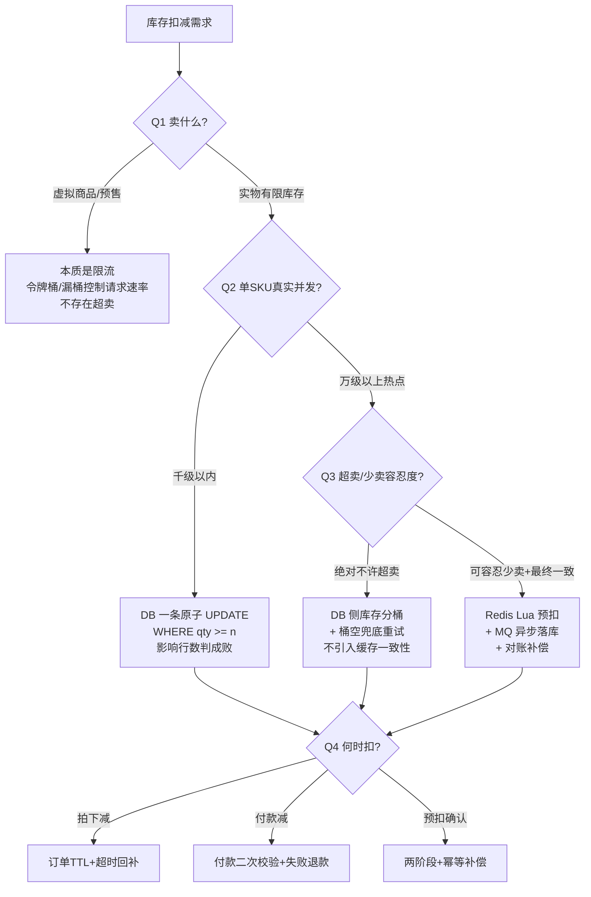

<!--question:
  id: 04.system-design-inventory-deduction-design
  topic: 04.system-design
  difficulty: ⭐⭐⭐⭐
  frequency: 高频
  scenario_type: 架构设计
  tags: [04.system-design, 库存扣减, 秒杀, 超卖, 少卖, 热点SKU, 库存分桶, 扣减时机]
  status: active
-->

# 高并发扣减库存怎么设计？—— 上来就答 Redis+MQ 的都是初学者

> 一句话定位：「高并发扣库存」不是技术选型题，而是**业务分析题** —— 先问清卖什么 / 多少并发 / 超卖少卖哪个更不能忍 / 何时扣，再定方案；多数场景一条带 `qty >= 1` 条件的原子 UPDATE 就够，Redis+MQ 只是**某些**场景的手段，且它把超卖问题换成了一致性问题。

> **系列定位**：经典系统设计面试题（电商、大促、秒杀岗位高频）。考察的不是"你背过几种扣库存方案"，而是 **业务场景分析能力** + **超卖 vs 少卖的容忍度权衡** + **方案与场景的匹配判断**。

---

## 引子：条件反射背方案的候选人

```text
面试官："设计一个高并发扣减库存的方案。"
候选人（条件反射）："Redis 预扣库存，Lua 脚本保证原子性；
    MQ 异步落库削峰；分布式锁兜底防超卖；库存分桶打散热点……"
面试官："先停一下。你卖的是什么？"
候选人："呃……商品？"
面试官："多少人抢？超卖和少卖，哪个更不能接受？库存是下单扣还是付款扣？"
候选人："……（答不上来）"
```

面试官这三个问题一出口，结论已经写好了：**这个人只是背过技术方案，没有真正分析过业务场景**。

方案背得再熟，没做业务分析就是空中楼阁——卖话费充值卡（虚拟商品）根本没有超卖问题，日销百单的小商家上 Redis+MQ 纯属给自己挖坑。更关键的是：**Redis+MQ 不是免费的**。它把"超卖"这一个问题，换成了"缓存与 DB 不一致"+"异步最终一致"两个新问题。方案越复杂，欠的债越多。

这道题的正确打开方式：**先问诊，再开方**。

---

## 一、先问业务：四个决定方案的问题

这一节是全题核心。四个问题构成一份可复用的"问诊清单"——任何库存类需求来了，先过一遍这四问，方案自然浮现。

### Q1：卖什么？（库存的物理属性决定问题是否存在）

| 商品类型 | 库存特征 | 有没有超卖问题 |
|---------|---------|---------------|
| **实物·限量品**（茅台 / 球鞋 / 演唱会票） | 有限且稀缺，一件都不能多卖 | ✅ 有，且最尖锐 |
| **实物·普通电商商品** | 有限但通常充足（几百上千件） | ✅ 有，但冲突概率低 |
| **虚拟商品 / 服务**（话费、会员、课程、云资源） | 库存近乎无限，"卖多少"取决于供给方额度 | ❌ 基本没有——本质是**限流**不是扣库存 |
| **预售** | 无现货，扣的是**预售额度**而非实物 | ❌ 额度是运营配的，超了改配置即可 |

**关键洞察**：虚拟商品和预售场景**根本不存在超卖问题**——给它们硬套"Redis 预扣 + 防超卖"一整套，是把限流问题（控制单位时间请求量）误诊成库存问题（保证账实相符）。前者回链 [限流算法](../rate-limiting/README.md)，后者才是本题。

### Q2：多少并发？（真实并发量级，不是 PV）

先分清**PV / UV / 同一 SKU 的真实写并发**——100 万 PV 的商城，落到**单个 SKU 同一秒的扣减请求**可能只有几十。量级分档决策（以下阈值为**量级判断、示例口径，非实测 benchmark**，实际容量必须压测）：

| 单 SKU 写并发量级 | 判断 | 方案方向 |
|------------------|------|---------|
| **百级以内** | 单机 DB 轻松扛 | 一条原子 UPDATE，什么中间件都不需要 |
| **千级** | 单行 UPDATE 的行锁竞争开始有感，但通常仍在 DB 承受范围内（量级判断，非 benchmark） | 原子 UPDATE + 连接池/超时调优，可加请求排队 |
| **万级以上·单 SKU 热点** | 单行锁竞争成为瓶颈 | 才轮到缓存前置（Redis Lua）或 DB 侧库存分桶 |

**反直觉点**：绝大多数业务的真实并发落在前两档。**"高并发"三个字吓出来的 Redis+MQ，多数时候是过度设计**——不是技术不对，是场景不配。

### Q3：超卖 vs 少卖，哪个更不能忍？（本题最有价值的辨析）

两种错误的代价完全不对称：

- **超卖** = 卖了不存在的货。后果是赔付、强制取消订单、用户投诉、平台处罚，甚至法务合规风险。**金融、限量品、强合规场景绝对不能超卖**。
- **少卖** = 有货没卖出去。后果是损失 GMV、活动效果打折。**多数电商可以容忍**——少卖的机会成本远低于超卖的处置成本。这就是"宁可少卖不可超卖"成为多数电商默认选择的原因。

**关键洞察**：几乎所有"高性能"手段，本质都是**用少卖风险换吞吐**——

| 手段 | 换来的吞吐 | 付出的代价 |
|------|-----------|-----------|
| Redis 预扣 | 扣减脱离 DB 行锁 | Redis 与 DB 出现不一致窗口（可能表现为少卖或多卖，取决于对账） |
| 异步 MQ 落库 | 请求快速返回 | 最终一致期间状态模糊，回补时序错乱可能少卖 |
| 库存分桶 | 单行锁竞争 ÷ N | 某桶空了但总库存还有 → **结构性少卖** |

而 DB 悲观锁 / 乐观锁是反方向：**用吞吐换不超卖**。

所以**先确定容忍度，再谈方案**——这就是"分析业务场景"的实质。绝对不许超卖的限量品，宁可牺牲吞吐也要强一致扣减；可容忍少卖的大促销场，才有资格上分桶、上异步。**跳过这一问直接报方案，等于不知道自己在优化什么、牺牲什么。**

### Q4：什么时候扣？（扣减时机，全库最容易漏掉的一问）

三种时机的权衡：

| 时机 | 超卖风险 | 恶意占位风险 | 实现复杂度 | 适用场景 |
|------|:-------:|:-----------:|:---------:|---------|
| **拍下减库存** | ✅ 无（下单即锁定） | ❌ 高：下单不付款锁死库存 | 中：需订单 TTL + 定时回补 | 限量品、秒杀（配合短 TTL） |
| **付款减库存** | ❌ 高：多人同时付款时库存已不足 | ✅ 无 | 低 | 库存充足的普通商品 |
| **预扣 + 确认**（主流电商） | ✅ 低 | ✅ 低（超时自动释放） | 高：两阶段 + 补偿 | 大多数交易场景 |

- **拍下减**：不超卖，但挡不住"下单不付款"的恶意占位（黄牛锁库存）→ 必须配**超时释放**：订单 TTL（如 15/30 分钟）+ 定时任务回补库存。
- **付款减**：没有占位问题，但下单时不锁库存，付款高峰期会超卖 → 必须**付款时二次校验库存**，扣减失败走退款路径。
- **预扣 + 确认**：下单预扣 → 支付成功确认扣减 → 超时/取消回补。本质是**两阶段 + 补偿**，回补操作必须幂等（同一订单重复回补不能加两次库存），详见 [幂等性设计](../idempotency/README.md) 与 [主模块幂等章节](../../../06.distributed-systems/06-idempotency/README.md)。

---

## 二、方案决策树：把四问的结论映射到方案



### 第一档：DB 原子 UPDATE（多数业务的正确答案，也是最多人漏掉的答案）

```sql
-- 一条 SQL 完成"判断 + 扣减"，以影响行数判定成败：
-- 影响行数 = 1 → 扣减成功；影响行数 = 0 → 库存不足（售罄）
UPDATE stock
SET qty = qty - 1
WHERE sku_id = ? AND qty >= 1;
```

```java
int rows = stockMapper.deduct(skuId, 1);
if (rows == 0) {
    throw new SoldOutException();   // 售罄，天然不超卖
}
```

为什么它足够好：

- **天然原子**：判断（`qty >= 1`）和扣减（`qty - 1`）在同一条语句内完成，DB 行锁保证并发安全，**不存在 check-then-act 竞态**；
- **天然不超卖**：条件不满足时影响 0 行，永远不会扣成负数；
- **天然幂等友好**：配合订单号唯一索引，重复请求不会重复扣；
- **零额外组件**：没有缓存一致性、没有消息丢失、没有对账任务。

**什么时候不该用**：单 SKU 写并发到了万级热点（第二档问题），行锁排队会把 DB 拖垮——这时才需要往下走。

### 第二档：单 SKU 热点 + 万级并发 → 缓存前置或 DB 分桶

两条打散路线见第三节。**什么时候不该用 Redis 预扣**：库存量小（几百件）、并发不高时，Redis 预扣纯属增加一致性负担——扣减快没有意义，反正几百件一瞬间就卖完了，DB 原子 UPDATE 直接扛完更简单。

### 第三档：虚拟商品 / 无限库存 → 限流

不扣库存，控制请求速率即可，方案完全在 [限流算法](../rate-limiting/README.md) 的范畴。

### 第四档：需要削峰且可接受最终一致 → MQ 异步

只有走到这一档，"Redis+MQ"才是正确答案。注意 MQ 消费能力不足时积压会把"库存落库延迟"无限放大，积压治理见 [MQ 消息积压](../mq-backlog/README.md)。

---

## 三、热点 SKU 的两条打散路线

单 SKU 万级并发的本质瓶颈：**所有请求争抢同一行记录的锁**。两条路线都叫"打散"，代价完全不同。

### 路线 A：DB 侧库存分桶

把 1 行库存拆成 N 行子库存（如 1000 件拆成 10 桶 × 100 件），请求随机或哈希路由到某个桶：

```sql
-- 表结构：stock_bucket(sku_id, bucket_no, qty)
-- 请求随机选桶扣减，仍是原子 UPDATE，以影响行数判成败
UPDATE stock_bucket
SET qty = qty - 1
WHERE sku_id = ? AND bucket_no = ? AND qty >= 1;
```

- **优点**：单行锁竞争降为 1/N；数据始终在 DB，**不引入缓存一致性问题**；对账简单（SUM 所有桶即总库存）。
- **代价**：**结构性少卖**——某个桶空了但其他桶还有货，随机路由的请求会误判售罄。
- **兜底**（必须做，否则少卖被放大）：桶空后**轮询重试其他桶**（有限次，如再试 2-3 个桶）；**定期再平衡**（把剩余桶的库存重新均分）。这正是 Q3"少卖容忍度"的实际应用：兜底重试越激进，少卖越少但热点又回来了，需要按业务调参。

### 路线 B：Redis 预扣 + MQ 异步落库

Redis 用 Lua 脚本原子扣减（判断+扣减一个脚本内完成），成功后发 MQ 异步更新 DB。

- **优点**：吞吐上限最高，扣减完全脱离 DB。
- **代价**：引入**缓存-DB 一致性**全套难题——Redis 扣了但 MQ 消息丢了 / 消费失败了 → DB 库存虚高 → 后续对不上账；回补消息乱序 → 库存回补错位。必须配**对账补偿任务**（定时比对 Redis 剩余 + 在途消息 + DB 已落库 = 初始库存）。

### 两条路线对比

| 维度 | 路线 A：DB 分桶 | 路线 B：Redis+MQ |
|------|:--------------:|:----------------:|
| 一致性风险 | ✅ 无（单一数据源） | ❌ 缓存-DB 双写 + 消息可靠性的双重风险 |
| 少卖风险 | ❌ 桶空误判（需兜底重试） | ✅ 低（Redis 侧全局计数） |
| 吞吐上限 | 高（锁竞争 ÷ N） | 最高 |
| 实现复杂度 | 中（分桶 + 再平衡） | 高（Lua + MQ + 对账三件套） |
| 排障难度 | 低（查 DB 即可） | 高（Redis / MQ / DB 三处任一环节） |

> ⚠️ **与 [分片键与数据倾斜](../sharding-key-data-skew/README.md) 的区别**：那道题治的是**分片键倾斜**——数据/流量按分片键分布不均，热点键落在单个分片；本题治的是**单行热点**——同一行库存记录被高并发争抢行锁。手段相似（都叫"打散"），问题层次不同：一个是分片路由问题，一个是行锁竞争问题。

---

## 四、Redis+MQ 方案的三个隐藏成本

回应引子的论断——"Redis+MQ 不是免费的"，具体贵在三处：

### ① 缓存与 DB 双写一致性

Redis 扣减成功但落库失败（MQ 丢消息 / 消费者异常 / DB 宕机）→ 两边库存永久漂移。必须建**对账机制**：定时任务核对 `Redis 剩余 + 在途未落库 + DB 已扣 = 初始总量`，不平则告警人工介入。双写一致性的通用模式（延迟双删 / binlog 监听）见 [缓存与数据库双写一致性](../cache-consistency/README.md)。

### ② 异步最终一致改变业务语义

用户看到"抢购成功"时，订单和库存**尚未落库**。这带来一串连锁问题：用户立刻取消订单，回补消息和扣减消息谁先到？支付回调来了但库存消息还在排队，放不放行？每个环节都要按"最终一致"重新设计，取消/退款路径复杂度翻倍。若业务要求"扣减成功=落库成功"的强语义，这套方案从根上就不合适——考虑 [分布式事务](../../../06.distributed-systems/02-distributed/distributed-transaction/README.md) 或直接回到 DB 原子扣减。

### ③ 排障与可观测性成本

"用户说没抢到但库存明明还有"——问题可能在 Redis（Lua 执行了但响应超时）、MQ（消息积压/重复消费）、DB（落库失败）三处任一环节。需要全链路 traceId 贯穿三层 + 各环节库存水位监控 + 对账报表，这套可观测性设施的建设成本常常超过扣减功能本身。

---

## 五、❌/✅ 反例对比

### 反例 1：不问业务直接报方案

```text
❌ 面试官："高并发扣库存怎么设计？"
   候选人："Redis Lua 预扣 + MQ 异步落库 + 分布式锁兜底 + 库存分桶。"
   （四个手段都对，但一个前提都没确认——面试官无从判断你是设计过还是背过）

✅ 候选人："先确认几个业务参数：卖的是实物还是虚拟商品？单 SKU 真实写并发什么量级？
   超卖和少卖哪个更不能接受？下单扣还是付款扣？
   ——如果是普通实物、千级以内并发、不许超卖，一条带 qty>=1 条件的原子 UPDATE 就是最优解；
   只有万级单 SKU 热点且能接受最终一致时，我才会上 Redis 预扣 + MQ，并且要配对账。"
```

同样的知识储备，一个是"手段清单"，一个是"决策过程"——档次差别就在于**方案是从业务参数推导出来的，不是背出来的**。

### 反例 2：check-then-act 竞态

```java
// ❌ 先查再判再改：两步之间状态可能已变，并发下必然超卖
Stock s = stockMapper.selectBySku(skuId);   // T1: 读到 qty=1
if (s.getQty() >= 1) {                      // T2: 另一线程也读到 qty=1，也通过判断
    stockMapper.update(skuId, s.getQty() - 1);  // 两边都扣 → qty=-1，超卖
}

// ✅ 判断与扣减压进一条原子 UPDATE，以影响行数判定成败
int rows = jdbc.update(
    "UPDATE stock SET qty = qty - 1 WHERE sku_id = ? AND qty >= 1", skuId);
if (rows == 0) { /* 售罄 */ }
```

`SELECT` 后在应用层判断再 `UPDATE`，是库存超卖最经典的根源。修正路径：**把条件下沉到 UPDATE 的 WHERE 里**，让 DB 行锁替你完成原子判断（与 [无 Redis 秒杀](../seckill-without-redis/README.md) 中乐观锁防超卖同一原理，version/唯一索引等单机细节见该文，不复述）。

### 反例 3：分桶后不做兜底

```text
❌ 1000 件拆 10 桶，请求随机路由；3 号桶先卖空后，
   路由到 3 号桶的请求直接返回"售罄"——此时总库存还剩 200+ 件。
   结果：明明有货却大面积卖不出去，少卖被无谓放大。

✅ 桶空后轮询重试其他桶（有限次，防止重试风暴把热点打回来）
   + 定期再平衡（低峰期把剩余库存重新均分到各桶）。
```

---

## 六、常见陷阱

### 陷阱 1：不分析业务直接上 Redis+MQ（把手段当答案）
- **真相**：Redis+MQ 只适配"万级单 SKU 热点 + 可接受最终一致"这一档场景。库存充足、并发不高的业务（绝大多数），一条原子 UPDATE 就是完整答案；强上 Redis+MQ 得到的不是性能，是缓存一致性 + 消息可靠性 + 对账三座新大山。

### 陷阱 2：check-then-act 竞态导致超卖
- **真相**：`SELECT` 判断 + `UPDATE` 扣减是两步操作，中间状态可变。必须合并为一条带 `WHERE qty >= n` 条件的原子 UPDATE，以影响行数判定成败——判断和扣减由 DB 行锁保证原子。

### 陷阱 3：忽略扣减时机的配套机制
- **真相**：拍下减库存不做超时释放 → 恶意下单不付款锁死库存（黄牛最爱）；付款减库存不做付款时二次校验 → 付款高峰超卖。时机没有免费午餐，选哪种时机就要配哪种兜底（TTL 回补 / 二次校验 + 退款）。

### 陷阱 4：库存分桶不做兜底重试
- **真相**：分桶把行锁竞争 ÷ N 的同时，引入了"单桶售罄 ≠ 全局售罄"的结构性少卖。桶空轮询其他桶 + 定期再平衡是分桶方案的**必选项**，不做等于主动放大少卖。

### 陷阱 5：Redis 扣减成功但落库失败，无对账机制
- **真相**：MQ 丢消息、消费异常、DB 故障都会让 Redis 与 DB 库存永久漂移，且**漂移是静默的**——不报错，只是账慢慢对不上。必须有定时对账（Redis 剩余 + 在途 + DB 已扣 = 初始总量）+ 不平告警，这是 Redis+MQ 方案的标配而非可选项。

### 陷阱 6：虚拟商品/预售场景硬套超卖防护
- **真相**：话费、会员、课程等虚拟商品库存近乎无限，预售扣的是运营配置的额度——两者都不存在超卖问题，真正的需求是**限流**（控制单位时间请求量保护下游）。套一整套预扣+对账，是误诊导致的过度设计。

---

## 七、面试话术

**30 秒版本**：

> "我会先反问四个业务问题：卖什么（实物/虚拟/预售）、单 SKU 真实并发量级、超卖和少卖哪个更不能忍、下单扣还是付款扣。多数场景一条带 `qty >= 1` 条件的原子 UPDATE 就够——判断和扣减在一条 SQL 里原子完成，影响行数为 0 即售罄，天然不超卖。Redis+MQ 是万级单 SKU 热点、且业务能接受最终一致时才用的手段，而且要清醒：它把超卖问题换成了缓存-DB 一致性和异步最终一致两个新问题，必须配对账。"

**90 秒版本**：

> "这道题我认为考的不是方案储备，是业务分析。上来就报'Redis 预扣 + MQ 落库 + 分布式锁'的，面试官马上能判断你只是背过方案。我会先问诊四个问题。
>
> 第一，卖什么：虚拟商品和预售根本没有超卖问题，那是限流场景；只有实物有限库存才需要扣减设计。第二，真实并发量级：注意是单 SKU 的写并发，不是 PV——千级以内 DB 一条原子 UPDATE 完全扛得住，万级单 SKU 热点才需要打散。第三，超卖和少卖哪个更不能忍：这是最关键的权衡，几乎所有高性能手段——Redis 预扣、异步 MQ、分桶——本质都是用少卖风险换吞吐，而 DB 锁是用吞吐换不超卖；限量品和金融场景宁可慢也不能超卖，大促可以容忍少卖。第四，何时扣：拍下减要配 TTL 超时回补防恶意占位，付款减要配二次校验防超卖，主流电商用预扣+确认的两阶段加幂等补偿。
>
> 热点 SKU 打散有两条路线：DB 侧分桶不引入一致性问题但有结构性少卖，要配桶空重试和再平衡；Redis+MQ 吞吐最高，但欠下双写一致性、业务语义最终一致化、三层排障成本三笔债，对账任务是标配。所以我的结论是：先问诊再定档，多数业务的正确答案朴素到只是一条 SQL。"

---

## 八、相关章节

**同栏目兄弟**：
- [无 Redis 秒杀](../seckill-without-redis/README.md) — 分工：本题讲**业务场景分析与方案决策**（无约束方法论）；该文讲**禁用 Redis/MQ 约束下**的单机实现细节（乐观锁 version / 唯一索引防重 / 5 大方案对比）
- [缓存与数据库双写一致性](../cache-consistency/README.md) — Redis 预扣后落库的一致性模式（延迟双删 / binlog 监听），本题第四节隐藏成本 ① 的深水区
- [限流算法](../rate-limiting/README.md) — 虚拟商品/预售场景的正解：不是扣库存而是控速率（Q1 的回链落点）
- [分片键与数据倾斜](../sharding-key-data-skew/README.md) — 辨析：分片键倾斜（数据/流量分布不均）vs 本题单行热点（同一行被争抢行锁），手段相似问题不同
- [幂等性设计](../idempotency/README.md) — 预扣+确认两阶段的回补必须幂等；重复下单/重复回补的防重手段
- [MQ 消息积压](../mq-backlog/README.md) — MQ 异步落库档位的风险：消费能力不足时库存落库延迟被积压无限放大

**主模块**：
- [秒杀单机方案深度章节](../../../06.distributed-systems/03-high-availability/rate-limiting/seckill-without-redis.md) — 5 大单机方案 + 3 大防超卖机制的完整展开
- [幂等性设计（主模块）](../../../06.distributed-systems/06-idempotency/README.md) — 库存扣减场景"乐观锁 + 分布式锁"组合建议的出处
- [分布式事务](../../../06.distributed-systems/02-distributed/distributed-transaction/README.md) — 强一致扣减需求的替代路线（2PC / TCC / 本地消息表）
- [OMS 订单系统](../../../10.business-systems/04-sales-service/oms/README.md) — 订单侧视角：库存同步、合并拆单时的库存联动

---

> 📅 2026-10-14 · 咬文嚼字 · 库存扣减设计 · ⭐⭐⭐⭐（高频面试 + 架构必备）

← [返回系统设计咬文嚼字](../README.md)
