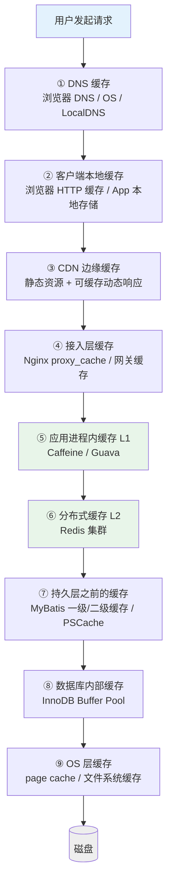
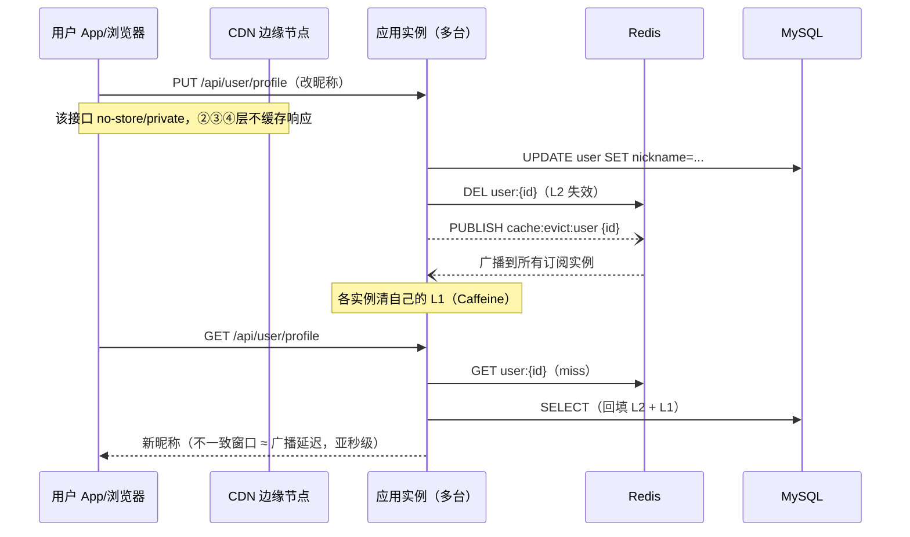

<!--question:
  id: 04.system-design-multi-level-cache-layers
  topic: 04.system-design
  difficulty: ⭐⭐⭐⭐
  frequency: 高频
  scenario_type: 架构设计
  tags: [04.system-design, 多级缓存, 全链路缓存, CDN, 浏览器缓存, Caffeine, Redis, Buffer Pool]
  status: active
-->

# 多级缓存到底有几级？—— Redis + 本地缓存只是中间两级

> 一句话定位：多级缓存是**全链路概念** —— 一个请求还没碰到 Redis，可能已经被 DNS、浏览器、CDN、Nginx 好几层缓存接住了。

> **系列定位**：经典系统设计面试题（缓存架构、高并发、页面性能场景高频）。考察的不是"背出 L1 Caffeine + L2 Redis"，而是 **全链路分层视野** + **每层的命中语义与失效机制** + **一致性代价的取舍能力**。

---

## 引子：昵称改了 10 分钟才生效

面试现场，候选人刚说完："我们做了多级缓存，本地 Caffeine 一级，Redis 集群二级，命中率很高。"

面试官没有评价，而是追问了一个问题：

> "用户在 App 上改了自己的昵称，**10 分钟后才看到新昵称生效**。你的'两级缓存'能解释为什么吗？"

候选人卡住了。他检查过 Redis——写入后立即删了 Key；也检查过 Caffeine——TTL 只有 30 秒。两级缓存都"失效正确"，为什么用户还是看到旧昵称 10 分钟？

因为请求根本没走到他的服务。这 10 分钟里，旧昵称可能藏在：**CDN 边缘节点的缓存副本**里、**用户浏览器的强缓存**（`max-age=600`）里、**App 客户端的本地存储**里、甚至**接入层 Nginx 的 proxy_cache** 里。他的"删 Redis + 清 L1"只打通了失效链路的中间两环，**外面还有好几层他从来没当成"缓存"的东西**。

这就是本题的立意：**多级 ≠ 两层，是全链路**。从浏览器发出请求到数据落盘，至少有 8~9 层缓存可能"接住"这个请求；答题的层次感 = 从外到内逐层枚举 + 说清每层的命中语义、失效机制和一致性代价。

---

> 📚 **前置知识**：[HTTP 缓存](../../09.front-end/http-cache/README.md) | [缓存与数据库双写一致性](../cache-consistency/README.md)

## 一、全链路缓存分层图（核心答案框架）

面试答题第一步：**先画链路，再谈方案**。一个请求从用户设备到数据库磁盘，完整路径如下：



多数人说的"多级缓存"只是图中绿色的 ⑤⑥ 两层。逐层拆解：

### 1.1 逐层速览表

| # | 层 | 位置 | 缓存什么 | 命中时省掉了什么 | 失效方式 | 延迟量级 | 谁负责 |
|---|-----|------|---------|----------------|---------|---------|--------|
| ① | **DNS 缓存** | 浏览器 + OS + 运营商 LocalDNS | 域名 → IP 映射 | 省掉一次 DNS 递归查询 | TTL 到期自动失效 | 命中纳秒-微秒；miss 几十毫秒起 | 浏览器/OS/运营商 |
| ② | **客户端本地缓存** | 用户设备 | HTTP 响应副本（强缓存 Cache-Control/Expires；协商缓存 ETag/Last-Modified）；App 内存/本地存储 | 省掉整个网络请求（强缓存）或省掉响应体传输（协商缓存 304） | max-age TTL；版本化 URL；清缓存 | 命中约等于 0（本地读） | 前端/客户端 |
| ③ | **CDN 边缘缓存** | 离用户最近的边缘节点 | 静态资源（JS/CSS/图片/视频）+ 配置为可缓存的动态响应 | 省掉回源全链路（骨干网 + 源站处理） | TTL + 刷新/预热 API | 命中几毫秒-几十毫秒 | CDN 厂商 + 运维 |
| ④ | **接入层缓存** | Nginx / API 网关 / LB | 上游响应副本（proxy_cache） | 省掉后端应用处理 | proxy_cache TTL / purge | 命中亚毫秒-毫秒 | 后端/运维 |
| ⑤ | **进程内缓存 L1** | 应用 JVM 内 | 热点业务对象（Caffeine/Guava） | 省掉一次 Redis 网络往返 + 反序列化 | 本地 TTL / 广播失效 | 纳秒-微秒 | 后端 |
| ⑥ | **分布式缓存 L2** | Redis 集群 | 序列化后的业务数据 | 省掉数据库查询 | DEL / TTL / Binlog 监听删 | 毫秒级（网络往返） | 后端 |
| ⑦ | **持久层之前的缓存** | ORM / 连接池 | MyBatis 一级缓存（SqlSession 内）、二级缓存（namespace 级）；PreparedStatement 缓存 | 省掉重复 SQL 执行 / SQL 解析编译 | 会话结束 / 更新即清 / 连接归还 | 微秒-毫秒 | 后端 |
| ⑧ | **数据库内部缓存** | MySQL 进程内 | InnoDB Buffer Pool：数据页 + 索引页 | 省掉磁盘随机 IO | LRU 变体自动淘汰；页脏了自然重写 | 命中微秒；miss 毫秒 | DBA |
| ⑨ | **OS 层缓存** | 操作系统内核 | page cache（文件内容在内存的副本） | 省掉真正的磁盘读写 | 内核自动回收；fsync 强制刷盘 | 命中微秒；miss 毫秒-几十毫秒（机械盘寻道更久） | OS |

> 延迟一栏只用**量级口径**（纳秒/微秒/毫秒/几十毫秒）——面试中编造具体 benchmark 数字反而露怯，量级 + 机制才是加分点。

### 1.2 每层一句话的"命中语义"

答题时用一句话点透每层"命中意味着什么"，比背延迟数字更有说服力：

- **① DNS 命中**：连 IP 都不用问，直接建连。这也是为什么切机房/换 IP 后总有人"还能访问旧地址"——TTL 没到期。
- **② 浏览器强缓存命中**：**请求根本不会发出去**（from disk/memory cache），服务端日志里看不到这次访问——这是排障时最容易被忽略的一层。
- **② 协商缓存命中**：请求发出去了，但服务端回 304，不传响应体——省带宽不省往返。
- **③ CDN 命中**：请求到了边缘节点就返回，**源站无感知**。源站监控看到的 QPS 远小于真实用户请求量。
- **④ proxy_cache 命中**：请求到了你的机器，但没进你的应用进程——应用日志同样看不到。
- **⑤ L1 命中**：不出进程，一次 HashMap 级别的查找，没有任何网络 IO。
- **⑥ L2 命中**：一次毫秒级网络往返，但省掉了数据库的磁盘 IO 和复杂查询计算。
- **⑦ ORM 缓存命中**：同一会话内重复查询直接返回对象，SQL 都不发。
- **⑧ Buffer Pool 命中**：MySQL 的读写几乎总是"内存操作"，脏页异步刷盘——数据库性能好的前提就是工作集能装进 Buffer Pool。
- **⑨ page cache 命中**：即使是"落盘成功"的写，默认也只是写进了内核内存，`fsync` 之后才真正到达持久介质——这是理解"写丢失"与数据库 doublewrite 的基础。

一个关键观察：**⑤⑥ 之外，还有 ②③④ 三层可能让请求"在服务端毫无痕迹地返回"**。这就是引子问题（昵称 10 分钟才生效）里候选人查日志查不出问题的原因。

### 1.3 三个容易被面试官点名的细节层

**② 浏览器缓存的两段式判断**（前端与后端都会问到的公共基础）：

```text
请求发出前：本地有副本？
  ├─ 有，且 max-age 未过期 → 强缓存命中（200 from disk/memory cache），不发请求
  ├─ 有，但已过期 → 带 If-None-Match(ETag) / If-Modified-Since 发请求
  │     ├─ 服务端判未变 → 304，用本地副本（协商缓存命中）
  │     └─ 服务端判已变 → 200 + 新响应体
  └─ 无副本 → 正常请求
```

强缓存省整个往返，协商缓存省响应体——语义完全不同，答题时要分清。

**⑧ Buffer Pool 为什么"不算业务缓存"**：它是**磁盘页在内存的镜像**，读写都必经它。读命中 = 省一次磁盘 IO；写路径是"改内存页（变脏页）+ 记 redo log → 异步刷脏"。它不需要失效机制，因为缓存与"真身"（磁盘页）由 InnoDB 自己维护一致——这与 Redis 缓存业务数据（真身在 MySQL，两边独立）有本质区别。能讲清这个区别，说明你不是在背清单。

**⑨ page cache 与 fsync**：应用调 `write()` 成功 ≠ 数据落盘，只是进了内核 page cache；`fsync` 才强制刷到持久介质。MySQL 的 redo log 刷盘策略（如 innodb_flush_log_at_trx_commit）、Kafka 依赖 OS page cache 做顺序写加速，都是建立在这一层之上。面试聊到"写丢失"或"为什么 Kafka 快"，落点都是 page cache。

---

## 二、失效链路：一致性才是真难点

分层枚举只是及格线。面试官真正想深挖的是：**改一条数据，要穿透多少层缓存才能让用户看到新值？**

### 2.1 逐层失效手段表

| 层 | 能否主动精确失效 | 手段 | 说明 |
|----|:---:|------|------|
| ① DNS | ❌ 只能等 | TTL 到期 | 记录在各级 DNS 服务器和客户端，无法逐个触达；只能靠调低 TTL 缩短窗口 |
| ② 浏览器/客户端 | ❌ 几乎不能 | 短 `max-age` / 协商缓存 / **版本化 URL** / 客户端主动清本地存储 | 缓存在用户设备上，服务端无法推送失效（除非 App 自建推送清缓存逻辑） |
| ③ CDN | ⚠️ 半主动 | **刷新 API**（按 URL/目录/前缀）+ 预热 + TTL | 能刷，但刷新有生效延迟、有配额限制，且只覆盖各边缘节点缓存副本 |
| ④ Nginx proxy_cache | ✅ 可以 | proxy_cache_purge 模块 / 短 proxy_cache_valid | 在自己机房内，可控 |
| ⑤ L1（多实例） | ✅ 可以 | **Redis Pub/Sub 或 MQ 广播失效消息** + 短 TTL 兜底 | 每个 JVM 实例独立，必须广播；详见 [缓存一致性](../cache-consistency/README.md) |
| ⑥ L2 Redis | ✅ 可以 | DEL / 延迟双删 / Binlog 监听异步删 | 经典 Cache Aside 领地 |
| ⑦ ORM 缓存 | ✅ 自动 | MyBatis 一级缓存随 SqlSession 结束；执行 update 即清空 | 一般不需要额外设计，但要知道它存在（长会话下会读到旧值） |
| ⑧ Buffer Pool | ✅ 不需要 | —— | 它是**磁盘页的缓存**，不是业务数据的独立副本：页被修改后就是脏页，最终刷回磁盘。数据本身变了，页自然重写，不存在"失效"问题 |
| ⑨ page cache | ✅ 不需要 | 同上；写路径靠 fsync 保证持久性 | 读路径由内核维护一致性（同一文件读写都经过 page cache） |

### 2.2 关键洞察：越外层越难精确失效

把上表按"可控性"重排，会得到本题最值钱的一条结论：

> **失效难度随层级向外递增，可控性随层级向内递增。**
> 外层（DNS/浏览器/CDN）的缓存副本**在别人的设备上**，你无法主动触达，只能靠两招：**TTL 等待** + **版本化 URL**；
> 内层（Nginx/L1/L2）在你自己的机房里，才能做**主动精确失效**（purge/广播/DEL）。

**版本化 URL（内容寻址）是外层的终极答案**：静态资源文件名带内容 hash（`app.3f2a1b.js`），内容一变文件名就变，URL 变了对旧 URL 的缓存自然全部作废——新 URL 在所有缓存层都是 miss，等于"绕过全部外层缓存的精确失效"。这样旧文件可以配**一年强缓存**，新文件天然生效，两头都占。

动态数据（如昵称）没有文件名可版本化，只有两条路：**外层 TTL 调短**（接受命中率下降），或**接口层干脆声明不可缓存**（`Cache-Control: no-store` / `private`，让 ②③④ 层不缓存，把失效战场收缩到 ⑤⑥ 内层）。引子里的昵称问题，正确修法通常是后者：**用户态动态接口本就不该被 CDN 和浏览器强缓存命中**——它被缓存本身就是配置事故（见陷阱 2）。

所以完整的失效链路设计是一道**分层组合题**：

```text
静态资源：内容 hash 版本化 URL + 超长 max-age + CDN 长 TTL（发布即失效）
动态数据：no-store/private 收缩缓存层 → 更新 DB → 删 L2 → Pub/Sub 广播清 L1
域名切换：提前调低 DNS TTL → 切换 → 等旧 TTL 窗口过去
```

### 2.3 一个具体的失效时序（改昵称的正确版本）



对比引子里的错误版本：少了第 2 行（接口声明不可缓存），CDN 的 600s 副本就成了 10 分钟脏读的元凶；多了 pub-sub 两步，把 L1 的窗口从 30s TTL 压到亚秒级。**同一段业务代码，链路设计的差别就是"10 分钟"与"亚秒级"的差别。**

---

## 三、什么时候该加哪层（避免过度设计）

不是每层都值得加。每加一层，就多加一份**一致性代价 + 排障复杂度**。权衡表：

| 数据特征 | 推荐层级组合 | 理由 |
|---------|------------|------|
| 静态资源（JS/CSS/图片/视频） | ②浏览器强缓存 + ③CDN + 版本化 URL | 内容不可变（immutable），缓存收益最大、一致性代价为零 |
| 读多写少的动态数据（商品详情、配置） | ⑤L1 + ⑥L2（+ ④网关缓存可选） | 内层可主动失效，一致性窗口可控在秒级 |
| 用户态个性化数据（昵称、余额、订单） | ⑥L2 短 TTL 或不缓存；②③层 no-store/private | 外层缓存用户态响应 = 缓存污染事故（见陷阱 2） |
| 写多读少 | 不加外层缓存，直写 DB + Buffer Pool 自然加速 | 缓存命中率低，失效成本反超收益 |
| 强一致要求（金融/库存扣减） | 绕过缓存直读 DB，或数据库层加锁 | 任何 TTL 窗口都不可接受 |
| 域名/IP 迁移期 | ①DNS TTL 提前调低 | 唯一手段就是 TTL，别无他法 |

一条通用原则：**缓存层数 = f(读放大倍数, 可接受的不一致窗口)**。读放大越大越值得多加层；一致性窗口要求越严，能用的层越少、越要靠内层主动失效。

### 3.1 延伸追问（面试官的下一刀）

| 追问 | 简短答案 |
|------|---------|
| "怎么知道线上一次请求命中在哪层？" | 逐层看痕迹：浏览器 DevTools（`from disk cache` / 304）→ 响应头 `X-Cache / Age / Via`（CDN/代理命中）→ 接入层访问日志（是否到达 Nginx）→ 应用日志（是否进入进程）→ L1/L2 命中率指标。设计期就给每层透传命中标记、打命中率监控 |
| "L1 该缓存全部数据还是只缓存热点？" | 只放热点。全量数据进 L1 会把一致性窗口放大到所有 Key；热点晋升（流量检测超阈值才进 L1）能同时拿到命中率和可控的失效面，京东 HotKey 是这个思路，详见 [缓存热点 Key](../cache-hot-key/README.md) |
| "外层缓存和内层缓存的 TTL 应该怎么搭？" | 外层 ≥ 内层是常见错误方向——外层 TTL 越长，内层主动失效被外层"捂住"的时间越久。动态数据要么外层不缓存，要么外层 TTL 显著短于业务可接受的不一致窗口；静态资源反过来，外层超长 TTL + 版本化 URL 才是最优解 |
| "全链路缓存会不会导致容量问题？" | 每层都有淘汰策略：浏览器按配额 LRU、CDN 按节点磁盘 LRU、Caffeine 按 maximumSize + W-TinyLFU、Redis 按 maxmemory-policy、Buffer Pool 按 LRU 变体。缓存层不承担持久化职责，淘汰 ≠ 丢数据，只影响命中率 |

---

## 四、❌/✅ 反例对比

**❌ "两级缓存"心智模型**（引子里的候选人）：

```text
心智图：请求 → Caffeine → Redis → MySQL
改昵称的失效操作：更新 DB → DEL Redis Key → （L1 等 30s TTL）
结果：DB 和 Redis 都是新值，用户 10 分钟看到旧昵称
盲点：CDN 缓存了 /api/user/profile 响应（TTL 600s）；
      App 端还把用户信息存在了本地存储里。
      这两层在"两级缓存"的世界观里根本不存在。
```

**✅ 全链路失效清单**（同一个需求的正确姿势）：

```text
设计期：
1. /api/user/profile 响应头声明 Cache-Control: private, no-store
   （或 max-age=0 + ETag 协商）→ CDN/浏览器不缓存用户态接口
2. 静态资源全部走内容 hash 版本化 URL，发布即"天然失效"
3. CDN 侧配置缓存规则：只缓存 /static/*，动态路径默认不缓存

更新期（改昵称）：
4. 更新 DB
5. DEL Redis L2 Key
6. Pub/Sub 广播失效消息 → 所有实例清 L1
7. （若接口确实被 CDN 缓存过）调 CDN 刷新 API 按 URL 刷新

验证期：
8. curl -H "Cookie: ..." -sD - 源站与 CDN 各请求一次，
   对比响应头 X-Cache / Age，确认命中发生在预期层
```

差距不在代码量，而在**是否把 CDN/浏览器/接入层当成缓存体系的一等公民**。

---

## 五、常见陷阱

### 陷阱 1：以为"多级缓存"= L1 + L2 两层
- **真相**：L1/L2 只是链路中段的 ⑤⑥ 两层。一个请求到达你的 Caffeine 之前，可能已被 DNS、浏览器、CDN、Nginx 四层中的任意一层"接住"并直接返回。答题只说两层 = 主动暴露视野盲区；先画全链路图再聚焦 L1/L2，才是架构师口径。

### 陷阱 2：CDN / 浏览器缓存了带用户态的动态响应（缓存污染）
- **真相**：如果 `/api/user/profile` 没声明 `Cache-Control: private/no-store`，CDN 或共享代理可能把用户 A 的响应缓存下来，用户 B 请求同一 URL 时直接命中 A 的数据——这不是"看到旧昵称"的性能问题，而是**用户数据串号的隐私/安全事故**。根因：缓存键默认只含 URL（不含 Cookie），而响应内容依赖用户身份。防线：动态接口显式声明不可缓存；CDN 缓存规则白名单只放行静态路径；确需缓存个性化内容时配置 `Vary` 或在缓存键中加入身份维度（多数 CDN 支持自定义缓存键）。

### 陷阱 3：L1 多实例失效只靠 TTL，不做广播
- **真相**：L1 是每个 JVM 独立的堆内缓存，实例 A 更新数据后清了**自己的** L1，实例 B 的 L1 依然是旧值——不一致窗口 = TTL 全长。TTL 设 5 分钟就是 5 分钟脏读。正确做法：**短 TTL（秒级）兜底 + Redis Pub/Sub / MQ 广播失效**，把窗口从"分钟级 TTL"压到"广播消息延迟"（通常亚秒级）。Pub/Sub 是 fire-and-forget 会丢消息，所以广播与短 TTL 是互补而非二选一。详见 [缓存一致性](../cache-consistency/README.md)。

### 陷阱 4：ETag 在多实例/负载均衡下不稳定，协商缓存永远 miss
- **真相**：ETag 的生成方式决定它是否跨机器稳定。基于**文件 inode/mtime/size** 的生成器（不少 Web 服务器的默认静态文件 ETag 策略），同一份文件在不同机器上 inode 不同 → 多台源站/多台 Nginx 对同一资源算出不同 ETag → 负载均衡轮询到哪台，协商请求的 `If-None-Match` 就对不上 → 永远 200 全量返回而不是 304，协商缓存形同虚设。修法：ETag 改用**内容派生**（内容 hash / 版本号），保证任何实例对同一内容算出同一 ETag；多机部署时关掉 inode 型 ETag 或统一用应用层生成的强 ETag。

### 陷阱 5：缓存层数越多，排障越难——"命中到底发生在哪层？"
- **真相**：全链路 8~9 层，任何一层命中都会让请求"提前返回"，且**越外层命中，服务端痕迹越少**（浏览器强缓存命中连请求都不发）。排障必须逐层定位：浏览器 DevTools Network 面板看 `from disk cache / 304`；响应头看 `X-Cache / Age / Via`（CDN 与代理命中标志）；应用访问日志确认请求是否到达应用；L1/L2 命中率指标确认进程内命中。设计期就要为可观测性买单：每层缓存打命中率指标、响应头透传命中标记，否则线上"数据不对"时只能靠猜。

### 陷阱 6：给写多读少的数据加外层缓存
- **真相**：缓存收益 = 命中率 × 回源代价。写多的数据在外层 TTL 窗口内大概率已过期，命中率低；每次写却要触发全链路失效，代价反超收益。写多场景直接依赖 ⑧ Buffer Pool（它天然加速写路径的页操作），业务层不加缓存。

---

## 六、面试话术

**30 秒版本**（先给框架，等追问再展开）：

> "多级缓存是全链路概念，不是 L1+L2 两层——从 DNS、浏览器 HTTP 缓存、CDN、Nginx proxy_cache，到进程内 Caffeine、Redis、ORM 缓存、InnoDB Buffer Pool、OS page cache，至少 8 层，每层命中都省掉它下面全部环节。答题我会先画链路图再谈失效：**越外层越难精确失效**（缓存在用户设备上），只能靠 TTL + 版本化 URL；越内层越能主动失效（purge/广播/DEL）。一致性设计的本质是给每类数据选择'缓存到哪一层为止'。"

**90 秒版本**（面试官说"展开讲讲"时）：

> "我按请求路径从外到内过一遍。① DNS 缓存决定域名到 IP，TTL 驱动，切机房时唯一的手段是提前调低 TTL。② 客户端：浏览器强缓存命中时请求根本不发出，协商缓存命中回 304 省响应体；App 端还有本地存储——这两层在服务端日志里是隐形的。③ CDN 缓存静态资源和可缓存的动态响应，命中时源站无感知。④ 接入层 Nginx proxy_cache。⑤⑥ 才是大家常说的 L1 Caffeine + L2 Redis——L1 纳秒到微秒级但每个实例独立，要靠 Pub/Sub 广播失效 + 短 TTL 兜底；L2 毫秒级网络往返，走 Cache Aside 删缓存。⑦ ORM 层 MyBatis 一级/二级缓存。⑧ InnoDB Buffer Pool 缓存数据页和索引页，命中省磁盘 IO——它不需要'失效'，因为它是磁盘的缓存，页改了就是脏页自然刷回。⑨ OS page cache，写的'落盘'默认只是写进内核内存，fsync 才真持久化。
>
> 真正的难点是失效链路：改一条数据要穿透多少层？我的结论是**越外层越难精确失效**——浏览器和 CDN 的副本在用户设备和边缘节点上，无法主动触达，只有 TTL 和版本化 URL 两招；所以静态资源用内容 hash 文件名配超长强缓存，发布即天然失效；用户态动态接口则显式 no-store/private，把缓存战场收缩到内层，内层才能做主动失效：更新 DB → 删 L2 → 广播清 L1。
>
> 加不加某一层的判断标准是读放大倍数和可接受的不一致窗口：静态资源闭眼加，读多写少的动态数据加 L1+L2，写多的不加，金融强一致的绕过缓存直读 DB。"

---

## 七、相关章节

- 主模块：[`全链路缓存分层`](../../../06.distributed-systems/04-high-performance/cache-layers/README.md) — 本题的深度原理版本
- 主模块：[`CDN`](../../../06.distributed-systems/04-high-performance/cdn/README.md) — 边缘缓存、回源与刷新预热机制
- 主模块：[`Spring 多级缓存实现`](../../../04.spring-backend/04-data/cache/multi-level.md) — CompositeCacheManager + TwoLevelCache 代码落地
- 同栏目：[`缓存与数据库双写一致性`](../cache-consistency/README.md) — L1/L2 失效广播与 Cache Aside 的完整方案
- 同栏目：[`缓存热点 Key 问题`](../cache-hot-key/README.md) — L1 承接热点流量的探测与晋升
- 跨栏目：[`缓存穿透/击穿/雪崩`](../../03.database/cache-penetration-breakdown-avalanche/README.md) — miss 之后的三大防护
- 跨栏目：[`HTTP 缓存`](../../09.front-end/http-cache/README.md) — 强缓存/协商缓存/ETag 细节（②层展开）
- 跨栏目：[`从 URL 到页面`](../../09.front-end/from-url-to-page/README.md) — 浏览器视角的全链路（与本题互补的另一半）
- 主模块：[`缓存设计模式`](../../../06.distributed-systems/04-high-performance/cache-patterns/README.md) — Cache Aside / Read Through / Write Through 模式族
- 主模块：[`Redis`](../../../03.data-stack/01-database/07-redis/README.md) — ⑥层 L2 的集群与分片原理

---

> 📅 2026-10-14 · 咬文嚼字 · 全链路多级缓存 · ⭐⭐⭐⭐（高频面试 + 架构必备）

← [返回系统设计咬文嚼字](../README.md)
