<!--question:
  id: 06.spring-extension-points
  topic: 06.spring
  difficulty: ⭐⭐⭐⭐
  frequency: 高频
  scenario_type: 架构决策困境
  tags: [06.spring, 扩展点, BeanPostProcessor, ApplicationRunner, 面试高频]
  status: active
-->

# Spring 扩展点全景：按启动时间线说清每个插槽

> **一句话定位**：Spring 扩展点 = 容器在各阶段预留的介入入口——**定义期改定义、实例期改实例、启动后跑任务、关闭期释放**。

> **系列定位**：经典 Spring 面试题（Bean 生命周期、自动配置、事件机制高频）。考察的不是"记住接口名"，而是 **能说清每个扩展点卡在生命周期的哪一步** + **能区分 BFPP 与 BPP 这类易混对** + **能在"改定义 / 改实例 / 跑任务"之间选对插槽**。

---

> 📚 **前置知识**：[IOC](../../../04.spring-backend/01-core/ioc/README.md) | [Bean 生命周期](../../../04.spring-backend/01-core/ioc/bean-lifecycle.md) | [启动流程](../../../04.spring-backend/02-boot/startup-flow.md)

## 引子：一个改了 3 天都没生效的 `@Value`

同事写了个 `@Value("${order.timeout}")`，配置里明明有值，注入进来却是 `${order.timeout}` 原文。他查了配置文件格式、查了 `@ComponentScan` 范围、查了 profile——全没问题。

最后发现：他同时写了一个 `BeanFactoryPostProcessor`，在里面 `factory.getBean(...)` 拿了个普通 Bean。这个调用**触发了普通 Bean 的提前实例化**，而此时处理 `${}` 占位符的 `PropertySourcesPlaceholderConfigurer` 还没轮到执行——占位符根本没被替换，Bean 就被创建并注入了。

同事的原话是："Spring 的扩展点太多了，我根本不知道该用哪个。"

**这道题问的就是他不知道的那件事**：Spring 留了一堆扩展点，每个都插在生命周期的**不同位置**。说不清位置，就只能靠试。

面试高频题：**说说 Spring 有哪些扩展点？**

---

## 一、核心原理：扩展点是沿时间线分布的插槽

### 1.1 为什么不按接口分类，要按时间线

初学时的困惑是：接口那么多，`BeanFactoryPostProcessor`、`BeanPostProcessor`、`ApplicationRunner`、`ApplicationContextInitializer`……到底用哪个？

答案不在接口名里，而在**它介入的时机**：

```mermaid
graph LR
    subgraph 定义期["定义期（Bean 还没诞生）"]
        BFPP[BeanFactoryPostProcessor]
        BDRPP[BeanDefinitionRegistryPostProcessor]
    end
    subgraph 实例期["实例期（Bean 已创建）"]
        BPP[BeanPostProcessor]
    end
    subgraph 初始化期["初始化期"]
        Aware[Aware 家族]
        Init[InitializingBean / @PostConstruct]
        SIS[SmartInitializingSingleton]
    end
    subgraph 启动后["启动后（容器就绪）"]
        Runner[ApplicationRunner / CommandLineRunner]
        Listener[ApplicationListener / @EventListener]
    end
    subgraph 关闭期["关闭期"]
        Dest[DisposableBean / @PreDestroy]
    end
    定义期 --> 实例期 --> 初始化期 --> 启动后 --> 关闭期
```



**一句话判据**：
- 想改 **Bean 定义**（还没创建）→ `BeanFactoryPostProcessor`
- 想改 **Bean 实例**（已创建）→ `BeanPostProcessor`
- 想在 **容器就绪后** 跑任务 → `ApplicationRunner` / `ApplicationReadyEvent`

### 1.2 主线：框架核心容器（`refresh()` 全流程）

| 阶段 | 扩展点 | 关键作用 |
|---|---|---|
| 定义期 | `BeanFactoryPostProcessor` | 改 BeanDefinition；`@Value` 占位符解析（`PropertySourcesPlaceholderConfigurer`）在此生效 |
| 定义期 | `BeanDefinitionRegistryPostProcessor` | 能**注册新** BeanDefinition；MyBatis `MapperScannerConfigurer` 扫 Mapper |
| 定义期 | `ImportSelector` / `DeferredImportSelector` | 动态返回要导入的类名；Boot 自动配置走 `AutoConfigurationImportSelector` |
| 定义期 | `ImportBeanDefinitionRegistrar` | 手动注册 BeanDefinition；`@MapperScan` 背后的 `MapperScannerRegistrar` |
| 定义期 | `Condition` | `@ConditionalOn*` 11 注解之外的自定义判定 |
| 实例期 | `BeanPostProcessor` | ⭐ **AOP 代理在此生成**；`@EventListener` 扫描也靠它 |
| 实例期 | `BeanNameAware` / `BeanFactoryAware` / `ApplicationContextAware` | 拿容器资源（名称 / BeanFactory / Context） |
| 初始化期 | `InitializingBean` / `@PostConstruct` / `init-method` | 自定义初始化 |
| 初始化期 | `SmartInitializingSingleton` | **所有单例初始化完成后**的跨 Bean 编排 |
| 关闭期 | `DisposableBean` / `@PreDestroy` / `destroy-method` | 资源释放 |

### 1.3 叠加线：Boot 启动扩展点（时序以 Boot 3.5.3 源码为准）

```java
refreshContext(context);                            // 阶段 4：refresh
listeners.started(context, timeTakenToStarted);     // ① ApplicationStartedEvent
callRunners(context, applicationArguments);         // ② Runner 执行
listeners.ready(context, startup.ready());          // ③ ApplicationReadyEvent
```

| 扩展点 | 介入时机 | 典型用途 |
|---|---|---|
| `EnvironmentPostProcessor` | 阶段 2（Environment 准备） | K8s ConfigMap / Vault 注入配置源 |
| `ApplicationContextInitializer` | 阶段 3（Context 创建后、refresh 前） | 注册自定义 Scope；Spring Cloud 起"父 Context"读远程配置 |
| `ApplicationRunner` / `CommandLineRunner` | 阶段 5 | 启动后任务、缓存预热；按 `@Order` 排序 |
| `ApplicationListener` / `@EventListener` | 全生命周期 | 事件解耦；`ApplicationReadyEvent` = 应用完全可用 |

### 1.4 旁路：Web 层（洋葱结构，从外到内）


| 扩展点 | 介入位置 | 注册方式 |
|---|---|---|
| `Filter` | 最外层（含静态资源） | `@Component` + `FilterRegistrationBean` |
| `HandlerInterceptor` | Filter 之后、Controller 之前 | `WebMvcConfigurer.addInterceptors()` |
| `HandlerMethodArgumentResolver` / `HttpMessageConverter` / `ViewResolver` | 参数解析 / 序列化 / 视图 | `WebMvcConfigurer` 各 `configure*` / `add*` 方法 |
| `@RestControllerAdvice` + `@ExceptionHandler` | 异常兜底 | 注解 |

---

## 二、代码示例

### 2.1 定义期 vs 实例期：最容易搞混的一对

```java
// ✅ 定义期：改 Bean 定义（Bean 还没创建）
@Component
public class MyBeanFactoryPostProcessor implements BeanFactoryPostProcessor {
    @Override
    public void postProcessBeanFactory(ConfigurableListableBeanFactory factory) {
        for (String name : factory.getBeanDefinitionNames()) {
            BeanDefinition def = factory.getBeanDefinition(name);
            if (def.getBeanClassName() != null && def.getBeanClassName().contains("DataSource")) {
                def.getPropertyValues().add("maxActive", 50);   // 改定义
            }
        }
    }
}

// ✅ 实例期：改 Bean 实例（Bean 已创建）
@Component
public class MyBeanPostProcessor implements BeanPostProcessor {
    @Override
    public Object postProcessAfterInitialization(Object bean, String beanName) {
        if (bean instanceof UserService) {
            return Proxy.newProxyInstance(...);   // 换掉实例
        }
        return bean;
    }
}
```

> 📌 口诀：**定义用 Factory，实例用 Post**。

### 2.2 启动后任务：Runner vs ReadyEvent

```java
// ✅ 需要读命令行参数 → ApplicationRunner
@Component
@Order(1)
public class CacheWarmupRunner implements ApplicationRunner {
    @Override
    public void run(ApplicationArguments args) {
        if (args.containsOption("warmup")) {
            cacheService.preload();
        }
    }
}

// ✅ 需要"服务已可对外提供" → ApplicationReadyEvent
@Component
public class ReadyListener {
    @EventListener(ApplicationReadyEvent.class)
    public void onReady() {
        // 内嵌服务器已监听端口，可以接流量了
        monitorService.markReady();
    }
}
```

### 2.3 事件解耦：同步 / 异步 / 事务感知

```java
// 同步（默认）——在发布者线程执行，异常会传播给发布者
@EventListener
public void onRegistered(UserRegisteredEvent e) { sendEmail(e.getUser()); }

// 异步——不阻塞主流程，但异常被吞
@Async
@EventListener
public void onRegistered(UserRegisteredEvent e) { sendSms(e.getUser()); }

// 事务感知——事务提交后才触发（发邮件必须用这个）
@TransactionalEventListener(phase = TransactionPhase.AFTER_COMMIT)
public void onRegistered(UserRegisteredEvent e) { addPoints(e.getUser()); }
```

---

## 三、常见陷阱

### 陷阱 1：`@PostConstruct` 里 `this` 调用 `@Transactional` 方法，事务不生效

- **真相**：初始化期执行 `@PostConstruct`（第 7 步）时操作的是**原始对象**，AOP 代理要到 `postProcessAfterInitialization`（第 10 步）才创建。`this.xxx()` 走的是原始对象，**事务完全不生效**。需要事务的初始化逻辑应拆到另一个 Bean，或用 `ApplicationRunner` 在容器就绪后执行。

### 陷阱 2：以为 `ApplicationStartedEvent` 在 Runner 之后

- **真相**：`run()` 里是 `listeners.started(...)` → `callRunners(...)` → `listeners.ready(...)`。`ApplicationStartedEvent` **早于** Runner；`ApplicationReadyEvent` 才在 Runner 之后。要"服务已可对外"必须用 `ApplicationReadyEvent`。

### 陷阱 3：prototype Bean 期待 `@PreDestroy` 触发

- **真相**：销毁回调**只对单例生效**。prototype Bean 创建后交给调用方，容器不再跟踪其生命周期。持有资源（连接、线程）的 prototype Bean 必须调用方自己清理。

### 陷阱 4：实现 `ApplicationRunner` + `CommandLineRunner` 期望只跑一个

- **真相**：`callRunner()` 用的是两个独立 `if` 而非 `else if`——同时实现两个接口的 Bean，**两个方法都会被调用**。

### 陷阱 5：在 `BeanFactoryPostProcessor` 里注入普通 Bean

- **真相**：BFPP 阶段容器尚未实例化普通 Bean，注入会触发"Bean 提前初始化"，可能导致循环依赖或半初始化状态。BFPP 中应只操作 `BeanDefinition`，需要 Bean 时改用 `BeanPostProcessor` 或 `ApplicationRunner`。

### 陷阱 6：以为 Boot 4 移除了 `spring.factories`

- **真相**：Boot 3.0 只是把**自动配置注册**迁到 `AutoConfiguration.imports`。`spring.factories` 在 Boot 4.1.1 中**依然存在**，且仍承载 `ApplicationContextInitializer` / `ApplicationListener` / `EnvironmentPostProcessor` / `SpringApplicationRunListener` 等 SPI。自研 Starter 继续用它注册 SPI，**不要跟着"Boot 3 弃用 spring.factories"的说法一起改**。

---

## 四、最佳实践

### 4.1 选型速查表

| 我想做的事 | 用哪个 | 注意 |
|---|---|---|
| 改 Bean 定义属性（实例化前） | `BeanFactoryPostProcessor` | 别和 BPP 混用 |
| 动态注册一批 BeanDefinition | `BeanDefinitionRegistryPostProcessor` | MyBatis 扫 Mapper 走这条 |
| 给所有 Bean 加代理 / 埋点 | `BeanPostProcessor` | AOP 代理本身就在这里生成 |
| 拿容器资源 | `ApplicationContextAware` | 比注入更轻，但耦合容器 |
| Bean 自己的初始化逻辑 | `@PostConstruct` | 优先于 `InitializingBean` |
| 所有单例就绪后的跨 Bean 编排 | `SmartInitializingSingleton` | 晚于 `@PostConstruct` |
| 启动后跑任务、预热缓存 | `ApplicationRunner` | 按 `@Order` 排序 |
| 确认服务已可对外提供 | `ApplicationReadyEvent` | 比 Runner 更晚 |
| 跨模块解耦通知 | `@EventListener` | 默认同步，异步要 `@Async` |
| 请求级鉴权、日志 | `HandlerInterceptor` | 需注入 Spring Bean 时用它 |
| 全局异常兜底 | `@RestControllerAdvice` | Web 层专用 |
| 启动时读远程配置 | `ApplicationContextInitializer` | Spring Cloud 走的就是它 |

### 4.2 工程约定

1. **优先注解、后接口**：`@PostConstruct` / `@PreDestroy` > `InitializingBean` / `DisposableBean`（注解驱动、不耦合 Spring 接口）
2. **能用 `@Order` 就别用依赖注入顺序**：Runner 之间的顺序用 `@Order` 显式声明，不依赖 Bean 定义顺序
3. **BFPP 里只碰 `BeanDefinition`**：需要真实 Bean 实例时一律改用 `BeanPostProcessor` 或 `ApplicationRunner`
4. **Web 层扩展点先问"要不要 Spring Bean"**：需要 → `HandlerInterceptor`；不需要且要拦静态资源 → `Filter`
5. **自定义 SPI 继续用 `spring.factories`**：Boot 4 也没移除，不要跟着过时的迁移文章一起改

### 4.3 Boot 4.x 差异（⚠️ 升级前必读）

> Boot 4.0 于 2025-11 GA，配套 Spring Framework 7.x。KB 其余内容仍以 Boot 3.x 为基线。

| 变化 | Boot 3.x | Boot 4.x |
|---|---|---|
| `EnvironmentPostProcessor` 包路径 | `org.springframework.boot.env` | `org.springframework.boot`（根包，旧路径保留兼容桥接） |
| 自动配置类包名 | `...autoconfigure.web.servlet.WebMvcAutoConfiguration` | `...webmvc.autoconfigure.WebMvcAutoConfiguration` |
| 新增 SPI | — | `BackgroundPreinitializer`（`Charsets` / `ConversionService` / `ZoneId` 三个实现） |
| `spring.factories` | 自动配置已迁出，SPI 仍用 | **仍存在**，SPI 全部照旧 |
| 自动配置模块 | 单一 `spring-boot-autoconfigure` | 拆成多个独立模块，各自带 imports 文件 |

---

## 五、面试话术（90 秒版）

> "Spring 的扩展点我按**容器启动的时间线**来记，因为关键不是接口名，而是**它卡在生命周期的哪一步**。
>
> **第一段，框架核心容器**：
> - 定义期改**定义**——`BeanFactoryPostProcessor`（`@Value` 占位符解析就在这）、`BeanDefinitionRegistryPostProcessor`（能注册新定义，MyBatis 扫 Mapper）、`ImportSelector` / `ImportBeanDefinitionRegistrar`；
> - 实例期改**实例**——`BeanPostProcessor`，它的 `postProcessAfterInitialization` 就是 **AOP 代理生成的地方**；再加 Aware 家族拿容器资源；
> - 初始化期——`@PostConstruct` / `InitializingBean`，以及晚一点的 `SmartInitializingSingleton`（所有单例就绪后）；
> - 关闭期——`@PreDestroy` / `DisposableBean`。
>
> **第二段，Boot 在启动两端叠加**：
> - 前面加 `EnvironmentPostProcessor`（读 ConfigMap / Vault）和 `ApplicationContextInitializer`（Spring Cloud 起父 Context 读远程配置就在这）；
> - 后面加 `ApplicationRunner` / `CommandLineRunner` 和事件机制，`ApplicationReadyEvent` 表示服务已完全可用。
>
> **第三段，Web 层**是洋葱结构：`Filter` → `HandlerInterceptor` → AOP → Controller，异常兜底是 `@RestControllerAdvice`。
>
> **最后两个高频坑**：
> 一是 `@PostConstruct` 里 `this` 调 `@Transactional` 方法事务不生效——因为那时 AOP 代理还没生成；
> 二是 `ApplicationStartedEvent` 其实**早于** Runner 执行，要等 Runner 跑完得用 `ApplicationReadyEvent`。"

---

## 六、相关章节

- 主模块：[`04.spring-backend`](../../../04.spring-backend/README.md) — Spring 知识体系
- 深度阅读：[`04.spring-backend/01-core/extension-points.md`](../../../04.spring-backend/01-core/extension-points.md) — 扩展点全景（含 Boot 4.x 差异完整版）
- 同栏目：[`bean-lifecycle`](../bean-lifecycle/) — 12 步生命周期，扩展点的落点
- 同栏目：[`auto-configuration`](../auto-configuration/) — `ImportSelector` / `@ConditionalOn*` 装配机制
- 同栏目：[`event-mechanism`](../event-mechanism/) — `ApplicationListener` / `@EventListener` 与 6 大陷阱
- 同栏目：[`aop-principle`](../aop-principle/) — AOP 代理在 `postProcessAfterInitialization` 生成
- 主模块：[`startup-flow`](../../../04.spring-backend/02-boot/startup-flow.md) — Boot 6 阶段与 8 个启动事件
- 主模块：[`event.md`](../../../04.spring-backend/01-core/event.md) — 事件机制全链路
- 主模块：[`组件执行顺序与对比`](../../../04.spring-backend/02-web/mvc/components-order.md) — Web 层 Filter → Interceptor → AOP 顺序

---

> 📅 2026-10-21 · 咬文嚼字 · Spring 扩展点 · ⭐⭐⭐⭐（高频面试 + 实战必会）
>
> 版本基线：Spring Framework 6.1.x / Spring Boot 3.5.x（主线），Boot 4.x 差异见 §4.3

← [返回: 咬文嚼字 · extension-points](../README.md)
